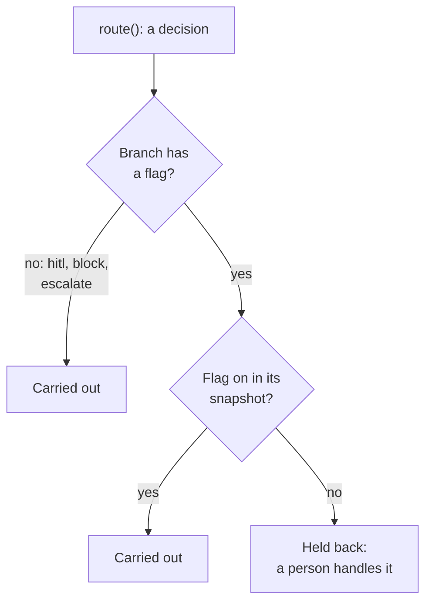

# ADR-0051: A branch's flag alone makes it live; shadow mode goes

**Status:** Accepted (2026-11-27), the owner's decision. The owner answered every open question the same day, in two rounds, and made live the default (*Owner's answers*). Built 2026-11-27 on branch `adr-0051/flag-alone-makes-live`, before F17 PR 3b (*Build notes*). **Relaxes guardrails.**
**Date:** 2026-11-27
**Amends:** ADR-0035 decision 1 and ADR-0044 decision 1. In F9: BR-F9-01, BR-F9-09, AC-F9-04 and the "Effective live" paragraph. In F7: BR-F7-04 and item 1 of "where the code differs" (the owner's decision of 2026-10-26). In F10: build note 3. F15's build note 26. F2's AC-F2-01 and its "Must not change" line.
**Departs from:** `requirement.md` §4 (`routing_decisions.shadow_mode BOOLEAN NOT NULL DEFAULT true`), §8.2, §11.2's example span and §14's P1 row. The spec stays as written; this ADR records the departures, as ADR-0027 does for §14 P4.
**Builds on:** ADR-0001 (the LLM proposes, code decides), ADR-0006 (runbooks always go to a person), ADR-0035 (per-branch rollout), ADR-0043 (one manager turns a flag on), ADR-0046 (the agent's flags)
**Touches:** CLAUDE.md *Current state*; `load-bearing.md` (Rollout, Mass incidents)

## Context

The system is at the R&D stage. No production environment exists, and no
real requester's ticket has gone through it: every database holds test
data.

Shadow mode exists in two places.

**The `SHADOW_MODE` env var.** `.env.example` ships it `true`. The dev
database `smart_triage` ran with it `false` and every flag on: all 248 of
its routing decisions (2026-11-05 to 2026-11-26) were carried out. Since F9
(ADR-0035) the env var is one of two keys: `Rollout.is_live(branch)` is true
only when `SHADOW_MODE` is false **and** the branch's flag is on. It holds
back six things:

| Held back | Flag | What it does live |
|---|---|---|
| `auto_route` | `auto_route` | Sets the category, moves to `auto_routed`, assigns a person |
| `auto_reply` | `auto_reply` | Moves to `auto_replied`, and the requester gets the answer |
| A chat decision held for the requester; the clarify question | `requester_questions` | Waits in `awaiting_requester`; asks the question |
| The agent in the chat | `agent_chat` | Answers turns (`POST /api/agent/turns`) |
| The agent in the console | `agent_console` | The same, for staff |
| A ticket escalated into a confirmed incident (BR-F7-04) | none | No review item. The incident's latest broadcast is posted on the ticket, and its requester is told at once |

The last row reads `settings.SHADOW_MODE` directly. `_finalize` sets
`shadow = settings.SHADOW_MODE` for every branch with no flag (`hitl`,
`block`, `escalate`, `clarify`). `_execute_or_enqueue` passes that value to
`incidents.attach(ticket, live=not shadow)` and nowhere else. For `hitl`,
`block` and `clarify`, the value is only recorded, since a person handles
those either way.

**The `routing_decisions.shadow_mode` column**, from the spec's DDL (§4).
`_finalize` writes the result of the check above on every decision, next to
`rollout_snapshot`, which holds its inputs: each flag's state, `env_shadow`
and the thresholds version. Snapshots written between 2026-10-26 and
2026-11-04 also hold `thresholds_approved`, a third key until ADR-0044.
Decisions written before F9 have an empty snapshot (`tickets.0009` added it
with no backfill). These read the column:
- reports: `automation_rate` live and would-have, and the rollout report
  (`reports.py`, `metrics/services/dashboard.py`);
- the rollout gates' shadow agreement (`rollout/services/gates.py`);
- the nightly facts: `auto_replied` and `shadow_branch` (`facts.py`);
- `release_to_support`, which carries out a held chat decision as it was
  recorded;
- the tickets and review response schemas, and through them the console's
  "shadow mode" badge in `TrustSignalsPanel` and the note on the ticket page.

`evals/calibration/fit_trust_score.py` doesn't read it. Its pairs are every
review decision whose item has a run with trust signals.

Two keys made sense when the flags were new. Since then:
- **A flag can be on and do nothing.** A manager turns a flag on
  (ADR-0043). While the env switch is true, nothing acts until someone
  edits `.env` and redeploys. The Rollout page marks the flag "not live: env
  shadow", but nobody can change that from the console.
- **Every new feature has to decide whether the env switch covers it.** The
  agent took both keys (F15 note 26). F17 PR 3b's ticket cues decide
  nothing and should run while the automated branches are still held back.
- **The env switch hides an action with no flag.** The incident attach in
  the table above messages requesters. Nothing in the Rollout page names it.
- **Without the env switch, the column repeats the snapshot.** Whether a
  decision was held back follows from its branch and the flags in its
  `rollout_snapshot`. Storing the answer as well is a second copy that can
  disagree.

## Decision

1. **A branch acts live exactly when its flag is on.**
   - `Rollout.is_live(branch)` reads the flag alone.
   - `SHADOW_MODE` leaves the settings code, `.env.example` and
     `docker-compose.yml` together (`test_settings_env` checks the three
     agree).
   - **Every flag is on by default.** A data migration turns on every
     flag that is off, writing one `rollout_flag_on` audit row per flag
     (`actor_type="system"`, reason "ADR-0051: live by default"). It skips
     the gates and their override reasons. The `RolloutFlag.state` default
     becomes `on`, the older seed migrations stay as written (the data
     migration turns their flags on), and a branch with no flag row reads as
     on. A flag added later is seeded on.
   - A branch is held back only when someone turns its flag off: any manager
     or security, alone, at once (BR-F9-02). Turning it back on is one
     manager's act with a reason (ADR-0043).
2. **The mass-incident attach is always live.** An `escalate` decision whose
   ticket joins a confirmed incident is attached (BR-F7-04): no review item,
   the incident's latest broadcast posted on the ticket, and the requester
   told. `incidents.attach` loses its `live` parameter, and `escalate` has
   no flag.
3. **`routing_decisions.shadow_mode` is dropped.** A migration removes the
   column.
   - Each branch's flag is named in one mapping, in the rollout app.
     `RoutingDecision.was_held_back()` and `held_back()` read it, and
     `AGREEMENT_BRANCH` in `gates.py` is its inverse; `_FLAGGED` in
     `pipeline.py` goes:

     | Branch | Flag |
     |---|---|
     | `auto_route` | `auto_route` |
     | `auto_reply` | `auto_reply` |
     | `clarify` | `requester_questions` |
     | `hitl`, `block`, `escalate` | none |

     ADR-0050 removes `clarify`; its row goes with it.
   - **The rule:** a decision was held back when its branch has a flag and
     that flag is not `on` in the decision's `rollout_snapshot`. A missing
     key counts as off. `Rollout.is_live(branch, snapshot)` is this rule,
     for the snapshot taken now and for one stored on a row.
   - **Where it lives** (`where-logic-goes.md`):
     - `RoutingDecision.objects.held_back()`, on the queryset, gives the
       rows. It is built on JSONB containment
       (`rollout_snapshot__contains={flag: "on"}`), which is false, never
       NULL, when the key is missing.
     - `RoutingDecision.was_held_back()`, on the model, answers for one row.
     - A test pins the two to the same answer for every branch and every
       snapshot shape: flag on, flag off, key missing, empty snapshot.
   - **Old rows are read by the same rule, and its errors are accepted**
     (second round, answer 1). Two kinds of old row read wrong:
     - A snapshot holding `env_shadow: true` or `thresholds_approved: false`
       was held back, but reads as carried out when its flag was on.
     - A row written before F9 has an empty snapshot and reads as held back,
       even if it was carried out.

     Neither local database has such a row (*Consequences*). The build PR
     runs the comparison on each database it migrates and records the count.
4. **Each reader moves to the rule:**

   | Reader | Today | After |
   |---|---|---|
   | `release_to_support` | `recorded.shadow_mode` | `recorded.was_held_back()` |
   | `Reports.automation`, `Reports.rollout`, the metrics dashboard | `filter(shadow_mode=…)` | `held_back()`, or the automated decisions outside it |
   | `RolloutMetrics.shadow_agreement` (the gates) | `…routing_decisions__shadow_mode=True` | the review decisions whose run's decision is in `held_back()` |
   | `ReportFacts`: `auto_replied`, `shadow_branch` | `filter(shadow_mode=…)` | `auto_reply` decisions outside `held_back()`; the latest held-back decision's branch |
   | The `routing_decided` audit payload and the task result | `"shadow_mode": shadow` | dropped; the decision row has the snapshot |
   | `RoutingDecisionOut` (tickets and review schemas) | `shadow_mode: bool` | `held_back: bool`, computed by `was_held_back()`, not stored |
   | Console: `TrustSignalsPanel`, the ticket page | `shadow_mode` | `held_back` |
   | `fit_trust_score.py` | not read | unchanged |

5. **`rollout_snapshot` stays the record** of what a decision ran under. It
   drops `env_shadow`. `GET /api/rollout` drops `env_shadow` too, and the
   console's "Env SHADOW_MODE" card goes.
6. **One action turns every flag off.**
   - `POST /api/rollout/off` takes a reason and turns off every flag that is
     on. It needs `ROLLOUT_FLAG_OFF`, has agent tier `NONE`, and writes one
     `rollout_flag_off` audit row per flag.
   - `manage.py rollout_off --reason "…"` does the same when the console or
     the API is unreachable. Its audit rows have `actor_type="system"`.
   - The Rollout page gets a "Turn everything off" button.
7. **The router doesn't change.** `route()` runs the same in both modes
   (spec §8.2), and whether a decision acts is still decided in `_finalize`,
   outside `router.py`.

## Owner's answers (2026-11-27)

**First round**, on the first draft's seven questions:

1. **The mass-incident attach: always live, with no flag** (not its own
   `incident_attach` flag). Decision 2.
2. **Turning everything off: a route and a management command.** Decision 6.
3. **What `hitl` and `block` record: neither; the column goes.** Every
   reader works out "held back" from what is stored with the decision.
   Decisions 3 and 4.
4. **A guard outside the database: none for now.** Revisit before a
   production database exists.
5. **Renaming the column:** moot, since it goes.
6. **The spec stays as written.** This ADR records the departures, the
   column included.
7. **Order: this ADR is built before F17 PR 3b.** 3b's `ticket_cues` flag
   then uses `is_live`.

**Second round**, on the revision's two questions:

1. **Old rows the rule reads wrong: accept the loss.** No data migration,
   and no special case for the old keys. Decision 3.
2. **The word "shadow" stays** for a branch whose flag is off.
3. **Live by default.** The owner expects the model to be live at all
   times. Every flag is on, including the agent's, and a branch is held back
   only when someone turns its flag off. Decision 1.
4. **Accepted, and built in the session that drafted it.** The build runs
   the comparison of the rule against the stored column on each database it
   migrates, and acts only if one shows a mismatch.

## Consequences

- **Relaxed guardrail: shadow first.** Live by default skips spec §14's P1
  phase and the calibration that was to come before P3 and P4.
  - Every automated branch acts on a fresh database from its first ticket:
    auto-routes, auto-replies, holding chat decisions for the requester.
  - Trust coefficients and `t_auto` / `t_route` are still hand-set
    placeholders. CLAUDE.md's "Do not enable P3/P4 before that" no longer
    holds, and the rollout gates no longer stand before a branch's first
    live decision.
  - The agent answers in the chat and the console before its trace suite
    and `agent.v*` eval have run (F15, TODO 23). On `smart_triage` both
    agent flags were already on.
  - Calibration loses its pairs for the automated branches. A live
    auto-route or auto-reply reaches no reviewer, so its ticket gets no
    verdict. The pairs `fit_trust_score.py` reads then come only from
    tickets the router sent to a person. The automated branches are
    measured by evals, reroutes and reopens instead.
  - Shadow agreement, the would-have rate and the gates count only what a
    flag turned off holds back.
- **Relaxed guardrail: the deploy-time second key.**
  - Today going live needs a redeploy with `SHADOW_MODE=false` and a
    manager's click. After this, the flag alone decides, and every flag
    starts on.
  - No guard replaces it while the system is in R&D (first round, answer 4).
    Revisit before a production database exists.
- **What these relax:**
  - spec §14 P1 ("the phase most easily skipped and the most valuable") and
    CLAUDE.md *Current state*'s calibration-first rule;
  - ADR-0035 decision 1 ("either missing is shadow"), and its flags that
    start off;
  - F15's flags off until the agent's evals (OQ-F15-06, TODO 23);
  - the `load-bearing.md` entry "Two keys, either missing is shadow" and
    `test_env_shadow_overrides_flags`;
  - F9's "`SHADOW_MODE=true` stays the master kill switch".
- **The mass-incident attach messages requesters, and nothing can turn it
  off.**
  - From the day this ships, a ticket escalated into a confirmed incident
    gets the incident's latest broadcast on its thread, and its requester is
    told, with no review item and no flag.
  - The only way to stop it is to stop confirming incidents, or a code
    change.
  - This supersedes the owner's decision of 2026-10-26 (F7, "where the code
    differs" item 1), which attached without a review item only when
    `SHADOW_MODE` was off.
  - The `load-bearing.md` entry "`attach` skipping the review item only when
    not in shadow mode" and
    `test_in_shadow_mode_a_late_joiner_still_reaches_a_reviewer` go.
- **Lost: a switch that works without the database.** Setting the env var
  and restarting forced every branch back to shadow whatever the flags table
  said. Decision 6 turns everything off at once, but by writing the
  database. A database copied between environments keeps its flags.
- **Kept:** turning one branch off at once with no deploy, and the
  per-branch audit trail.
- **Reports keep their numbers.** On both local databases (`smart_triage`
  and its copy `smart_triage_adr49`, 248 decisions each) the rule gives the
  stored value for every row. That was checked with a read-only query on
  2026-11-27. Going forward:
  - `hitl`, `block` and `escalate` are never held back. No report counts
    them as automated.
  - `clarify` reads its flag, `requester_questions`. Before, it recorded
    the env value.
  - `shadow_branch` in the nightly facts has no reader today; it keeps its
    meaning.
- **Every database is live once it migrates.** On `smart_triage` every flag
  was already on and the env already false, so nothing there changes.
  Anywhere else, the migration turns every flag on; a branch that should
  stay held back is turned off right after.
- **Spec departures**, the spec unchanged (answer 6):
  - §4's DDL loses `shadow_mode`, and §11.2's example span drops it.
  - §14's P1 "router (shadow_mode=true)" now means "every flag off". P3 and
    P4's "turn the branch on" means that branch's flag.
  - §8.2's code sketch reads the env var, but its point holds: the same
    `route()` in both modes.
- **The word "shadow" stays** for a branch whose flag is off: shadow
  agreement, the would-have automation rate, `shadow_branch` and the
  glossary (second round, answer 2).

### What would change

**Code (core-api)**
- `config/settings/base.py`: drop `SHADOW_MODE`; add
  `TEST_NON_SERIALIZED_APPS = ["apps.audit"]`.
- `apps/rollout/`:
  - `services/rollout.py`: `snapshot` drops `env_shadow`; `is_live` reads
    the flag alone; add `turn_all_off`.
  - `domain/vocabulary.py`: the mapping from a routing branch to its flag.
  - `models.py`: `RolloutFlag.state` defaults to `on`.
  - `migrations/0006_live_by_default.py`: turns every flag on and writes
    its audit rows on every database, fresh or not; the old seeds in
    `0002` and `0005` stay as they are.
  - `services/rollout.py` also reads a branch with no flag row as on.
  - `views.py`, `response_schema.py`: drop `env_shadow`; add
    `POST /api/rollout/off`.
  - `management/commands/rollout_off.py`: new.
  - `services/gates.py`: `shadow_agreement` filters through `held_back()`.
  - `testing.py`: `all_live` goes, since every flag starts on;
    `flags_off(*branches)` holds a branch back in a test.
- `apps/tickets/`:
  - `models.py`: drop the `shadow_mode` field; add `was_held_back()` and
    the `held_back()` queryset method.
  - `migrations/00xx_…`: drops the column, with no data step.
  - `services/pipeline.py`: `_finalize` stops computing and writing
    `shadow`, and its audit payload and result drop it;
    `_execute_or_enqueue` takes `held_back`, which only the flagged
    branches read; `release_to_support` reads `was_held_back()`.
  - `response_schema.py`: `held_back` in place of `shadow_mode`.
- `apps/incidents/services/incidents.py`: `attach` loses `live`.
- `apps/review/response_schema.py`: `held_back` in place of `shadow_mode`.
- `apps/reports/services/reports.py`, `facts.py` and
  `apps/metrics/services/dashboard.py`: read `held_back()`.
- `apps/audit/models.py`: the `record` docstring stops listing
  `shadow_mode`.

**Settings and compose**
- `.env.example`: drop `SHADOW_MODE` and its comment.
- `docker-compose.yml`: drop it from core-api's allowlist.

**Tests (core-api)**
- `apps/rollout/tests/test_rollout.py`:
  - replace `test_env_shadow_overrides_flags` with
    `test_a_flag_off_holds_back_its_branch`;
  - drop the `env_live` fixture;
  - add `test_turn_all_off_turns_every_flag_off` and a test of the
    `rollout_off` command.
- New tests on the model:
  - `test_a_branch_with_no_flag_is_never_held_back`;
  - `test_a_snapshot_missing_the_flag_is_held_back`;
  - one that pins `held_back()` and `was_held_back()` to the same answer.
- `apps/incidents/tests/test_incidents.py`: drop the late-joiner shadow
  test; the live attach test needs no setup.
- The test database migrates, so every flag starts on there too. Tests that
  relied on flags starting off, or set `SHADOW_MODE`, turn the branch's flag
  off themselves; tests that called `all_live` drop the call; tests that
  read `shadow_mode` read `was_held_back()`:
  - `apps/tickets/tests/`: `test_process_ticket.py`, `test_agent_handoff.py`,
    `test_clarification.py`, `test_requester_hold.py`;
  - `apps/reports/tests/test_reports.py`, `apps/review/tests/test_api.py`,
    `apps/teams/tests/test_assignment.py`, `apps/requester/tests/conftest.py`;
  - `apps/agent/tests/test_turns.py`, `apps/chat/tests/test_api.py`.
- `apps/accounts/tests/test_access_equivalence.py` (`ADDED_SINCE_SNAPSHOT`)
  and the agent-tier route count, for the new route.

**Console**
- `services/admin-console/app/admin/settings/rollout/page.tsx`:
  - drop the env card, the "not live: env shadow" badge, and the "env not
    shadow" wording in the header comment, the description and the turn-on
    hint;
  - add "Turn everything off".
- `components/TrustSignalsPanel.tsx` and `app/tickets/[id]/page.tsx`: read
  `held_back`. The badge and the note say the decision was recorded only,
  because its branch's flag was off.
- `lib/types/generated.ts` in both apps, regenerated by `make types`.

**Docs**
- `CLAUDE.md`: *Current state*, and the "Whether a branch acts live" row.
- `README.md` (lines 29, 97, 314, 487), `docs/architecture.md` (the shadow
  section), `docs/status.md`, `docs/glossary.md` (Shadow mode),
  `docs/onboarding.md`, `docs/TODO.md` (the §11.2 span attributes).
- `.claude/skills/refactor/references/load-bearing.md`: the two-keys entry
  and the attach entry. `.claude/skills/feature/references/core-api/checklist.md`:
  the "both `SHADOW_MODE` off and the branch's flag" item.
- Specs:
  - F9: BR-F9-01, BR-F9-09, the "Effective live" paragraph, AC-F9-04, the
    build notes;
  - F7: BR-F7-04 and its build note;
  - F10: build note 3;
  - F15: build note 26;
  - F2: AC-F2-01 and its "Must not change" line;
  - `08-traceability.md` (test names) and `10-release-plan.md` (RL-01).
- `02-scope.md` and `03-baseline.md` describe the past and stay.
- ADR-0035 and ADR-0044 get an "Amended by ADR-0051" note on decision 1.

## Build notes (2026-11-27)

1. **The comparison** (answer 4) ran on the one database the build
   migrated, the test database, which is created empty: nothing to compare.
   `smart_triage` was not migrated, since other sessions share it; its
   read-only check (*Consequences*) found no mismatch.
2. **`TEST_NON_SERIALIZED_APPS = ["apps.audit"]`.** `rollout.0006` is the
   first migration that writes `audit_log` rows. A test with
   `serialized_rollback` restores every migration-written row by saving it,
   which tries an UPDATE first, and `audit_log` refuses UPDATE. Leaving the
   audit app out of that serialization keeps the five such tests working.
3. **The daily gate notices.** `rollout.sweep` tells managers once a day
   about a live branch whose computed gate isn't met. With every flag on,
   nothing is held back, so the shadow-agreement gates (reroute rate,
   clarify agreement) have no data and read as not met: a notice for
   `auto_route` and `requester_questions` every day, and for `auto_reply`
   while fewer than three low-risk pages are approved. Built unchanged; the
   owner decides (TODO 28).
4. **The column goes in the release that stops writing it.** Release rule
   RL-02 asks destructive steps to ship a release later; no production
   database exists, so the rollback it protects doesn't arise yet.

## Open questions

None on the decision itself. Build notes 3 and 4 are for the owner (TODO 28).

## Alternatives

- **Keep the switch, and give each new feature a flag-only check.** It keeps
  the deploy-time key, but "on" in the console still means nothing while the
  env is true. Each feature would keep choosing which check applies.
- **Drop the switch but keep the column**, written as "the branch's flag was
  off". It saves rewriting the readers, but it stores a second copy of what
  the snapshot already holds, and the two can disagree.
- **Keep every flag starting off.** A fresh database would hold every
  branch back until a manager turns it on. The owner expects the model to be
  live (second round, answer 3).
- **Give the mass-incident attach its own flag.** It keeps an off switch for
  an action that messages requesters. The owner chose to have it always
  live (answer 1).
- **Keep the switch only as a boot-time override** (`SHADOW_MODE=true` forces
  every flag off at startup). It keeps a database-free kill switch, but it
  writes flags on every boot and hides a second source of truth.
- **Make the switch the only key, and drop the flags.** That undoes
  ADR-0035's per-branch rollout. P3 turns on `auto_route` without
  `auto_reply` (spec §14), which needs separate keys.
