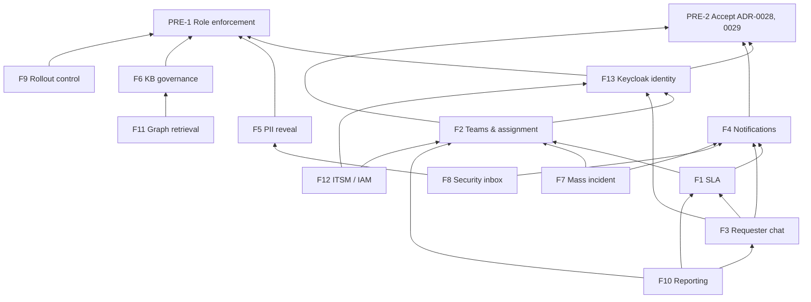

# 2. Scope

## 2.1 Feature list

Two changes from your brief, marked ⚠️, were confirmed by the product owner on
2026-10-17:

- ⚠️ **F13 Identity (Keycloak) is split out of F12 and proposed as Must.** You
  asked whether we can build a Keycloak feature: yes. For a real IT org, users
  created by hand in a Django shell (README step 3) do not scale, and F2
  (team membership), F4 (email addresses) and F3 (who is the requester) all
  need directory data. Keycloak signs people in; core-api keeps its own
  session (ADR-0029), so immediate revocation still works.
- ⚠️ **Two prerequisites, PRE-1 and PRE-2, are added before any Must feature.**
  They are not new features. They fix gaps the features would sit on (§3.4).

| ID | Feature | MoSCoW | Tag | One line |
|---|---|---|---|---|
| PRE-1 | Server-side role enforcement | **Must (prerequisite)** | CHANGED | Every endpoint checks the caller's role in core-api, not only in the browser |
| PRE-2 | Accept ADR-0028 and ADR-0029 | **Must (prerequisite)** | CHANGED (status only) | F1, F2, F4 and F13 build on them |
| F1 | SLA & business hours | Must | NEW + CHANGED | Policies per category × priority, Vietnam holiday calendar, pause, warnings, escalation on breach, on lifecycle actions |
| F2 | Teams, assignment & workload | Must | NEW + CHANGED | Teams per category, assign after `auto_route` or HITL, round-robin or least-loaded, reassign with reason |
| F3 | Requester experience in chat | Must | NEW + CHANGED | My tickets (chat and form), status, reply, reopen within a window, rating; chat memory within one conversation only |
| F4 | Notifications | Must | NEW + CHANGED | In-app, email, webhook; a notification matrix; user preferences; mandatory notices can't be turned off |
| F5 | PII quarantine reveal | Must | NEW | Mandatory reason, access log in the same transaction, who may reveal. Closes `status.md` Gap 1 |
| F13 | Identity via Keycloak (OIDC) | **Must** ⚠️ | NEW + CHANGED | Sign-in through Keycloak for both apps, users created on first sign-in, roles and teams from Keycloak, deactivation ends sessions |
| F6 | KB authoring & governance UI | Should | NEW + CHANGED | Drafts, review, risk tiers, authority approval, authority-log viewer, KB-gap report |
| F7 | Mass-incident management | Should | NEW + CHANGED | Incident page, broadcast with ETA to linked requesters, close all on resolve |
| F8 | Security inbox | Should | NEW | Block, injection, critical-PII and session-theft alerts with triage states |
| F9 | Rollout & threshold control | Should | NEW + CHANGED | Shadow-mode switch, phase gates, threshold changes need approval, all audited |
| F10 | Reporting | Should | NEW | SLA compliance, team workload, reviewer fatigue, KB gaps, CSAT |
| F11 | Graph-based retrieval as a KB feature | Could | CHANGED | Entity graph (ADR-0018, ADR-0025) gets a KB-side view and review |
| F12 | ITSM / IAM integration, n8n workflows | Could | NEW + CHANGED | Replace `itsm_mock` with a real connector; n8n flows. SSO moved to F13 |
| — | Anything for external customers | Won't | — | Out of this phase |

## 2.2 Dependencies

An arrow means "needs".

| Feature | Hard dependency (can't start without) | Soft dependency (can start, can't finish) |
|---|---|---|
| F1 | F2 (team calendars, escalate to team lead), PRE-2 | F4 (warning delivery) |
| F2 | F13 (team membership from Keycloak groups), PRE-2 | — |
| F3 | F13, F4 | F1 (show the SLA to the requester) |
| F4 | PRE-2 | F13 (user email addresses) |
| F5 | PRE-1 | F8 (alert on unusual reveal volume) |
| F13 | PRE-1, PRE-2 | — |
| F6 | PRE-1 | F10 (KB-gap report) |
| F7 | F4, F2 | F1 (pause SLA of linked tickets) |
| F8 | F4 | F5 (reveal from the inbox) |
| F9 | PRE-1 | F10 (gate metrics) |
| F10 | F1, F2, F3 | — |
| F11 | F6 (review UI for graph edges) | — |
| F12 | F13, F2 | — |

## 2.3 Build order

| Wave | Contents | Why this order |
|---|---|---|
| 0 | PRE-1, PRE-2, **F5** | PRE-1 closes holes the rest would widen. F5 is small, independent, and closes a spec gap |
| 1 | **F13**, **F4** core (in-app + email, matrix, preferences) | Every later feature needs to know who a user is and needs to tell them something |
| 2 | **F2**, then **F1** | SLA policies and escalation target teams and team leads |
| 3 | **F3** | Shows status, SLA and notifications that waves 1–2 produce |
| 4 | **F8**, **F7**, **F6**, **F9**, **F10** | Should features; F10 last because it reports on the others |
| 5 | **F11**, **F12** | Could features |

How this lines up with rollout phases P2–P5 is in [§10](10-release-plan.md#103-rollout-phases-what-each-needs-from-phase-2). In short:
waves 0–3 are safe to ship while `SHADOW_MODE=true`, because they act only
after a person or the pipeline has already decided. F9 must exist before P3.
