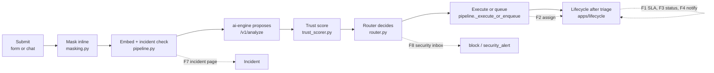

# 3. Baseline summary

Only the parts of today's system that phase 2 touches. Read against `main` @
`7ac264b` (2026-10-17). Where docs and code disagree, this follows the code and
says so.

## 3.1 Services and who may write

| Service | What it does today | Phase 2 rule |
|---|---|---|
| `core-api` (Django 6, Ninja, Celery) | Owns every decision and every business write | Every new decision and write goes here |
| `ai-engine` (FastAPI, LangGraph) | Proposes only; DB role `ai_engine_ro` is `SELECT`-only, **except** INSERT/DELETE on `kb_article_associations` for the offline entity-graph build (ADR-0025) | No new grant. F11 stays inside that one table |
| `admin-console` (Next.js) | Pages: `queue`, `review/[id]`, `dashboard`, `kb`, `login` | New pages per feature; changed pages shown before → after |
| `chat` (Next.js) | One page: ask, see the answer, answer a clarify, ask for a ticket | F3 extends it |

Docs drift found: README and CLAUDE.md still describe one `services/web` app.
The code has two apps, `services/admin-console` and `services/chat`.

## 3.2 The ticket path the features join

| Step | Today | Where |
|---|---|---|
| Submit | `Ticket.objects.submit` masks, stores masked text, encrypts raw PII into `pii_quarantine` (72 h TTL), starts the lifecycle, audits, queues `process_ticket` | `apps/tickets/models.py` |
| Route | Pure `Router(th).route(...)`; branches `auto_reply`, `auto_route`, `hitl`, `block`, `escalate`, `clarify` | `apps/tickets/utils/router.py` (ADR-0001, ADR-0016) |
| Execute | `auto_route` sets `assigned_team = category` (a string). `hitl`/`clarify`/`block`/`escalate` create a `ReviewItem` with a queue and priority 1–3. Shadow mode sends everything to a person | `pipeline.py` lines 331–400 |
| Chat hold | A live chat ticket's `hitl`/`auto_route`/`clarify` decision waits in `awaiting_requester` until the requester asks for a ticket (`release_to_support`) | `pipeline.py` lines 249–328 |
| Lifecycle | Statuses, transitions, rules, actions on Celery. Pipeline statuses are reserved; only `lifecycle.system_move` enters them | `apps/lifecycle/` (ADR-0028, **Proposed**) |

## 3.3 What exists, per feature

| Feature | REUSED as is | Gap or CHANGED |
|---|---|---|
| **F1 SLA** | `Ticket.sla_due_at`; action `set_sla`; statuses with an `On hold` base (`seed.py`) | `set_sla` adds **wall-clock** hours (`actions.py` lines 267–282) → must count business time. **No `Ticket.priority`** (only `ReviewItem.priority`). `awaiting_requester` is a triage status no person can enter (ADR-0028 §2), so "waiting for the requester" after triage needs a new status |
| **F2 Teams** | Actions `assign_user`, `assign_team`; `Ticket.assigned_to` | **No team table**: `assigned_team` is a 50-char string set to the category on `auto_route` (`pipeline.py` line 398). Duplicates copy the original's team and assignee (line 444) |
| **F3 Requester** | `GET /api/chat/tickets` lists the caller's **chat** tickets; `reopen_ticket` Celery task (moves to `reopened`, `reopened_count += 1`, retracts few-shot) with no endpoint | **One chat message = one ticket** (`/api/chat/ask` submits a ticket). No conversation, no reply, no rating. Form tickets are not listed |
| **F4 Notifications** | Action `send_email` (Django `send_mail`); `call_webhook` with host allow-list; `trigger_n8n` | No in-app notifications (ADR-0028 excluded them). No preferences. Dev email backend is the console. Approvers are not notified (`TODO.md` item 14.3) |
| **F5 PII reveal** | `PiiQuarantine` (AES-GCM, TTL task), `PiiAccessLog` model, `crypto.decrypt()` | Read path not built: no endpoint, no log rows (`status.md` Gap 1, `TODO.md` item 1). Fails safe today |
| **F6 KB** | `kb_articles`, `kb_authority_log`, manager-only `auto-reply-allowed` and `risk-tier` with reason (ADR-0002); `refusal_rate` on the dashboard | Articles are created live, no draft or review. `POST /api/kb` has no role check |
| **F7 Mass incident** | `Incident` (`INC-YYYY-NNNN`), detector (baseline + 3σ, advisory lock), tickets linked by `incident_id`, `escalate` branch | No incident page, no broadcast, no ETA, no close-all. `Incident.status` is a free string `"open"` |
| **F8 Security** | `block` → review item in queue `injection` or `pii_verify`; `security_alert` audit events (router, refresh-token reuse ADR-0029) | No inbox, no triage states, no alert to a person |
| **F9 Rollout** | `SHADOW_MODE` env var; `thresholds.yaml` loaded and validated at boot; full snapshot in `routing_decisions.thresholds_used` | Shadow mode changes only by redeploy. No approval on threshold changes. Hard rule 2: every tunable lives in `thresholds.yaml` |
| **F10 Reporting** | `GET /api/metrics/dashboard`: `reopen_rate_after_autoreply`, `override_rate`, `reroute_rate`, `refusal_rate`, `approve_rate_per_reviewer`, `median_time_spent` (`apps/metrics/utils.py`) | No SLA, team, CSAT or KB-gap reports |
| **F11 Graph retrieval** | `kb_article_associations` with source `entity_graph` (ADR-0018, ADR-0025); `ASSOCIATION_SOURCE` | Phase 2 builds on it, no new grant |
| **F12 ITSM/IAM** | `apps/itsm_mock` (runbook registry, execution always via a review item, ADR-0006); `trigger_n8n` with callback | No real ITSM or IAM connector |
| **F13 Identity** | Sign-in sessions: 5-min access token in memory, rotating refresh token in an httpOnly cookie per app, reuse detection, `SessionAuth` on every endpoint (ADR-0029, **Proposed**) | Local usernames and passwords only. Users are created by hand in a Django shell (README step 3). No lockout after failed passwords |

## 3.4 Constraints found in the code that phase 2 must respect

1. **Role checks are missing on several endpoints.** README lists roles per
   route. The code checks only that the caller is signed in on: the review
   queue, claim and decide (`apps/review/views.py`), `GET
   /api/tickets/{public_id}` (any ticket, any caller), `POST /api/kb`, `POST
   /api/kb/{slug}/reingest`, `GET /api/metrics/dashboard`, and `POST
   /api/itsm/review-items/{id}/execute`. Runbook execution does require an
   approved `runbook_approval` decision (ADR-0006), but the decide endpoint
   that approves it has no role check either, so the human in the loop is not
   guaranteed to be staff. Only `apps/lifecycle/views.py` uses
   `require_role`, and the KB authority methods check `is_manager` on the
   model. The admin console refuses requesters in the browser only. Phase 2
   cannot add "my tickets" or new roles on top of this. See PRE-1 in §2.
2. **Two ADRs the features build on are still Proposed:** ADR-0028
   (lifecycle) and ADR-0029 (sessions). F1, F2, F4 and F13 sit on them.
3. **Times are UTC** (`TIME_ZONE = "UTC"`, `USE_TZ = True`). Business hours
   need an explicit time zone per calendar (`Asia/Ho_Chi_Minh`).
4. **Demo data is English.** The demo KB is 3,542 AWS documentation pages
   (`demo_kb/`); golden tickets are English. Production tickets are mixed
   Vietnamese and English (spec §0). Mockups use AWS page titles with mixed
   ticket text.
5. **`retrieval.floor` is 0.6** in `thresholds.yaml`; README's table still
   says 0.30. Code wins.
6. **Actions see masked text only** (ADR-0028 §6). Every notification
   template in F4 inherits this.
