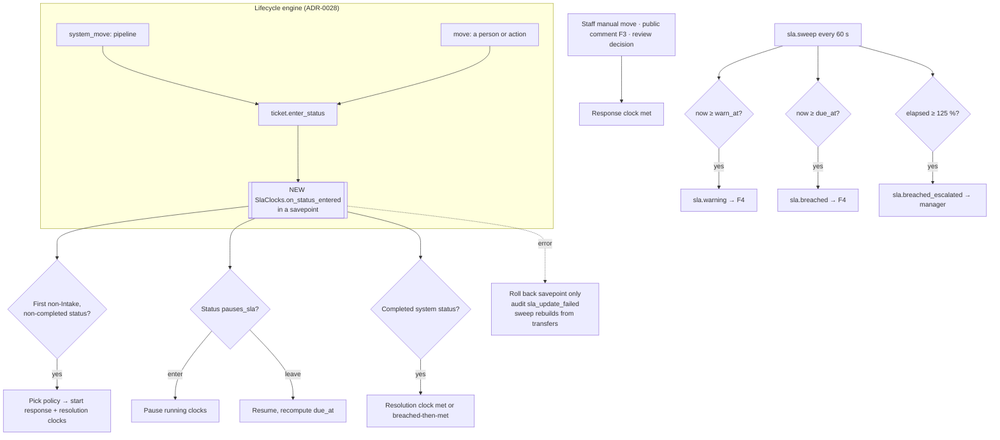

# 6. F1 SLA & business hours — NEW + CHANGED

Must · Wave 2 · ADR-0030 (accepted 2026-10-26). Defaults from OQ-04…07 (accepted 2026-10-17).

## a. Problem & goal

Nothing measures how long support takes. `tickets.sla_due_at` exists but only
the lifecycle `set_sla` action writes it, as **wall-clock** hours
(`actions.py` lines 267–282), and no default workflow uses it. Tickets have
no priority. There is no calendar, no holiday list, no pause, no warning.

**Goal:** every ticket handed to support gets a response clock and a
resolution clock, counted in business time on a Vietnam calendar, paused while
waiting for the requester, with a warning at 75 % and escalation at 100 % and
125 %. Clocks never change a routing decision or block a status move.

**Benchmark:** ServiceNow and JSM use start/pause/stop conditions on a
schedule or calendar; Freshservice and SDP use a priority matrix with
multi-level escalation and pause on waiting for the user. Adopt targets per
(category, priority), ordered first-match policies, calendars with holidays.
Adapt: start/pause/stop are lifecycle **status events**, not free conditions
(ADR-0028 §5); holidays are entered per year because Vietnam sets Tết and
bridge days by decision ([benchmark F1](benchmark.md#f1-sla--business-hours)).

**Why events, not actions.** Your brief says "built on lifecycle actions".
Pipeline statuses (`pending_review`, `auto_routed`, `escalated`) carry no
actions, by ADR-0028 §2, and those are exactly where clocks must start. So
F1 hooks the one place every status change passes — the engine's
`record_system_transfer` and `commit_locked`, right after
`ticket.enter_status()` — and the `set_sla` **action** is kept, changed to a
business-time override (§h). Proposed ADR-0030 records this.

## b. Process flow



## c. State changes

**NEW workflow status** in the seed and every workflow: `waiting_on_requester`
("Chờ người yêu cầu"), base `On hold`, `pauses_sla = true`. Not a pipeline
status: people move tickets into it (unlike `awaiting_requester`, which is
triage-only, ADR-0028 §2).

**NEW status flag** `pauses_sla` on `lifecycle_workflow_statuses`.

**Clock states** (`sla_clocks.state`):

| From | Event | To |
|---|---|---|
| — | Handoff (first entry into a status whose base is neither `is_backlog` nor `is_completed`) | `running` |
| `running` | Enter a `pauses_sla` status | `paused` |
| `paused` | Leave it | `running` (due_at recomputed) |
| `running`/`paused` | Response event (response clock) or enter completed status (resolution clock) | `met` |
| `running` | Sweep: now ≥ due_at | `breached` (keeps counting until met) |
| `breached` | Stop event | `met`, with `breached_at` kept |
| any | Ticket deleted from support (moved back to triage by `clarify` re-run) | `cancelled` |
| `met` (resolution) | Reopen (F3) | `running` (elapsed kept) |

**Ticket priority** (NEW `tickets.priority`): `P1`–`P4`; set at handoff by
rules; changed by staff with a reason.

## d. Use cases

| Field | UC-F1-01 · Start clocks at handoff |
|---|---|
| Actor | System |
| Trigger | Engine enters a status after triage (e.g. `pending_review`, `auto_routed`, `escalated`) for the first time |
| Preconditions | No running clocks for the ticket |
| Main flow | 1. Set priority by BR-F1-02 if empty. 2. Pick the first active policy matching (category, priority). 3. Pick the calendar (BR-F1-04). 4. Create response and resolution clocks with a snapshot of targets and calendar. 5. Compute `due_at`, `warn_at`. 6. Mirror resolution `due_at` to `tickets.sla_due_at`. 7. Audit `sla_started` |
| Alternate | 1a. Linked to an open mass incident → P1 |
| Exception | 2x. No policy matches (shouldn't, default exists) → default policy, audit `sla_policy_fallback`. Any error → savepoint rolled back, status move kept, audit `sla_update_failed`, sweep rebuilds |
| Postconditions | Two clocks `running` |
| Rules | BR-F1-01…05, 11 |
| Screens | [`F1 · SLA badge`](https://www.figma.com/design/KXpnlC78p9pHYRuZZuQxIL?node-id=8-604) on queue and ticket (CHANGED `queue`, `review/[id]`) |
| MoSCoW | Must |

| Field | UC-F1-02 · Pause while waiting for the requester |
|---|---|
| Actor | Technician |
| Trigger | Moves the ticket to `waiting_on_requester` with a public question (F3) |
| Preconditions | Clocks running |
| Main flow | 1. Engine commits the move. 2. Hook pauses both clocks, storing business elapsed. 3. Badge shows "Paused" |
| Alternate | 2a. Response clock not yet met → this staff move meets it first (BR-F1-06), then resolution pauses |
| Exception | — |
| Postconditions | `paused`; no warning or breach while paused |
| Rules | BR-F1-06, 07 |
| Screens | [`F1 · SLA badge`](https://www.figma.com/design/KXpnlC78p9pHYRuZZuQxIL?node-id=8-604) |
| MoSCoW | Must |

| Field | UC-F1-03 · Resume when the requester replies |
|---|---|
| Actor | System (on F3 reply), or technician |
| Trigger | Requester replies (F3 moves the ticket back to its previous status) or staff moves it out |
| Preconditions | Clock paused |
| Main flow | 1. Hook resumes. 2. Recompute `due_at`, `warn_at` from remaining business time |
| Alternate | 1a. No reply for `requester.auto_close_after_business_days` (5) → F3 resolves the ticket; clock `met` |
| Exception | — |
| Postconditions | `running` |
| Rules | BR-F1-07 |
| Screens | — |
| MoSCoW | Must |

| Field | UC-F1-04 · Warn, breach, escalate |
|---|---|
| Actor | System (`sla.sweep`) |
| Trigger | Every 60 s |
| Preconditions | Running clocks |
| Main flow | 1. Clocks with `warn_at ≤ now`, not warned → `sla.warning`. 2. `due_at ≤ now`, not breached → state `breached`, `sla.breached`. 3. Business elapsed ≥ 125 % of target, not escalated → `sla.breached_escalated` to manager |
| Alternate | — |
| Exception | 1x. Sweep down → next run catches up; each notice still sent once (unique per clock + level) |
| Postconditions | Each level fires once per clock |
| Rules | BR-F1-08, 09 |
| Screens | [`F1 · Breach list`](https://www.figma.com/design/KXpnlC78p9pHYRuZZuQxIL?node-id=8-685) |
| MoSCoW | Must |

| Field | UC-F1-05 · Change priority |
|---|---|
| Actor | Assignee, team lead, manager |
| Trigger | Impact turns out larger or smaller |
| Preconditions | Ticket not completed |
| Main flow | 1. Pick new priority, reason. 2. Re-match policy for running clocks; keep elapsed; new target; recompute. 3. Audit `ticket_priority_changed`, `sla_retargeted` |
| Alternate | 2a. New target < elapsed → `breached` at once |
| Exception | Requester or no reason → 403 / 422 |
| Postconditions | — |
| Rules | BR-F1-02, 10 |
| Screens | [`F1 · Priority dialog`](https://www.figma.com/design/KXpnlC78p9pHYRuZZuQxIL?node-id=8-677) |
| MoSCoW | Must |

| Field | UC-F1-06 · Maintain policies, calendars, holidays |
|---|---|
| Actor | `workflow_admin` (draft), manager (approve) |
| Trigger | New year's holidays announced; target change |
| Preconditions | — |
| Main flow | 1. Edit a policy draft or calendar. 2. Add holidays for 2027 (e.g. Tết 4–10 Feb 2027). 3. Manager approves the policy draft → active. Calendar and holiday edits are effective at once, audited |
| Alternate | 2a. Preview: enter category, priority, start time → see due times |
| Exception | 3x. Author approving own draft → 403 `self_approval` |
| Postconditions | New clocks use the new policy; running clocks keep their snapshot |
| Rules | BR-F1-03, 05, 12, 14 |
| Screens | [`F1 · SLA policies`](https://www.figma.com/design/KXpnlC78p9pHYRuZZuQxIL?node-id=8-57), [`F1 · Business calendars`](https://www.figma.com/design/KXpnlC78p9pHYRuZZuQxIL?node-id=8-283), [`F1 · Holidays`](https://www.figma.com/design/KXpnlC78p9pHYRuZZuQxIL?node-id=8-435) |
| MoSCoW | Must |

## e. Business rules

| ID | Rule | Rationale | Enforced where |
|---|---|---|---|
| BR-F1-01 | Clocks start at **handoff**: the first entry into a status whose base is neither `is_backlog` nor `is_completed`. Time in `new` and `awaiting_requester` never counts | OQ-07; a chat question held for the requester isn't support's work yet | `SlaClocks.on_status_entered` |
| BR-F1-02 | Priority at handoff: linked to an open incident → P1; category `security` → P2; else P3. Staff change it with a reason. Requesters can't. No `proposed_*` field is read | OQ-06; ADR-0001 | `Priority.initial()`, endpoint |
| BR-F1-03 | Policy = first active row by `order` matching category (null = any) and priority (null = any). A default (both null) must exist and can't be retired | Ordered first-match (JSM goals) | Policy service; DB check |
| BR-F1-04 | Calendar = policy's (`is_24x7` overrides) → team's (F2) → default calendar | P1 is 24×7 (OQ-05); teams may keep other hours later | Clock service |
| BR-F1-05 | A clock keeps a **snapshot** of its targets and calendar id. Policy edits apply to new clocks only. Calendar holiday edits apply to running clocks at their next recompute | Like `routing_decisions.thresholds_used`: past numbers stay explainable | `sla_clocks.policy_snapshot` |
| BR-F1-06 | Response is met by the first of: a staff manual status move, a staff public comment (F3), a review decision. System assignment is not a response | A response is a person acting, not a robot assigning | Hooks in engine (manual trigger), F3, review service |
| BR-F1-07 | Entering a `pauses_sla` status pauses every running clock of the ticket; leaving resumes. Only `waiting_on_requester` pauses; `on_hold` (vendor, part) keeps counting | OQ-17 (decided 2026-10-17): the requester's wait is real even when a vendor causes it | Hook |
| BR-F1-08 | Warning at `sla.warn_at_percent` (75) of target, breach at 100, escalation at `sla.escalate_at_percent` (125). Each fires once per clock | K3; Freshservice/SDP levels | Sweep; unique `(clock, level)` |
| BR-F1-09 | No automatic priority change on breach | A raise would retarget the clock it just breached | — (by design) |
| BR-F1-10 | Priority change keeps business elapsed and switches target | JSM-style re-evaluation; honest compliance numbers | Clock service |
| BR-F1-11 | An SLA error never changes the status move or the routing decision; it rolls back a savepoint, is audited, and the sweep rebuilds the clock from `lifecycle_transfers` | BR-X-07 | Hook + `sla.rebuild` |
| BR-F1-12 | A policy draft is activated by a manager who is not its author | Targets are a commitment to the business | Approve endpoint |
| BR-F1-13 | Reopen (F3) resumes the same resolution clock with elapsed kept; the response clock is not restarted | Reopened work isn't new work; K2 stays honest | Hook on `reopened` |
| BR-F1-14 | Holidays are whole days in the calendar's zone. Missing holidays for next year by 1 Dec → notice to `workflow_admin` | Vietnam sets dates by annual decision; Culture Day 24 Nov 2026 was a one-off approval | Sweep (daily check) |
| BR-F1-15 | A linked ticket's resolution clock pauses while its incident is `confirmed`, and resumes on unlink, dismiss, or resolve without close-all (added by F7) | The incident carries one P1 clock for the outage (BR-F7-07, BR-F7-10) | Hook on incident link events |

## f. Functional requirements

| ID | Requirement |
|---|---|
| FR-F1-001 | The system shall store business calendars: name, IANA zone, working intervals per weekday |
| FR-F1-002 | The system shall store holidays per calendar as dated whole days with a name |
| FR-F1-003 | The system shall store SLA policies with order, optional category, optional priority, response and resolution targets in business minutes, optional calendar, `is_24x7`, state `draft`/`active`/`retired` |
| FR-F1-004 | The system shall add `priority` (`P1`–`P4`) to tickets and set it at handoff by BR-F1-02 |
| FR-F1-005 | The system shall start one response and one resolution clock at handoff by BR-F1-01 |
| FR-F1-006 | The system shall compute `due_at` and `warn_at` by walking working intervals, skipping weekends and holidays, in the calendar's zone, storing UTC |
| FR-F1-007 | The system shall pause and resume clocks on `pauses_sla` statuses and recompute on resume |
| FR-F1-008 | The system shall mark the response clock met on the events in BR-F1-06 |
| FR-F1-009 | The system shall mark the resolution clock met on entering a completed system status, and resume it on reopen |
| FR-F1-010 | A beat task shall run every `SLA_SWEEP_INTERVAL_SEC` (60) and fire warning, breach and escalation once each |
| FR-F1-011 | The system shall mirror the running resolution clock's `due_at` into `tickets.sla_due_at` |
| FR-F1-012 | The lifecycle `set_sla` action shall set a manual resolution target in **business** hours on the ticket's calendar, audited as an override |
| FR-F1-013 | The system shall let staff change priority with a reason and retarget running clocks |
| FR-F1-014 | The system shall preview due times for (category, priority, start time) without creating clocks |
| FR-F1-015 | The system shall rebuild a ticket's clocks from its transfer log on demand and in the sweep after `sla_update_failed` |
| FR-F1-016 | The system shall show on queue rows and the ticket page: target, due time, remaining business time, state (running, paused, warned, breached, met) |
| FR-F1-017 | The system shall audit `sla_started`, `sla_paused`, `sla_resumed`, `sla_met`, `sla_breached`, `sla_escalated`, `sla_retargeted`, `sla_override`, `sla_update_failed`, `sla_policy_activated`, `sla_calendar_changed`, `ticket_priority_changed` |

## g. Data changes

| Table | Status | Fields |
|---|---|---|
| `sla_calendars` | NEW | `name` unique, `timezone` (IANA), `working_hours` JSON `{"mon":[["08:00","17:30"]],…}`, `is_default` (exactly one) |
| `sla_holidays` | NEW | `calendar` FK, `date`, `name`. Unique (`calendar`, `date`) |
| `sla_policies` | NEW | `name`, `order`, `category` null, `priority` null, `response_minutes`, `resolution_minutes`, `calendar` FK null, `is_24x7`, `state`, `created_by`, `approved_by` null, `approved_at` null |
| `sla_clocks` | NEW | `ticket` FK, `kind` (`response` \| `resolution`), `policy` FK, `policy_snapshot` JSON, `state`, `started_at`, `paused_at` null, `elapsed_business_sec`, `elapsed_as_of`, `due_at`, `warn_at`, `warned_at`, `breached_at`, `escalated_at`, `met_at`, `override_minutes` null. Unique (`ticket`, `kind`) |
| `sla_clock_events` | NEW | `clock` FK, `event` (`start` \| `pause` \| `resume` \| `met` \| `breach` \| `retarget` \| `override` \| `rebuild`), `at`, `transfer` FK null, `actor` null, `elapsed_business_sec` |
| `tickets` | CHANGED | NEW `priority` varchar(2) null (`P1`–`P4`); `sla_due_at` now a mirror of the resolution clock |
| `lifecycle_workflow_statuses` | CHANGED | NEW `pauses_sla` bool default false; seed adds `waiting_on_requester` |
| `team_teams` (F2) | — | `calendar` FK used here |

**Seed data**

| calendar | timezone | working_hours |
|---|---|---|
| `VN office` (default) | `Asia/Ho_Chi_Minh` | Mon–Fri `[["08:00","17:30"]]`, Sat–Sun `[]` |

| order | name | category | priority | response | resolution | calendar | 24×7 |
|---|---|---|---|---|---|---|---|
| 10 | P1 — critical | any | P1 | 15 min | 240 min | — | yes |
| 20 | P2 — high | any | P2 | 30 min | 480 min (8 business h) | VN office | no |
| 30 | P3 — normal | any | P3 | 240 min | 1,710 min (3 business days × 570) | VN office | no |
| 40 | P4 — low | any | P4 | 570 min (1 business day) | 2,850 min (5 business days) | VN office | no |
| 999 | Default | any | any | 240 min | 1,710 min | VN office | no |

Holidays seeded for `VN office` [from the sources in benchmark F1; HR confirms each year, OQ-13]:

| date | name |
|---|---|
| 2026-11-24 | Ngày Văn hoá Việt Nam |
| 2027-01-01 | Tết Dương lịch |
| 2027-02-04 → 2027-02-10 | Tết Nguyên đán (7 rows) |
| 2027-04-16 | Giỗ Tổ Hùng Vương |
| 2027-04-30 | Ngày Giải phóng miền Nam |
| 2027-05-03 | Quốc tế Lao động (nghỉ bù) |
| 2027-09-02, 2027-09-03 | Quốc khánh |

**`thresholds.yaml` — CHANGED**

```yaml
sla:
  warn_at_percent: 75
  escalate_at_percent: 125
  holidays_reminder_month_day: "12-01"
requester:
  auto_close_after_business_days: 5   # used by F3
```

**`.env.example` — CHANGED:** `SLA_SWEEP_INTERVAL_SEC=60`.

**Migration:** existing tickets get no clocks (no backfill: their history has
no priority). `tickets.priority` null for old rows. PII: none.

### Worked example — one P3 hardware ticket

Input at handoff:

```json
{ "public_id": "TKT-2026-000418", "category": "hardware", "incident": null,
  "event": "system_move → pending_review", "at": "2026-10-23T08:30:00Z" }
```

`2026-10-23T08:30Z` is **Fri 15:30 (+07)**.

Step 1 — priority and policy: not incident, not security → `P3` → policy 30
(240 / 1,710 business minutes, `VN office`).

Step 2 — business time on `VN office` (570 working minutes a day):

| Day (+07) | Working window | Minutes counted |
|---|---|---|
| Fri 23 Oct | 15:30–17:30 | 120 |
| Sat 24, Sun 25 | — | 0 |
| Mon 26 | 08:00–17:30 | 570 |
| Tue 27 | 08:00–17:30 | 570 |
| Wed 28 | 08:00–… | rest |

Clocks created:

| kind | target | due_at (+07) | warn_at (+07, 75 %) | state |
|---|---|---|---|---|
| response | 240 | Mon 26 Oct **10:00** (120 Fri + 120 Mon) | Mon 26 Oct 09:00 (180) | running |
| resolution | 1,710 | Wed 28 Oct **15:30** (120+570+570+450) | Wed 28 Oct 08:22:30 (1,282.5) | running |

`tickets.sla_due_at` = `2026-10-28T08:30:00Z`.

Step 3 — Mon 26 Oct 09:12, Mai moves it to `in_progress` (staff manual move) →
response clock `met` at 09:12, under target.

Step 4 — Tue 27 Oct 10:00, Mai moves it to `waiting_on_requester` ("Chị gửi
giúp em ảnh màn hình Display settings") → resolution paused. Elapsed:
120 + 570 + 120 = **810**.

| kind | state | elapsed_business_sec | paused_at (+07) | due_at |
|---|---|---|---|---|
| resolution | paused | 48,600 | Tue 27 Oct 10:00 | — (none while paused) |

Step 5 — Wed 28 Oct 09:30, Lan replies (F3) → back to `in_progress`, resumed.
Remaining 1,710 − 810 = 900: Wed 09:30–17:30 = 480, Thu 29 Oct 08:00 + 420 →
**Thu 29 Oct 15:00**. Warn at 1,282.5 → 472.5 after resume → **Wed 28 Oct
17:22:30**.

Step 6 — Thu 29 Oct 11:40, Mai resolves → `met` at 1,710 − 200 = 1,510
business minutes. Not breached.

`sla_clock_events` for the resolution clock (output):

| event | at (+07) | elapsed (min) |
|---|---|---|
| start | Fri 23 Oct 15:30 | 0 |
| pause | Tue 27 Oct 10:00 | 810 |
| resume | Wed 28 Oct 09:30 | 810 |
| met | Thu 29 Oct 11:40 | 1,510 |

Same ticket as **P1** (24×7): due 4 h wall-clock after Fri 15:30 → Fri 19:30,
weekend and holidays ignored.

## h. API changes

| Method · Path | Role | Request | Response | Errors |
|---|---|---|---|---|
| `GET /api/sla/policies` | staff | — | list with state | — |
| `POST /api/sla/policies`, `PATCH /api/sla/policies/{id}` | workflow_admin | `{name, order, category, priority, response_minutes, resolution_minutes, calendar_id, is_24x7}` | policy (`draft`) | 422 `invalid_target` · 409 `order_taken` |
| `POST /api/sla/policies/{id}/approve` | manager | `{reason}` | policy (`active`) | 403 `self_approval` |
| `POST /api/sla/policies/{id}/retire` | manager | `{reason}` | policy | 409 `default_policy` |
| `GET/POST/PATCH /api/sla/calendars` | workflow_admin (write), staff (read) | `{name, timezone, working_hours}` | calendar | 422 `bad_interval` / `unknown_timezone` |
| `GET/POST/DELETE /api/sla/calendars/{id}/holidays` | workflow_admin | `{date, name}` or `{from, to, name}` | holidays | 409 `holiday_exists` |
| `POST /api/sla/preview` | staff | `{category, priority, start_at}` | `{policy, response:{due_at, warn_at}, resolution:{…}}` | — |
| `GET /api/tickets/{public_id}/sla` | staff; reporter (own) | — | see below | 404 |
| `PATCH /api/tickets/{public_id}/priority` | assignee, lead, manager | `{priority, reason, expected_version}` | ticket + clocks | 422 `reason_required` · 409 `version_conflict` |
| `POST /api/tickets/{public_id}/sla/rebuild` | manager | — | clocks | — |
| `GET /api/sla/breaches?team=&state=` | staff | — | breached and warned clocks | — |

`GET /api/tickets/TKT-2026-000418/sla` at Wed 28 Oct 11:00 (+07):

```json
{ "priority": "P3", "policy": "P3 — normal", "calendar": "VN office",
  "clocks": [
    { "kind": "response", "state": "met", "target_minutes": 240,
      "met_at": "2026-10-26T02:12:00Z", "breached": false },
    { "kind": "resolution", "state": "running", "target_minutes": 1710,
      "elapsed_minutes": 900, "remaining_minutes": 810,
      "due_at": "2026-10-29T08:00:00Z", "warn_at": "2026-10-28T10:22:30Z",
      "paused": false, "breached": false } ] }
```

The requester's view (F3) shows only `state` and `due_at` of the resolution clock.

**Lifecycle catalog — CHANGED:** `set_sla` params `{offset_hours}` → `{business_hours, reason}`;
before: `sla_due_at = now + offset_hours` (wall clock); after: sets
`override_minutes` on the resolution clock and recomputes on the ticket's
calendar. Rule `before_sla` keeps reading `tickets.sla_due_at`.

**Celery tasks**

| Task | Trigger | Idempotency |
|---|---|---|
| `sla.sweep` | beat, every `SLA_SWEEP_INTERVAL_SEC` | Each level guarded by `warned_at`/`breached_at`/`escalated_at` null check under `SELECT … FOR UPDATE SKIP LOCKED`; rebuilds clocks flagged by `sla_update_failed` |
| `sla.holiday_check` | beat, daily 07:00 `Asia/Ho_Chi_Minh` | Sends at most one notice per calendar per year |

Webhook events: `sla.warning`, `sla.breached`, `sla.breached_escalated` through F4 subscriptions.

## i. Impact

- **Changes:** two engine methods call the SLA hook; `set_sla` changes meaning (business hours, override); seed gains `waiting_on_requester`; `tickets` gains `priority`; review-decision service and F3 comments call "response met".
- **Must not change:** `system_move` never fails for a workflow reason (ADR-0028 §2) — the hook runs in a savepoint and swallows its own errors; reserved pipeline statuses carry no actions; routing; shadow mode (clocks run in shadow mode too, because people still work every ticket — that's the data K1/K2 need).
- **ADRs:** 0028 (§2 respected; amended by proposed 0030), 0001 (priority never from a proposal).
- **Regression tests:** `test_system_move_succeeds_when_sla_hook_raises`; `test_no_clock_time_in_triage_statuses`; `test_business_time_skips_weekend_and_holiday`; `test_pause_resume_keeps_elapsed`; `test_policy_edit_does_not_change_running_clock`; `test_each_sla_level_fires_once`; `test_dst_free_zone_round_trip_utc`; existing `test_hardening` `set_sla` cases updated to business hours.

## v0.6.6 — where the code differs (build, 2026-10-26)

Code wins (README §0.4 item 5). Each change and its reason:

1. **Clocks store `escalate_at`** beside `warn_at` and `due_at`, so the sweep
   compares times instead of recomputing business time for every clock.
2. **Failed updates queue in `sla_rebuilds`** (one row per ticket); the sweep
   rebuilds each from `lifecycle_transfers` and review decisions, then deletes
   the row. `POST …/sla/rebuild` does the same on demand.
3. **Changing an active policy means drafting a replacement** (`replaces_id`);
   approval activates the draft and retires the one it replaces. Only drafts can
   be edited (409 `not_a_draft`); two active policies can't share an order
   (409 `order_taken` on approval). A retirement needs a reason too.
4. **`ASSIGNMENT_TIMEZONE` is gone** (owner's decision for F2): "on leave today"
   is now judged in the team's calendar zone, else the default calendar's.
5. **What counts as a response today:** a staff member's manual (or forced) move
   and a review decision. F3 adds the public comment and the requester's reopen,
   F7 the incident pause (AC-F1-10's comment half, AC-F1-11, AC-F1-12). A
   person moving a resolved ticket back already resumes its resolution clock.
6. **Back to triage cancels the clocks** (a `clarify` re-run); the next handoff
   starts fresh ones. A ticket that goes straight to a completed status (an
   auto-reply) gets none.
7. **`set_sla` takes `{business_hours, reason}`**; migration `lifecycle.0005`
   converts saved `offset_hours`. On a ticket with no running clock the run fails
   (`invalid_param`).
8. **`tickets.sla_due_at` is empty while the clock is paused or finished**, so a
   `before_sla` rule never fires on a ticket waiting for its requester.
9. **API additions:** staff ticket rows carry `priority` and an `sla` badge
   (business minutes left, level, both clocks); breach rows carry the badge too.
   The requester's `GET …/sla` returns only the resolution clock's state, due and
   met times.
10. **Notices are keyed by ticket, clock kind, start time and level**, so a
    rebuild never sends a warning or breach again.
11. **The breach list is for all staff, filtered by team**; the Figma note "a
    lead sees own teams" is not enforced.
12. **A clock past its target keeps the due time it passed**, not the time of a
    later recompute (a resume, rebuild or retarget).
13. **Workflows get `waiting_on_requester` but no transitions to it**: an open
    workflow (the default) can use it at once; a strict one needs an admin to add
    the transitions.
14. **`requester.auto_close_after_business_days` is left to F3**, which reads it.
15. **Screens:** the badge on the ticket list, team queue and ticket page;
    "SLA at risk" (`/sla`) under Tickets; policies with the preview, calendars
    and holidays under Settings. Approve and retire ask for the reason in a
    prompt.

## j. Acceptance criteria

```gherkin
Feature: F1 SLA and business hours

  Background:
    Given calendar "VN office" in "Asia/Ho_Chi_Minh" with Mon–Fri 08:00–17:30
    And active policy "P3 — normal" with response 240 and resolution 1710 business minutes

  @BR-F1-01 @BR-F1-02 @BR-F1-03
  Scenario: AC-F1-01 clocks start at handoff, not at submit
    Given "TKT-2026-000418" was submitted Fri 23 Oct 2026 15:00 (+07) in category "hardware"
    When the pipeline moves it to "pending_review" at 15:30 (+07)
    Then its priority is "P3"
    And the response clock is due Mon 26 Oct 10:00 (+07)
    And the resolution clock is due Wed 28 Oct 15:30 (+07)

  @BR-F1-04 @BR-F1-14
  Scenario: AC-F1-02 holidays don't count
    Given holiday 2026-11-24 on "VN office"
    And a P3 ticket handed off Mon 23 Nov 2026 16:30 (+07)
    Then the response clock is due Wed 25 Nov 2026 11:00 (+07)
    # Mon 16:30–17:30 = 60 min, Tue 24 Nov skipped, Wed 08:00 + 180 min

  @BR-F1-07
  Scenario: AC-F1-03 waiting on the requester pauses the clock
    Given the resolution clock of "TKT-2026-000418" has 810 business minutes elapsed
    When "mai.bn" moves the ticket to "waiting_on_requester"
    And 1 business day passes
    And "lan.nt" replies
    Then elapsed is still 810 minutes at the moment of the reply
    And due_at is Thu 29 Oct 15:00 (+07)

  @BR-F1-08 @BR-F1-09
  Scenario: AC-F1-04 warning, breach and escalation each fire once
    Given a running P2 resolution clock with target 480
    When the sweep runs at 360, 480 and 600 business minutes elapsed, twice each
    Then exactly one "sla.warning", one "sla.breached" and one "sla.breached_escalated" notice exist

  @BR-F1-04
  Scenario: AC-F1-05 P1 counts around the clock
    Given a ticket linked to an open mass incident is handed off Sat 24 Oct 22:00 (+07)
    Then its priority is "P1"
    And its resolution clock is due Sun 25 Oct 02:00 (+07)

  @BR-F1-11 @BR-X-07
  Scenario: AC-F1-06 an SLA failure never blocks the pipeline
    Given the SLA hook raises an error
    When the pipeline moves a ticket to "auto_routed"
    Then the ticket is "auto_routed"
    And one audit row "sla_update_failed" exists
    And after the next sweep the ticket has running clocks

  @BR-F1-05
  Scenario: AC-F1-07 policy edits don't move running clocks
    Given "TKT-2026-000418" has a running resolution clock due Wed 28 Oct 15:30
    When a manager activates a new P3 policy with resolution 1140
    Then "TKT-2026-000418" is still due Wed 28 Oct 15:30
    And a P3 ticket handed off afterwards uses 1140

  @BR-F1-12
  Scenario: AC-F1-08 a manager can't approve their own draft
    Given "huy.pq" created a policy draft
    When "huy.pq" approves it
    Then the response is 403 with code "self_approval"

  @BR-F1-10
  Scenario: AC-F1-09 priority change keeps elapsed
    Given a running P3 resolution clock with 600 business minutes elapsed
    When "ha.vt" changes priority to "P2" with a reason
    Then the clock target is 480 and its state is "breached"
    And one audit row "sla_retargeted" exists

  @BR-F1-06
  Scenario: AC-F1-10 a staff reply is a response, an assignment is not
    Given "TKT-2026-000415" was handed off Mon 26 Oct 2026 08:31 (+07) and assigned to "khoa.lv" by the strategy
    Then the response clock is still running
    When "khoa.lv" posts the public comment "Chị cho em xin ảnh lỗi trong AWS VPN Client > Show logs ạ" at 09:12
    Then the response clock is "met" at 09:12

  @BR-F1-13
  Scenario: AC-F1-11 a reopen resumes the old resolution clock
    Given "TKT-2026-000432" was resolved with 1,020 business minutes on its resolution clock and a met response clock
    When "lan.nt" reopens it within 7 days
    Then the same resolution clock runs again from 1,020 minutes
    And no new response clock is created

  @BR-F1-15
  Scenario: AC-F1-12 a confirmed incident pauses linked tickets
    Given "TKT-2026-000415" has a running resolution clock
    When it is linked to incident "INC-2026-0007" and the incident is confirmed
    Then the clock is "paused"
    When the ticket is unlinked
    Then the clock runs again with its elapsed minutes kept
```
