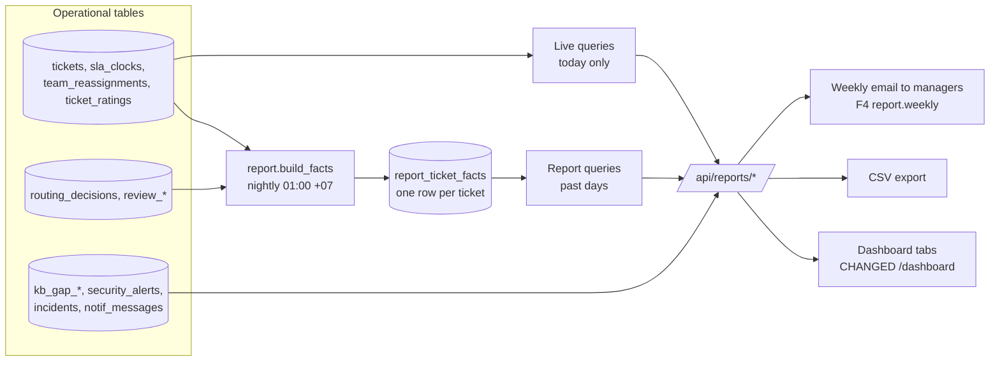

# 6. F10 Reporting — NEW + CHANGED

Should · Wave 4 (last: it reports on F1–F9).

## a. Problem & goal

`GET /api/metrics/dashboard` (`apps/metrics/utils.py`) returns four groups —
quality, HITL health, ops, business — computed live over a window. Gaps:

- `business_metrics.sla_compliance` = resolved before `sla_due_at`, a
  wall-clock date only `set_sla` writes. After F1 it would disagree with the
  real clocks.
- `automation_rate` counts every routing decision, shadow or live. In shadow
  mode it reports automation that never happened.
- Nothing per team, per person, per priority; no CSAT, no KB gaps, no
  security or incident numbers; no export.
- Everything is computed live over the whole window on each page load.

**Goal:** one reporting area that answers, per month and per team: did we
meet SLAs, who is overloaded, are reviewers really reviewing, where is the KB
weak, are requesters happy, is each branch ready to go live. Each KPI in §1.3
gets a defined query. Per-person numbers are visible only to people who
should see them.

**Benchmark:** ServiceNow's SLA dashboard shows % resolved and responded in
time and open-overdue counts, broken down by group, priority and category.
Freshservice's group report shows resolved %, first-contact resolution, SLA %
and CSAT. Moveworks reports coverage and precision. Adopt the SLA breakdowns
and team scorecards. Adapt with reviewer fatigue as a first-class report
(spec §11.1). Skip `automation_rate` as a target
([benchmark F10](benchmark.md#f10-reporting)).

## b. Process flow



## c. State changes

None on tickets. `report_ticket_facts` rows are rebuilt for any ticket that
changed since the last build (idempotent upsert).

## d. Use cases

| Field | UC-F10-01 · Review the month's SLA compliance |
|---|---|
| Actor | Manager (Huy), team lead (own team) |
| Trigger | Month end, weekly email |
| Preconditions | F1 clocks exist |
| Main flow | 1. Pick month. 2. See response % and resolution % (K1, K2) by team, priority, category; breaches warned in time (K3); open-overdue now. 3. Click a cell → tickets behind it. 4. Export CSV |
| Alternate | 1a. Team lead sees only their team |
| Exception | Technician → 403 for others' teams |
| Postconditions | — |
| Rules | BR-F10-01…04 |
| Screens | [`F10 · SLA report`](https://www.figma.com/design/KXpnlC78p9pHYRuZZuQxIL?node-id=17-1291) |
| MoSCoW | Should |

| Field | UC-F10-02 · Balance team workload |
|---|---|
| Actor | Team lead, manager |
| Trigger | Daily |
| Preconditions | F2 |
| Main flow | 1. Per member: open now, age buckets, resolved this week, time to assign (K4), reassignments in/out. 2. Team: reassignment rate (K5), unassigned now |
| Alternate | — |
| Exception | — |
| Postconditions | — |
| Rules | BR-F10-05 |
| Screens | [`F10 · Team report`](https://www.figma.com/design/KXpnlC78p9pHYRuZZuQxIL?node-id=17-1399) |
| MoSCoW | Should |

| Field | UC-F10-03 · Check reviewers aren't rubber-stamping |
|---|---|
| Actor | Manager; each reviewer sees their own row |
| Trigger | Weekly |
| Preconditions | ≥ 20 decisions by the reviewer in the window |
| Main flow | 1. Per reviewer: decisions, approve rate, median seconds per review, trend. 2. Rows over `alerts.reviewer_approve_rate_max` **and** under `alerts.reviewer_median_time_min_sec` are flagged |
| Alternate | — |
| Exception | Team lead → 403 (people management stays with the manager) |
| Postconditions | — |
| Rules | BR-F10-06 |
| Screens | [`F10 · Reviewer report`](https://www.figma.com/design/KXpnlC78p9pHYRuZZuQxIL?node-id=17-1631) |
| MoSCoW | Should |

| Field | UC-F10-04 · See KB health and gaps |
|---|---|
| Actor | `kb_editor`, manager |
| Trigger | Weekly |
| Preconditions | F6 |
| Main flow | 1. Refusal rate per week (REUSED metric), open gap clusters, gap closure after a page is published |
| Alternate | — |
| Exception | — |
| Postconditions | — |
| Rules | BR-F10-07 |
| Screens | [`F10 · KB report`](https://www.figma.com/design/KXpnlC78p9pHYRuZZuQxIL?node-id=17-1765) |
| MoSCoW | Should |

| Field | UC-F10-05 · Read requester satisfaction |
|---|---|
| Actor | Manager, team lead |
| Trigger | Monthly |
| Preconditions | F3 |
| Main flow | 1. Mean rating, response rate, distribution 1–5, by team and by "auto-replied vs handled by a person". 2. Read low-rated comments (masked) |
| Alternate | — |
| Exception | — |
| Postconditions | — |
| Rules | BR-F10-08 |
| Screens | [`F10 · CSAT report`](https://www.figma.com/design/KXpnlC78p9pHYRuZZuQxIL?node-id=17-1916) |
| MoSCoW | Should |

| Field | UC-F10-06 · Check rollout readiness |
|---|---|
| Actor | Manager, Head of IT Ops |
| Trigger | Before a P3/P4 request (F9) |
| Preconditions | Shadow decisions with reviewer outcomes |
| Main flow | 1. Per branch: shadow agreement, gate value, coverage (share of tickets the branch would take). 2. `automation_rate` shown as live and would-have, labelled "not a target" |
| Alternate | — |
| Exception | — |
| Postconditions | Same numbers F9 snapshots on approval |
| Rules | BR-F10-09, 10 |
| Screens | [`F10 · Rollout readiness`](https://www.figma.com/design/KXpnlC78p9pHYRuZZuQxIL?node-id=17-2028) (also embedded in [`F9 · Rollout`](https://www.figma.com/design/KXpnlC78p9pHYRuZZuQxIL?node-id=16-1179)) |
| MoSCoW | Should |

| Field | UC-F10-07 · Security and incident numbers |
|---|---|
| Actor | Security (security report); manager, incident manager (incident report) |
| Trigger | Monthly |
| Preconditions | F7, F8 |
| Main flow | Security: alerts by kind, ack time p50/p90 (K12), false-positive rate. Incidents: count, time to confirm, time to first broadcast (K13), unlink rate (detector precision) |
| Alternate | — |
| Exception | Manager sees security counts only (BR-F8-01) |
| Postconditions | — |
| Rules | BR-F10-05 |
| Screens | [`F10 · Security report`](https://www.figma.com/design/KXpnlC78p9pHYRuZZuQxIL?node-id=17-2164), [`F10 · Incident report`](https://www.figma.com/design/KXpnlC78p9pHYRuZZuQxIL?node-id=17-2311) |
| MoSCoW | Should |

## e. Business rules

| ID | Rule | Rationale | Enforced where |
|---|---|---|---|
| BR-F10-01 | SLA % counts clocks **stopped** in the period: met ÷ (met + breached-then-met), by `met_at` in `Asia/Ho_Chi_Minh` days. Running clocks appear only in "open-overdue". Cancelled clocks are excluded | Stable month numbers; no ticket counted twice | Facts query |
| BR-F10-02 | `business_metrics.sla_compliance` is redefined from F1 clocks (resolution); the old wall-clock formula is removed | One definition only | `apps/metrics/utils.py` CHANGED |
| BR-F10-03 | Tickets created before F1 (no clocks) are excluded from SLA % and shown as a count "no SLA data" | Honest denominators (A-08) | Facts query |
| BR-F10-04 | Linked incident tickets are reported separately and excluded from team SLA % | Their clocks were paused by design (BR-F7-07); the incident has its own target | Facts flag `linked_incident` |
| BR-F10-05 | Per-person rows: the manager sees all; a team lead sees their team; a person sees themself. Security details: `security` only | People data is need-to-know | Report endpoints |
| BR-F10-06 | A reviewer is flagged only with ≥ `reports.min_decisions_for_flag` (20) decisions in the window, using the existing `alerts.reviewer_approve_rate_max` (0.95) and `alerts.reviewer_median_time_min_sec` (10) | Spec §11.1; avoid flagging on 3 decisions | Report query (REUSED thresholds) |
| BR-F10-07 | Gap closure = refusals matching a cluster's centroid in the 4 weeks after its page was published ÷ the 4 weeks before | Shows whether writing the page helped | KB report task |
| BR-F10-08 | CSAT is reported for auto-replied and person-handled tickets separately | An AI answer and a technician are different services | Facts `auto_replied` |
| BR-F10-09 | `automation_rate` is shown twice — **live** (carried out) and **would-have** (shadow) — and labelled as not a target | Spec §11.1, §14; ADR-0006 erosion risk | UI and API field names |
| BR-F10-10 | Shadow agreement for a branch = shadow decisions of that branch whose review decision was `approve` (and, for `auto_route`, category not corrected) ÷ shadow decisions of that branch with a review decision | Same number F9's gate uses | Shared query function |

## f. Functional requirements

| ID | Requirement |
|---|---|
| FR-F10-001 | A nightly task shall upsert one `report_ticket_facts` row per ticket changed since the last run |
| FR-F10-002 | The system shall report SLA response and resolution compliance per month by team, priority and category, with drill-down to tickets |
| FR-F10-003 | The system shall report open-overdue clocks now, by team |
| FR-F10-004 | The system shall report per-member workload: open, age buckets (0–1, 1–3, 3–5, > 5 business days), resolved this week, time to assign median/p90, reassignments in/out |
| FR-F10-005 | The system shall report reassignment rate per team (K5) |
| FR-F10-006 | The system shall report reviewer decisions, approve rate, median time per review, with flags per BR-F10-06 |
| FR-F10-007 | The system shall report weekly refusal rate, open gap clusters, and gap closure |
| FR-F10-008 | The system shall report CSAT mean, response rate and distribution, split by auto-replied vs person-handled |
| FR-F10-009 | The system shall report per-branch shadow agreement, coverage, and `automation_rate` live and would-have |
| FR-F10-010 | The system shall report security alert counts, ack time p50/p90 and false-positive rate to `security` |
| FR-F10-011 | The system shall report incident count, time to confirm, time to first broadcast, unlink rate |
| FR-F10-012 | The system shall report notification delivery: in-app row latency p95, email hand-off p95, failure count (K8) |
| FR-F10-013 | Every report shall export as CSV with the same filters; exports are audited |
| FR-F10-014 | The system shall email a weekly summary (K1–K7) to managers every Monday 07:30 `Asia/Ho_Chi_Minh` |
| FR-F10-015 | The dashboard shall keep today's numbers live and read past days from the facts table |

## g. Data changes

**`report_ticket_facts` — NEW** (one row per ticket; writer: core-api nightly task)

| Field | Meaning |
|---|---|
| `ticket` FK unique, `created_day` (+07 date) | |
| `team`, `category`, `priority`, `source` | At resolution, or current if open |
| `handed_off_at`, `first_assigned_at`, `first_response_at`, `resolved_at` | UTC |
| `time_to_assign_business_min` | F1 business time from handoff to first assignment |
| `response_state`, `resolution_state` | `met` \| `breached` \| `running` \| `paused` \| `none` |
| `response_warned_in_time`, `resolution_warned_in_time` | For K3 |
| `reassign_count`, `cross_team_reassign_count` | From `team_reassignments` |
| `auto_replied`, `reopened`, `linked_incident` | bools |
| `csat_score` null, `csat_seq` | Latest rating |
| `shadow_branch` null, `review_action` null, `category_corrected` | For shadow agreement |
| `built_at` | |

**`thresholds.yaml` — CHANGED**

```yaml
reports:
  min_decisions_for_flag: 20
  list_page_size: 50
```

**`.env.example` — CHANGED:** `REPORT_FACTS_BUILD_HOUR=1` (local hour, +07).

**Migration:** backfill facts for all tickets once (pre-F1 tickets get
`response_state = none`). PII: none (masked subjects are not copied into
facts; drill-down reads `tickets`).

### Worked example — Access team, October 2026, resolution SLA

Facts rows (stopped resolution clocks with `met_at` in October):

| ticket | priority | resolution_state | linked_incident | counted? |
|---|---|---|---|---|
| `TKT-2026-000412` | P3 | met | no | yes — met |
| `TKT-2026-000415` | P3 | breached (met 2 h late) | no | yes — breached |
| `TKT-2026-000431` | P3 | met (auto-replied) | no | yes — met |
| `TKT-2026-000447` | P2 | met | no | yes — met |
| `TKT-2026-000442` | P1 | met | **yes** | no (BR-F10-04) |
| `TKT-2026-000301` | — | none (pre-F1) | no | no (BR-F10-03) |

Output:

```json
GET /api/reports/sla?month=2026-10&team=access
{ "team": "access", "month": "2026-10",
  "resolution": { "met": 3, "breached": 1, "compliance": 0.75 },
  "response":   { "met": 4, "breached": 0, "compliance": 1.0 },
  "breaches_warned_in_time": { "warned": 1, "breached": 1, "rate": 1.0 },
  "excluded": { "linked_incident": 1, "no_sla_data": 1 },
  "open_overdue_now": 0 }
```

### Worked example — reviewer flags, last 30 days

| reviewer | decisions | approved | approve_rate | median sec | flagged? |
|---|---|---|---|---|---|
| `duc.tm` | 212 | 205 | 0.967 | 7 | **yes** (> 0.95 and < 10 s) |
| `ha.vt` | 168 | 151 | 0.899 | 34 | no |
| `mai.bn` | 12 | 12 | 1.0 | 6 | no — below 20 decisions |

## h. API changes

| Method · Path | Role | Query | Response |
|---|---|---|---|
| `GET /api/reports/sla` | manager; lead (own team) | `month`, `team`, `priority`, `category` | as above |
| `GET /api/reports/sla/tickets` | same | same + `state` | ticket list (drill-down) |
| `GET /api/reports/teams/{slug}` | manager; lead (own); member (own row) | `from`, `to` | workload + reassignment |
| `GET /api/reports/reviewers` | manager; a reviewer gets only self | `days` | rows with flags |
| `GET /api/reports/kb` | kb_editor, manager | `weeks` | refusal trend, clusters, closure |
| `GET /api/reports/csat` | manager; lead (own team) | `month`, `team` | mean, rate, distribution, split |
| `GET /api/reports/rollout` | manager, security | `days` | per-branch agreement, coverage, automation live/would-have |
| `GET /api/reports/security` | security | `month` | counts, ack p50/p90, FP rate |
| `GET /api/reports/incidents` | manager, incident_manager | `month` | counts, times, unlink rate |
| `GET /api/reports/notifications` | manager, workflow_admin | `days` | latency p95, failures |
| any of the above + `.csv` | same | same | `text/csv` |
| `GET /api/metrics/dashboard` | CHANGED | — | `business.sla_compliance` from F1 clocks; NEW `business.automation_rate_live`, `business.automation_rate_would_have`; old `automation_rate` kept one release as an alias of `would_have`, then removed |

**Celery tasks**

| Task | Trigger | Idempotency |
|---|---|---|
| `report.build_facts` | beat, daily 01:00 +07 | Upsert by ticket; picks tickets with `updated_at`/clock/rating changes since the last `built_at` |
| `report.weekly_email` | beat, Monday 07:30 +07 | One F4 `report.weekly` event per week (unique key `report:YYYY-WW`) |

## i. Impact

- **Changes:** `apps/metrics/utils.py` `business_metrics` (SLA from clocks, automation split); dashboard page becomes tabs ([`F10 · Dashboard`](https://www.figma.com/design/KXpnlC78p9pHYRuZZuQxIL?node-id=19-2015) CHANGED); new facts table and nightly task.
- **Must not change:** existing quality and HITL metrics and their names (`reopen_rate_after_autoreply`, `override_rate`, `reroute_rate`, `refusal_rate`, `approve_rate_per_reviewer`), which the drift task and docs use; `alerts.*` thresholds reused, not copied.
- **ADRs:** spec §11.1 metric groups; 0006 (automation not a target).
- **Regression tests:** `test_sla_compliance_uses_clocks_not_sla_due_at`; `test_incident_tickets_excluded_from_team_sla`; `test_reviewer_flag_needs_min_decisions`; `test_lead_cannot_read_other_team`; `test_automation_rate_split_live_vs_shadow`; `test_facts_build_is_idempotent`; existing `apps/metrics/tests` unchanged except `sla_compliance`.

## j. Acceptance criteria

```gherkin
Feature: F10 Reporting

  @BR-F10-01 @BR-F10-02 @BR-F10-03
  Scenario: AC-F10-01 SLA compliance from clocks
    Given the six Access tickets in §g
    When "huy.pq" opens the SLA report for October 2026, team "access"
    Then resolution compliance is 0.75 from 3 met and 1 breached
    And 1 linked-incident ticket and 1 ticket without SLA data are listed as excluded

  @BR-F10-06
  Scenario: AC-F10-02 rubber-stamping is flagged, small samples are not
    Given the three reviewers in §g
    When "huy.pq" opens the reviewer report for 30 days
    Then only "duc.tm" is flagged

  @BR-F10-05
  Scenario: AC-F10-03 a lead sees only their team
    When "ha.vt" (Access lead) requests the team report for "network"
    Then the response is 403

  @BR-F10-05
  Scenario: AC-F10-04 a reviewer sees only themself
    When "ha.vt" opens the reviewer report
    Then exactly one row is returned, for "ha.vt"

  @BR-F10-09
  Scenario: AC-F10-05 automation is not inflated by shadow mode
    Given 100 routing decisions in the window, 40 auto_route in shadow and 0 carried out live
    When the dashboard loads
    Then automation_rate_live is 0.0 and automation_rate_would_have is 0.4

  @BR-F10-05
  Scenario: AC-F10-06 export matches the screen
    When "huy.pq" exports the SLA report for October as CSV
    Then the CSV totals equal the JSON totals
    And one audit row "report_exported" exists

  @BR-F10-04
  Scenario: AC-F10-07 incident tickets stay out of team SLA
    Given 23 network tickets are linked to "INC-2026-0007"
    When the SLA report for team "network" is built
    Then those 23 tickets are not in the team's SLA %
    And they appear in the incident report

  @BR-F10-07
  Scenario: AC-F10-08 gap closure compares four weeks before and after
    Given cluster "g-42-03" had 9 matching refusals in the 4 weeks before its page was published
    And 3 in the 4 weeks after
    Then the KB report shows gap closure 67 % for "g-42-03"

  @BR-F10-08
  Scenario: AC-F10-09 CSAT splits auto and person
    Given 61 ratings on auto-replied tickets averaging 4.1 and 212 on person-handled tickets averaging 4.4
    Then the CSAT report shows 4.1 and 4.4 on separate lines, never one blended number

  @BR-F10-10
  Scenario: AC-F10-10 shadow agreement uses the same query as the gate
    Given 248 shadow auto_route decisions with a review decision, 31 rerouted and 7 approved with a corrected category
    Then shadow agreement for auto_route is 210 / 248 = 84.7 %
    And F9 reads the same value
```
