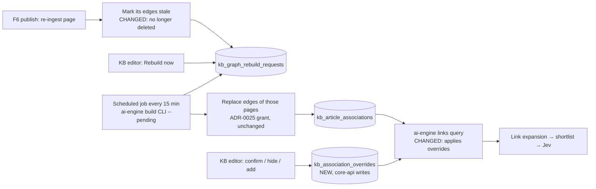

# 6. F11 Graph-based retrieval as a KB feature — CHANGED

Could · Wave 5 · Proposed ADR-0037. Lighter spec (accepted default for
Could features): no full use-case tables.

## a. Problem & goal

The entity graph is shipped as retrieval plumbing (ADR-0018, ADR-0025): an
offline DeepSeek build writes problem → fix pointers between pages into
`kb_article_associations`, and link expansion follows them from the
shortlister's top 3 pages. As a KB feature it has gaps:

1. **Edits erase a page's edges.** `ArticleIndexer.ingest` deletes every
   `entity_graph` row touching the article (`apps/kb/utils/indexing.py`).
   Edges come back only when an engineer re-runs the build CLI. After F6, every
   published edit would silently drop that page out of expansion.
2. **Nobody can see or correct the graph.** The `reviewed` column exists and
   is always `false`. A wrong edge (page A "points to" an unrelated fix) can
   only be fixed by changing the prompt and rebuilding.
3. **Its value isn't measured in production.** Retrieved chunks don't record
   whether they came from expansion, so nobody can say how many auto-replies
   expansion made possible.

LightRAG itself was measured and rejected for this KB: its shared-entity
graph reached recall@3 0.817 against the pointer graph's 0.900
(`TODO.md` item 12). "LightRAG-style" here means the graph idea, kept in the
pointer form that measured better.

**Goal:** edits keep their edges until rebuilt; rebuilds run on a schedule for
changed pages; KB editors can see each page's edges with their evidence, and
confirm, hide or add one; reports show expansion's contribution.

**Benchmark:** no product in the benchmark exposes a retrieval graph to KB
editors. LightRAG's dual-level retrieval and incremental update are the
reference; we adopt incremental update only ([benchmark F11](benchmark.md#f11-graph-based-retrieval)).

## b. Process flow



## c. State changes

Edge flags: `stale` (NEW) set on re-ingest of either page, cleared by the next
build; `reviewed` (existing) set by "confirm". Overrides: `hide` or `add`,
active until removed.

## d. Use cases (summary)

| ID | Actor | What | Rules |
|---|---|---|---|
| UC-F11-01 | kb_editor | Open a page's graph tab: outgoing and incoming edges, score, evidence (symptom → remedy pairs), build id, stale flag | BR-F11-02, 04 |
| UC-F11-02 | kb_editor | Confirm an edge (`reviewed = true`), hide an edge, or add a missing pointer with a reason | BR-F11-02, 03, 06 |
| UC-F11-03 | kb_editor, system | Request a rebuild for a page (button, or automatically on publish); see when it last ran | BR-F11-01, 05 |
| UC-F11-04 | manager, kb_editor | See graph health: pages with ≥ 1 edge, stale edges, hidden/added overrides, expansion contribution | BR-F11-04 |

Screens: [`F11 · Page graph`](https://www.figma.com/design/KXpnlC78p9pHYRuZZuQxIL?node-id=20-1874) (tab on [`F6 · KB editor`](https://www.figma.com/design/KXpnlC78p9pHYRuZZuQxIL?node-id=13-737)), [`F11 · Graph health`](https://www.figma.com/design/KXpnlC78p9pHYRuZZuQxIL?node-id=17-1912) (in [`F10 · KB report`](https://www.figma.com/design/KXpnlC78p9pHYRuZZuQxIL?node-id=17-1765)).

## e. Business rules

| ID | Rule | Rationale | Enforced where |
|---|---|---|---|
| BR-F11-01 | Re-ingesting a page marks its `entity_graph` edges `stale`; it no longer deletes them | An old pointer to a still-active fix page is better than none; the next build replaces it | `ArticleIndexer.ingest` (CHANGED) |
| BR-F11-02 | Only ai-engine's build inserts or deletes `entity_graph` rows; core-api only flips `stale` and `reviewed` on them (and keeps writing `authored_link` rows at ingest, as today). Editor corrections go to `kb_association_overrides`, which core-api writes and ai-engine only reads | Keeps ADR-0025's single writer per table | Grants |
| BR-F11-03 | A `hide` override removes the edge from expansion; an `add` override inserts it ranked first for its seed. Overrides survive rebuilds | Corrections must outlive the next build | ai-engine links query |
| BR-F11-04 | Edge scores and evidence never reach a threshold, the trust score, the router, or a requester | ADR-0018 decision 1, ADR-0002 | Unchanged |
| BR-F11-05 | Rebuilds call DeepSeek on KB text only, never ticket text | ADR-0019 | Build CLI |
| BR-F11-06 | Any change to how edges are followed passes the retrieval eval gate (recall@5 ≥ 0.90) before merge | CLAUDE.md rules 8, 9 | CI |

## f. Functional requirements

| ID | Requirement |
|---|---|
| FR-F11-001 | `ArticleIndexer.ingest` shall mark a page's `entity_graph` edges `stale` instead of deleting them, and create a rebuild request for the page |
| FR-F11-002 | The ai-engine build CLI shall accept `--pending`, rebuild only pages with pending requests, replace only those pages' edges, and mark the requests done |
| FR-F11-003 | A scheduled job shall run the CLI with `--pending` every `GRAPH_BUILD_INTERVAL_MIN` (15) |
| FR-F11-004 | The system shall show a page's edges with score, evidence, build id, stale and reviewed flags |
| FR-F11-005 | The system shall store `hide` and `add` overrides with reason and author, and ai-engine's link query shall apply them |
| FR-F11-006 | ai-engine shall report each shortlisted chunk's origin (`fused` or `expansion`) in the retrieval signals (wire change in both services, defaulted) |
| FR-F11-007 | The system shall report pages with edges, stale edges, overrides, and the share of auto-replies whose cited page came from expansion |
| FR-F11-008 | The system shall audit `kb_graph_edge_confirmed`, `kb_graph_override_added`, `kb_graph_override_removed`, `kb_graph_rebuild_requested` |

## g. Data changes

| Table | Status | Fields | Writer |
|---|---|---|---|
| `kb_article_associations` | CHANGED | NEW `stale` bool default false | ai-engine build writes rows; core-api (the table's owner) updates only `stale` and `reviewed` |
| `kb_association_overrides` | NEW | `source_article` FK, `target_article` FK, `action` (`hide` \| `add`), `reason`, `created_by`, `created_at`. Unique (`source_article`, `target_article`) | core-api |
| `kb_graph_rebuild_requests` | NEW | `article` FK, `requested_by` null, `reason` (`publish` \| `manual`), `state` (`pending` \| `done` \| `failed`), `requested_at`, `done_at`, `build_id` | core-api inserts; ai-engine build updates state |
| `ai_engine_ro` grants | CHANGED | SELECT on `kb_association_overrides`; SELECT, UPDATE(`state`, `done_at`, `build_id`) on `kb_graph_rebuild_requests` | `infra/migrations/sql/0008_graph_feature_grants.sql` |

Sample edges for `client-vpn-user.windows-troubleshooting` (seed):

| target | score | evidence (first pair) | stale | reviewed | override |
|---|---|---|---|---|---|
| `client-vpn-user.common-troubleshooting` | 3 | "TLS handshake failed" → "re-download the configuration file" | no | yes | — |
| `workspaces-user.client_troubleshooting` | 1 | "client can't connect" → "check the client version" | no | no | **hide** — "Không liên quan VPN" |

Wire change (rule 4, both services): retrieved-chunk entries gain
`origin: "fused" | "expansion"` with default `"fused"`.

## h. API changes

| Method · Path | Role | Request | Response | Errors |
|---|---|---|---|---|
| `GET /api/kb/{slug}/graph` | kb_editor, manager | — | `{outgoing[], incoming[], last_build, pending_request}` | 404 |
| `POST /api/kb/{slug}/graph/edges/{target}/confirm` | kb_editor | — | edge | 404 |
| `POST /api/kb/{slug}/graph/overrides` | kb_editor | `{target, action, reason}` | override | 409 `override_exists` · 422 `self_edge` |
| `DELETE /api/kb/{slug}/graph/overrides/{target}` | kb_editor | `{reason}` | 204 | — |
| `POST /api/kb/{slug}/graph/rebuild` | kb_editor, manager | — | request | 409 `already_pending` |
| `GET /api/reports/kb` | CHANGED (F10) | — | adds graph health block | — |

No Celery task (the build is ai-engine's scheduled CLI). No webhook event.

## i. Impact

- **Changes:** ingest stops deleting edges; build CLI gains `--pending`; ai-engine link query applies overrides; one wire field; two grants.
- **Must not change:** single source followed at a time (`ASSOCIATION_SOURCE`); scores never thresholded (ADR-0005, 0018); triage never writes (ADR-0025 scope); the eval gates.
- **Regression tests:** `test_ingest_marks_edges_stale_not_deleted`; `test_hide_override_survives_rebuild`; `test_add_override_ranks_first`; `test_triage_writes_nothing`; retrieval suite recall@5 unchanged with no overrides present.

## j. Acceptance criteria

```gherkin
Feature: F11 Graph retrieval as a KB feature

  Scenario: AC-F11-01 a publish keeps edges until the rebuild
    Given "client-vpn-user.windows-troubleshooting" has 4 entity_graph edges
    When an edit of that page is published
    Then the page still has 4 edges, all stale
    And one pending rebuild request exists
    When the scheduled build runs
    Then the page's edges are replaced and none is stale

  Scenario: AC-F11-02 a hidden edge stays hidden after a rebuild
    Given "mai.bn" hid the edge to "workspaces-user.client_troubleshooting"
    When the build rewrites the page's edges, including that one
    Then link expansion from the page does not return "workspaces-user.client_troubleshooting"

  Scenario: AC-F11-03 overrides don't move the eval gate
    Given no overrides exist
    When the retrieval suite runs
    Then recall@5 is at least 0.90
```
