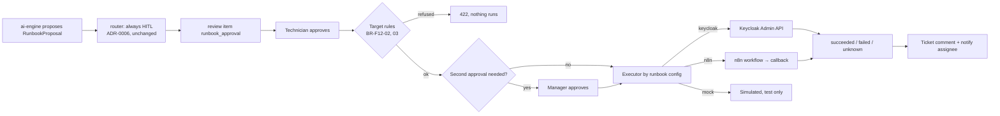

# 6. F12 ITSM / IAM integration and n8n workflows — NEW + CHANGED

Could · Wave 5 · Proposed ADR-0038 · SSO moved to F13. Lighter spec
(accepted default for Could features).

## a. Problem & goal

`apps/itsm_mock` holds a hard-coded `RUNBOOK_REGISTRY` of three runbooks
(`RB-RESET-PASSWORD`, `RB-GRANT-ACCESS`, `RB-RESTART-SERVICE`).
`RunbookExecution.objects.execute` checks for an approving review decision
(ADR-0006) and returns `{"simulated": true}`. Nothing real happens. Separately,
the lifecycle can already call n8n with a signed callback
(`TriggerN8n`, ADR-0028), but no runbook uses it.

Two risks the mock hides, which a real connector would expose:

- **Who is the target?** The LLM proposes `draft_payload.target_username`. A
  requester could ask "reset the password of `huy.pq`". Approval by a
  technician is the only check.
- **What if it half-works?** A real reset can time out after it happened.

**Goal:** runbooks run for real through pluggable executors — Keycloak Admin
API for identity actions, n8n for everything else — still only after a
person approves (ADR-0006), with target rules that don't depend on the
reviewer noticing, and with honest "unknown" outcomes.

**Benchmark:** Moveworks sits on top of an existing ITSM and syncs tickets;
the ITSM products are the system of record. Here Smart Ticket is the system
of record, so we reverse it: one executor interface, `itsm_mock` kept as its
test double; n8n through the existing action; identity actions only as
runbooks through HITL ([benchmark F12](benchmark.md#f12-itsm--iam-integration-n8n)).

## b. Process flow



## c. State changes

`runbook_executions.state` (NEW): `queued` → `running` → `succeeded` |
`failed` | `unknown` (timeout after the request was sent). `unknown` is never
retried automatically; a person checks and marks it.

## d. Use cases (summary)

| ID | Actor | What | Rules |
|---|---|---|---|
| UC-F12-01 | Technician (+ manager for high-risk runbooks) | Approve a runbook proposal; the system checks target rules, runs it, records the outcome on the ticket | BR-F12-01…06 |
| UC-F12-02 | Technician | Resolve an `unknown` outcome: check the target system, mark `succeeded` or `failed` with a note | BR-F12-06 |
| UC-F12-03 | `workflow_admin` drafts, manager approves | Add or change a runbook: code, title, executor, config, required fields, target rule, risk | BR-F12-05, 08 |
| UC-F12-04 | System | n8n calls back with the result (REUSED lifecycle callback pattern, one-time token) | BR-F12-07 |

Screens: `F12 · Runbook approval` (CHANGED `review/[id]` runbook panel),
`F12 · Runbook catalog`.

## e. Business rules

| ID | Rule | Rationale | Enforced where |
|---|---|---|---|
| BR-F12-01 | A runbook runs only with an approving decision on its `runbook_approval` item, by staff (PRE-1 FR-PRE1-005). No flag or threshold skips this | ADR-0006 | `RunbookExecution.objects.execute` (kept) |
| BR-F12-02 | Self-service runbooks (`target_rule = reporter`) may target only the ticket's reporter: `target_username` must equal `ticket.reporter.username`, whatever the proposal says | A requester can't get someone else's password reset by asking | Executor pre-check |
| BR-F12-03 | `risk = high` runbooks (e.g. grant access) need a second approval by a manager who is not the first approver | Two-person rule for privilege changes | Execution service |
| BR-F12-04 | The proposal's `draft_payload` is shown to the approver and can be edited before approval; the executed payload is what the approver saw, stored with the execution | The LLM proposes; a person decides what runs | Review UI + execution row |
| BR-F12-05 | Identity actions never handle passwords: reset = Keycloak `execute-actions-email` (`UPDATE_PASSWORD`); unlock = clear brute-force lock; access = add to a pre-listed group | No secret passes through Smart Ticket | Keycloak executor |
| BR-F12-06 | A timeout after sending is `unknown`, never retried automatically | Reset twice is harmless; grant twice or restart twice may not be | Executor |
| BR-F12-07 | n8n runbooks reuse `TriggerN8n`'s allow-list, signed callback, and one-time token | ADR-0028 §6 and amendment | Executor |
| BR-F12-08 | The runbook catalog is data; changes need a manager approval and are audited | Runbooks are powerful; config is as sensitive as code | Catalog API |

## f. Functional requirements

| ID | Requirement |
|---|---|
| FR-F12-001 | The system shall store runbooks as data: code, title, executor (`keycloak` \| `n8n` \| `mock`), config, required fields, target rule, risk, active |
| FR-F12-002 | The system shall migrate the three registry entries into the catalog with executor `mock` |
| FR-F12-003 | The system shall check BR-F12-02 and BR-F12-03 before any executor runs |
| FR-F12-004 | The Keycloak executor shall support `send_password_reset`, `unlock_account`, `add_to_group` (from an allow-list), using a service account with only the needed realm-management roles |
| FR-F12-005 | The n8n executor shall start a workflow and accept its callback, with timeout → `unknown` |
| FR-F12-006 | The system shall record each execution's payload, approver(s), executor, state, external reference, timings and error, and post a ticket comment |
| FR-F12-007 | The system shall let a technician resolve `unknown` executions with a note |
| FR-F12-008 | The system shall audit `runbook_approved`, `runbook_executed`, `runbook_failed`, `runbook_unknown`, `runbook_resolved`, `runbook_catalog_changed` |

## g. Data changes

| Table | Status | Fields |
|---|---|---|
| `itsm_runbooks` | NEW | `code` unique, `title`, `executor`, `config` JSON (n8n URL, or Keycloak action + allowed groups), `required_fields`, `target_rule` (`reporter` \| `any`), `risk` (`low` \| `high`), `is_active`, `approved_by`, `approved_at` |
| `runbook_executions` | CHANGED | NEW `runbook` FK, `state`, `executed_payload`, `second_approver` null, `external_ref`, `started_at`, `finished_at`, `error`, `resolved_by`, `resolution_note`, `idempotency_key` unique (`review_item:attempt`). `result` kept |
| `RUNBOOK_REGISTRY` | REMOVED after migration | — |

Seed after migration (then edited by `workflow_admin`, approved by a manager):

| code | executor | target_rule | risk | config |
|---|---|---|---|---|
| `RB-RESET-PASSWORD` | keycloak | reporter | low | `{"action":"send_password_reset"}` |
| `RB-UNLOCK-ACCOUNT` | keycloak | reporter | low | `{"action":"unlock_account"}` |
| `RB-GRANT-ACCESS` | keycloak | any | high | `{"action":"add_to_group","allowed_groups":["/apps/jira-users","/apps/vpn-users"]}` |
| `RB-RESTART-SERVICE` | n8n | any | high | `{"url":"https://n8n.congty.vn/webhook/restart-service"}` |

Execution record (Lan asked to reset her own access-portal password):

| field | value |
|---|---|
| runbook | `RB-RESET-PASSWORD` |
| executed_payload | `{"target_username":"lan.nt"}` |
| approver | `ha.vt` |
| state | `succeeded` |
| external_ref | Keycloak user `3f9b2c41-…0a12`, action `UPDATE_PASSWORD` email sent |

Refused case: proposal `{"target_username":"huy.pq"}` on Lan's ticket → 422
`target_not_reporter`, nothing sent.

**`.env.example` — CHANGED:** `ITSM_EXECUTOR_TIMEOUT_SEC=30`. Keycloak admin
credentials reuse F13's `KEYCLOAK_ADMIN_*` (separate client recommended,
OQ-25).

## h. API changes

| Method · Path | Role | Request | Response | Errors |
|---|---|---|---|---|
| `POST /api/itsm/review-items/{id}/execute` | CHANGED: technician, manager | `{payload}` (edited by the approver) | execution | 422 `target_not_reporter` / `missing_fields` · 409 `second_approval_required` · 403 |
| `POST /api/itsm/executions/{id}/second-approval` | manager ≠ first approver | — | execution | 403 `self_approval` |
| `POST /api/itsm/executions/{id}/resolve` | technician, manager | `{state, note}` | execution | 409 `not_unknown` |
| `GET /api/itsm/runbooks` | CHANGED: from catalog | — | runbooks | — |
| `POST/PATCH /api/itsm/runbooks`, `/approve` | workflow_admin (draft), manager (approve) | runbook fields | runbook | 422 `group_not_allowed` |
| `POST /api/itsm/executions/{id}/callback` | n8n with one-time token | `{state, external_ref, error}` | 204 | 403 `bad_callback_token` |

Celery: `itsm.execute(execution_id)` — runs the executor; idempotent by
`idempotency_key`; a row past `queued` is never re-sent.

**Out of scope this phase (OQ-24):** mirroring tickets to an external ITSM
(ServiceNow, Jira). If needed later, it fits as an n8n flow on F4 webhook
events plus a status callback, with no new core-api surface.

## i. Impact

- **Changes:** runbook registry becomes data; execution becomes real and asynchronous; execute endpoint takes the approver's payload.
- **Must not change:** ADR-0006 (router always HITL for runbooks; second check in `execute`); `RunbookProposal` handling in the router; no runbook rollout flag (F9 BR-F9-10).
- **Regression tests:** `test_runbook_never_runs_without_approval` (kept); `test_reset_targets_only_the_reporter`; `test_high_risk_needs_second_manager`; `test_timeout_after_send_is_unknown_not_retried`; `test_mock_executor_matches_old_behaviour`.

## j. Acceptance criteria

```gherkin
Feature: F12 Runbook executors

  Scenario: AC-F12-01 reset only for the reporter
    Given Lan's ticket has a RunbookProposal RB-RESET-PASSWORD with target_username "huy.pq"
    When "ha.vt" approves and executes it
    Then the response is 422 with code "target_not_reporter"
    And Keycloak receives no request

  Scenario: AC-F12-02 a real reset sends the Keycloak action email
    Given the target_username is "lan.nt", the reporter
    When "ha.vt" approves and executes
    Then Keycloak receives execute-actions-email UPDATE_PASSWORD for Lan's sub
    And the execution is "succeeded" with a ticket comment

  Scenario: AC-F12-03 grant access needs a second manager
    Given an approved RB-GRANT-ACCESS for group "/apps/vpn-users"
    When "duc.tm" executes it
    Then the response is 409 with code "second_approval_required"
    When "huy.pq" gives the second approval
    Then the user is added to "/apps/vpn-users"

  Scenario: AC-F12-04 an n8n timeout is unknown
    Given RB-RESTART-SERVICE is approved by two people
    When n8n accepts the call but never calls back within 30 seconds
    Then the execution is "unknown" and no second call is sent
```
