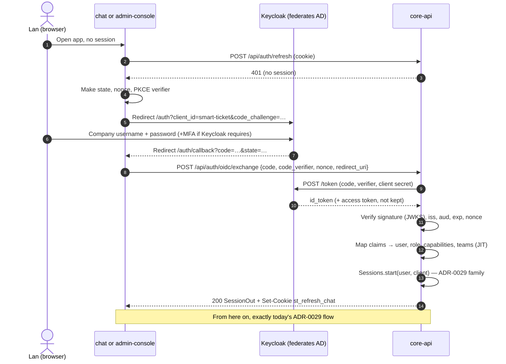
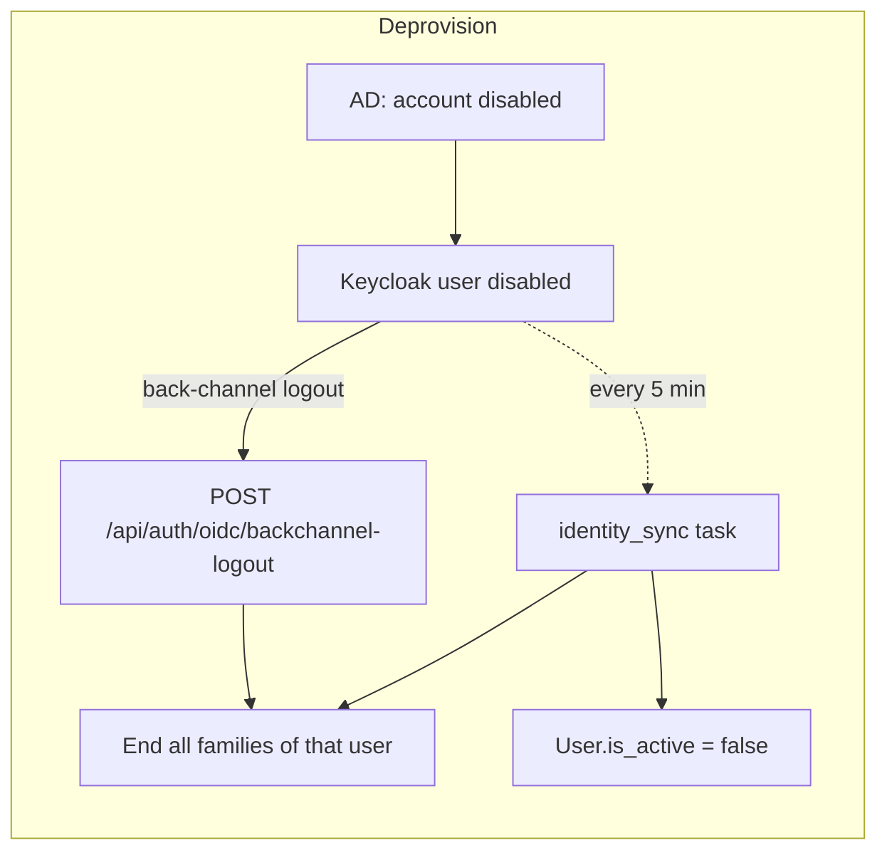

# 6. F13 Identity via Keycloak — NEW + CHANGED

Must (confirmed 2026-10-17) · Wave 1 · Proposed ADR-0032 · Builds on ADR-0029.

## a. Problem & goal

People sign in with a username and password that someone created in a Django
shell (README step 3). There is no directory link, no lockout after failed
passwords (ADR-0029 "Not done"), and leaving the company doesn't end access
unless someone remembers to deactivate the account.

**Goal:** both apps sign in through Keycloak (OIDC). core-api creates the user
on first sign-in, takes role, capabilities and teams from Keycloak, and keeps
issuing **its own** session exactly as ADR-0029 does, so `SessionAuth`'s
one-query, immediate revocation stays. Disabling someone in the directory
ends every session within 5 minutes (K11).

**Benchmark:** ServiceNow auto-provisions users and groups at SSO sign-in and
keeps a local fallback; Keycloak federates AD, maps roles and groups into
tokens with mappers, and locks accounts after repeated failures. Adopt OIDC
code + PKCE, JIT provisioning, claims mapping, Keycloak lockout. Adapt: core-api
keeps the session; local login only for break-glass accounts
([benchmark F13](benchmark.md#f13-identity-via-keycloak)).

## b. Process flow





## c. State changes

User account states (NEW, on `accounts_user`):

| From | Event | To |
|---|---|---|
| — | First OIDC sign-in with a valid primary role | `active`, `auth_source=oidc` |
| `active` | Sync or back-channel finds the Keycloak user disabled or without client access | `inactive`; all families revoked (`revoke_reason=idp_deprovisioned`) |
| `inactive` | Next OIDC sign-in with access restored | `active` |
| `active` | Sync finds a changed primary role or capability | `active`, new role; all families revoked so the next sign-in carries new rights |

## d. Use cases

| Field | UC-F13-01 · Sign in with the company account |
|---|---|
| Actor | Any person (employee, technician, manager, security) |
| Trigger | Opens either app without a session |
| Preconditions | Keycloak reachable; user enabled; has at least one `smart-ticket` client role |
| Main flow | 1. App redirects to Keycloak with PKCE. 2. User signs in. 3. App sends code to core-api. 4. core-api verifies the ID token. 5. core-api finds the user by `external_id` (= `sub`); not found → links or creates (UC-F13-02). 6. Applies role, capabilities, teams. 7. Starts an ADR-0029 session. 8. App lands on the page the user asked for |
| Alternate | 5a. Existing local user with the same **verified** email and no `external_id` → linked, audited `identity_linked` |
| Exception | 4x. Bad signature, wrong `iss`/`aud`, expired, nonce mismatch → 401 `oidc_token_invalid`. 6x. No primary role → 403 `no_access`. 6y. Two or more primary roles → 403 `ambiguous_role`, `security_alert`. 3x. Keycloak unreachable → 502 `idp_unavailable` |
| Postconditions | One `auth_login` audit row with `method: "oidc"` |
| Rules | BR-F13-01…06 |
| Screens | `F13 · Sign-in` (CHANGED both apps' `/login`), `F13 · Sign-in error` |
| MoSCoW | Must |

| Field | UC-F13-02 · First sign-in creates the user (JIT) |
|---|---|
| Actor | System |
| Trigger | UC-F13-01 step 5 finds no user |
| Preconditions | Claims mapped without error |
| Main flow | 1. Create `accounts_user` with `username=preferred_username`, `email`, `first_name/last_name` from `name`, `external_id=sub`, `auth_source=oidc`, unusable password. 2. Write capabilities and team memberships. 3. Audit `identity_provisioned` |
| Alternate | 1a. `preferred_username` taken by another user → username `preferred_username-<4 chars of sub>`, audited |
| Exception | — |
| Postconditions | User exists; can be assigned (F2), notified (F4) |
| Rules | BR-F13-02, 03 |
| Screens | — |
| MoSCoW | Must |

| Field | UC-F13-03 · Leaver loses access |
|---|---|
| Actor | System (Keycloak back-channel, sync task) |
| Trigger | User disabled in AD → Keycloak, or removed from all `smart-ticket` roles |
| Preconditions | Keycloak back-channel logout configured to core-api |
| Main flow | 1. Keycloak posts a logout token. 2. core-api verifies it, finds the user by `sub`, revokes every family (ADR-0029 decision 5), audits `auth_backchannel_logout`. 3. Within `identity.sync_interval_minutes`, `identity_sync` sees the user disabled → `is_active=false`, audits `identity_deactivated` |
| Alternate | 1a. Back-channel not delivered → step 3 alone ends sessions within the interval |
| Exception | 3x. Keycloak admin API down → task logs, retries next interval, `identity_sync_failed` audit after 3 failures in a row; no user is deactivated on a failed read |
| Postconditions | Next API call with that user's token → 401 |
| Rules | BR-F13-04, 05, 08 |
| Screens | — |
| MoSCoW | Must |

| Field | UC-F13-04 · Break-glass sign-in |
|---|---|
| Actor | Holder of a break-glass account (`manager` role) |
| Trigger | Keycloak down, or an IdP misconfiguration locks everyone out |
| Preconditions | Account has `is_break_glass=true` |
| Main flow | 1. Opens `/login?local=1`. 2. Username + password via today's `POST /api/auth/login`. 3. Session starts; `security_alert` audit + mandatory notification to `security` (F4) |
| Alternate | — |
| Exception | 2x. Not a break-glass account → 403 `local_login_disabled`. 2y. 5 failures in 15 min → 423 `account_locked` for 15 min |
| Postconditions | Every break-glass use is visible to security |
| Rules | BR-F13-06 |
| Screens | `F13 · Break-glass sign-in` |
| MoSCoW | Must |

## e. Business rules

| ID | Rule | Rationale | Enforced where |
|---|---|---|---|
| BR-F13-01 | Keycloak authenticates; core-api issues the session. No Keycloak token reaches the browser except the one-time code; core-api keeps no Keycloak token after the exchange | Keeps ADR-0029's immediate revocation and httpOnly cookie; nothing extra to steal | `OidcSignIn.exchange()` |
| BR-F13-02 | Primary role = the one `smart-ticket` client role among `employee`, `technician`, `manager`, `security`. Zero → refused. More than one → refused and alerted | One role per user is today's model (`User.role`); guessing a precedence would quietly grant power | Claims mapper |
| BR-F13-03 | Capabilities = client roles among `workflow_admin`, `kb_editor`, `incident_manager`. Teams = groups under `/it/<team>`; `/it/<team>/lead` = lead. Unknown roles and groups are ignored and logged | Proposed ADR-0031 | Claims mapper |
| BR-F13-04 | Users are identified by `sub` (`external_id`), never by username or email after linking | Usernames change; `sub` doesn't | Model unique constraint |
| BR-F13-05 | Role or capability lost in Keycloak → all sessions revoked at the next sync, so the next sign-in carries the new rights | Rights must not outlive their grant by more than one sync interval | `identity_sync` |
| BR-F13-06 | Local password sign-in only for ≤ `identity.max_break_glass_accounts` (2) accounts flagged `is_break_glass`, role `manager`. Every use alerts security | OQ-11 default | `Sessions.login`, DB check |
| BR-F13-07 | Roles, capabilities and teams of `oidc` users can't be edited in core-api; Keycloak is the source | One source of truth | Admin endpoints refuse with `managed_by_idp` |
| BR-F13-08 | A failed read of Keycloak never deactivates anyone | Degrade toward people keeping access briefly, not toward mass lockout; revocation still comes from back-channel | `identity_sync` |

## f. Functional requirements

| ID | Requirement |
|---|---|
| FR-F13-001 | Both apps shall start sign-in with an OIDC authorization-code request using PKCE (S256), `state` and `nonce` |
| FR-F13-002 | core-api shall exchange the code with Keycloak as a confidential client and verify the ID token's signature (RS256, keys from JWKS cached for `OIDC_JWKS_CACHE_SEC`), `iss`, `aud`, `exp` (60 s skew), and `nonce` |
| FR-F13-003 | core-api shall find the user by `sub`, else link a local user with the same verified email and no `sub`, else create one |
| FR-F13-004 | core-api shall set role, capabilities and team memberships from the claims at every sign-in |
| FR-F13-005 | core-api shall start the session through the same `Sessions` service as password sign-in (one family, httpOnly cookie per `X-Auth-Client`) |
| FR-F13-006 | core-api shall accept Keycloak back-channel logout tokens and revoke every live family of that user |
| FR-F13-007 | A Celery beat task shall compare active `oidc` users with Keycloak every `identity.sync_interval_minutes` and deactivate, change rights, or revoke sessions as BR-F13-05 says |
| FR-F13-008 | `POST /api/auth/login` shall refuse users who are not break-glass with 403 `local_login_disabled` |
| FR-F13-009 | core-api shall lock a break-glass account for `identity.local_lockout_minutes` after `identity.local_max_failures` failures |
| FR-F13-010 | The system shall audit `auth_login` (with `method`), `identity_provisioned`, `identity_linked`, `identity_rights_changed`, `identity_deactivated`, `auth_backchannel_logout`, `identity_sync_failed` |
| FR-F13-011 | `GET /api/accounts/me` shall return capabilities and team memberships |
| FR-F13-012 | Both apps shall show a sign-in error page that names the reason code in vi and en |

## g. Data changes

**`accounts_user` — CHANGED**

| Field | Change | Notes |
|---|---|---|
| `external_id` | NEW varchar(64), unique, null | Keycloak `sub` |
| `auth_source` | NEW `local` \| `oidc`, default `local` | Existing rows stay `local` |
| `is_break_glass` | NEW bool, default false | CHECK: true only if `role='manager'` |
| `rights_synced_at` | NEW timestamptz, null | Last claims or sync apply |
| `failed_logins`, `locked_until` | NEW int default 0, timestamptz null | Break-glass only |

**`accounts_user_capabilities` — NEW**

| Field | Type |
|---|---|
| `user` | FK user, CASCADE |
| `capability` | varchar(30): `workflow_admin`, `kb_editor`, `incident_manager` |
| `source` | `keycloak` \| `local` |
| `granted_at` | timestamptz |

Unique (`user`, `capability`). Team memberships are F2's `team_memberships`;
F13 writes them for `oidc` users.

Migration: add columns nullable; existing users keep `auth_source=local`.
After cut-over, a management command `identity_link_report` lists local users
with no `sub` so they can be linked or deactivated. PII: `email` and names
already exist on the table; no new PII.

**Settings — `.env.example` (operational)**

```
OIDC_ISSUER_URL=https://sso.congty.vn/realms/congty
OIDC_CLIENT_ID=smart-ticket
OIDC_CLIENT_SECRET=change-me
OIDC_REDIRECT_URIS=http://localhost:3000/auth/callback,http://localhost:3001/auth/callback
OIDC_JWKS_CACHE_SEC=600
OIDC_HTTP_CONNECT_TIMEOUT_SEC=3
OIDC_HTTP_READ_TIMEOUT_SEC=10
KEYCLOAK_ADMIN_CLIENT_ID=smart-ticket-sync
KEYCLOAK_ADMIN_CLIENT_SECRET=change-me
```

**`thresholds.yaml` — CHANGED**

```yaml
identity:
  sync_interval_minutes: 5
  local_max_failures: 5
  local_lockout_minutes: 15
  max_break_glass_accounts: 2
```

**Records, stage by stage** (Lan's first sign-in)

1 · ID token claims core-api verified:

```json
{ "iss": "https://sso.congty.vn/realms/congty", "aud": "smart-ticket",
  "sub": "3f9b2c41-7d0e-4a8e-9c55-1b2e8f6d0a12", "nonce": "q8Zr…",
  "preferred_username": "lan.nt", "email": "lan.nt@congty.vn", "email_verified": true,
  "name": "Nguyễn Thị Lan",
  "resource_access": { "smart-ticket": { "roles": ["employee"] } },
  "groups": ["/finance"] }
```

2 · Mapped (in memory):

```json
{ "role": "employee", "capabilities": [], "teams": [], "ignored_groups": ["/finance"] }
```

3 · Rows written:

| table | row |
|---|---|
| `accounts_user` | username `lan.nt` · email `lan.nt@congty.vn` · role `employee` · external_id `3f9b2c41-…0a12` · auth_source `oidc` · rights_synced_at 2026-10-17 04:10 UTC |
| `accounts_refresh_sessions` | user `lan.nt` · client `chat` · family `a1c0…` · token_hash `9d2e…` (ADR-0029, unchanged) |
| `audit_log` | `identity_provisioned` · `auth_login` `{"method":"oidc","client":"chat"}` |

## h. API changes

| Method · Path | Auth | Request | Response | Errors |
|---|---|---|---|---|
| `GET /api/auth/oidc/config` | none | — | `{issuer, client_id, authorize_url, scopes}` | — |
| `POST /api/auth/oidc/exchange` | none; `X-Auth-Client` | `{code, code_verifier, nonce, redirect_uri}` | 200 `SessionOut` (+ cookie) — same shape as `/login` | 400 `redirect_uri_not_allowed` · 401 `oidc_token_invalid` · 403 `no_access` / `ambiguous_role` · 502 `idp_unavailable` |
| `POST /api/auth/oidc/backchannel-logout` | Keycloak signed logout token | form `logout_token` | 200 | 400 `logout_token_invalid` |
| `POST /api/auth/login` | none | unchanged | unchanged | **NEW** 403 `local_login_disabled` · 423 `account_locked` |
| `GET /api/accounts/me` | any | — | **CHANGED** adds `capabilities: [str]`, `teams: [{team, role}]`, `auth_source` | — |

`SessionOut.user` gets the same three fields. TS types regenerated (`make types`).

**Celery:** `apps.accounts.tasks.identity_sync` — beat every
`identity.sync_interval_minutes`. Idempotent: it compares and applies desired
state; running twice changes nothing the second time. Holds a Postgres
advisory lock so two workers don't sync at once.

No webhook events.

## i. Impact

- **Changes:** sign-in page in both apps; `Sessions.login` split into "check credentials" and `Sessions.start`; local login refused for most users.
- **Must not change:** ADR-0029 refresh rotation, reuse detection, cookie per app, `SessionAuth`'s live-family check; `X-Auth-Client`.
- **ADRs:** 0029 (built on), proposed 0031 (capabilities), proposed 0032 (this design).
- **Regression tests:** all of `apps/accounts/tests/` still pass with sessions started by OIDC; `test_token_without_live_family_is_refused` unchanged; `test_backchannel_logout_revokes_all_families`; `test_failed_keycloak_read_deactivates_nobody`; `test_two_primary_roles_refused`; `test_break_glass_only_manager`.
- **Ops:** Keycloak realm config (client, mappers, back-channel URL, brute-force detection) is documented in a new `docs/runbooks/keycloak.md`.

## j. Acceptance criteria

```gherkin
Feature: F13 Keycloak identity

  Scenario: AC-F13-01 first sign-in creates the user
    Given no core-api user has external_id "3f9b2c41-7d0e-4a8e-9c55-1b2e8f6d0a12"
    When Lan completes Keycloak sign-in from the chat app with client role "employee"
    Then a user "lan.nt" exists with role "employee" and auth_source "oidc"
    And a refresh cookie "st_refresh_chat" is set
    And audit rows "identity_provisioned" and "auth_login" exist

  Scenario: AC-F13-02 rights come from Keycloak
    Given Đức has client roles "technician" and "incident_manager" and groups "/it/network/lead", "/it/hardware"
    When Đức signs in to the admin console
    Then GET /api/accounts/me returns role "technician", capabilities ["incident_manager"]
    And teams [{"team":"network","role":"lead"},{"team":"hardware","role":"member"}]

  Scenario: AC-F13-03 no client role, no access
    Given a Keycloak user with no "smart-ticket" client role
    When they complete Keycloak sign-in
    Then the exchange returns 403 with code "no_access"
    And no core-api user is created

  Scenario: AC-F13-04 two primary roles are refused and alerted
    Given a Keycloak user with client roles "technician" and "manager"
    When they complete Keycloak sign-in
    Then the exchange returns 403 with code "ambiguous_role"
    And one audit row "security_alert" exists

  Scenario: AC-F13-05 leaver loses access within 5 minutes
    Given Đức has a live admin-console session
    When Đức is disabled in AD and Keycloak sends a back-channel logout
    Then Đức's next API call returns 401
    And when back-channel is not delivered, the call returns 401 within 5 minutes

  Scenario: AC-F13-06 Keycloak down does not end existing sessions
    Given Lan has a live chat session
    And Keycloak is unreachable
    When Lan's app refreshes its access token
    Then the refresh succeeds
    And a new person opening the app sees the sign-in error "idp_unavailable"

  Scenario: AC-F13-07 local login is closed to normal users
    When "duc.tm" posts username and password to /api/auth/login
    Then the response is 403 with code "local_login_disabled"

  Scenario: AC-F13-08 break-glass use alerts security
    Given "breakglass1" is a manager with is_break_glass true
    When "breakglass1" signs in with the correct password
    Then the session starts
    And "anh.lh" receives a mandatory notification "Break-glass sign-in"

  Scenario: AC-F13-09 a forged ID token is refused
    When the exchange receives an ID token signed by an unknown key
    Then the response is 401 with code "oidc_token_invalid"

  Scenario: AC-F13-10 failed sync deactivates nobody
    Given the Keycloak admin API returns 503
    When identity_sync runs
    Then no user changes is_active
    And after 3 failures in a row one audit row "identity_sync_failed" exists
```
