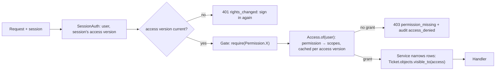
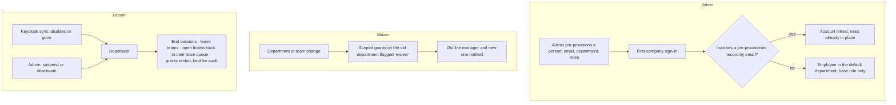
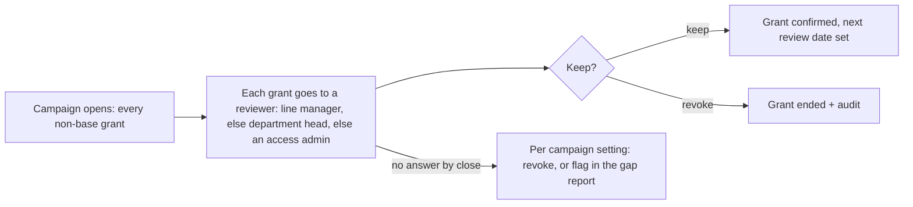

# 6. F14 People, departments and access (RBAC) — NEW + CHANGED

**Status:** Proposed (2026-11-05). Needs the owner's acceptance, and the
Information Security Officer's sign-off on §e and §i.
**ADR:** [ADR-0045](../../adr/0045-roles-are-permission-sets-with-scope.md) (Proposed)
**Built:** 2026-11-05 on branch `f14-org-access`, not merged. Where the build
departs from this spec, ADR-0045 *Implementation* lists it and wins.
**Builds on:** ADR-0029 (sessions), ADR-0031 (roles, capabilities, team
scope), ADR-0041 (teams in core-api), ADR-0042 (roles set in the console),
ADR-0043 (one person applies a change)
**Leans on:** BR-X-01, BR-X-02, BR-X-03, BR-X-04, BR-X-08

## a. Problem & goal

Today access is four fixed roles (`employee`, `technician`, `manager`,
`security`) plus three add-on capabilities (`workflow_admin`, `kb_editor`,
`incident_manager`). They are hard-coded in 107 route gates and 71 checks
inside services. There is no organisation model for the people who *ask*
for help. Support teams exist, but requesters belong to nothing.

What that costs:

| Gap | Effect today |
|---|---|
| No departments | Reports can't say "Finance raised 40% of access tickets". A department head can't see their people's tickets. SLA policies can't treat a department differently. |
| Roles are code | "Technician who may also run reports" or "auditor who reads everything but changes nothing" needs a code change and a deploy. |
| Rights are global | A manager manages *every* team. A team lead's rights don't exist as a grant; they're implied by `TeamMembership.role = lead`. |
| No lifecycle | No pre-provisioning before first sign-in, no time-bound cover, no access review. A leaver's rights stay until the Keycloak sync deactivates them. |
| No explanation | Nobody can answer "why can Mai see this ticket?" or "who can reveal PII?" without reading code. |

**Goal:** an end-to-end people, department and access system in core-api.
- **Organisation:** departments in a tree, people in departments, line managers.
- **RBAC:** a fixed permission catalogue in code; roles as data built from permissions; each role assignment carries a *scope* (everywhere, a department subtree, or a team).
- **Lifecycle:** joiner, mover and leaver handling, time-bound grants, periodic access reviews.
- **Explainability:** effective-access and "who can …" views.

Keycloak keeps proving identity only (ADR-0042).

**Non-goals:**
- Attribute-based policies or a policy language.
- Per-ticket ACLs.
- Multi-tenant orgs.
- Letting the LLM or ai-engine see or use any of this. Access never enters routing, the trust score or a prompt (hard rules 1, 6).

**Benchmark notes:** ServiceNow (roles contain roles, groups carry roles,
`snc_internal` base role), Jira Service Management (project roles ×
permission schemes), Okta and Entra access reviews (campaigns, reviewer =
manager, auto-revoke on no answer), AWS IAM (explain-access via policy
simulation). We take the *permission scheme + scoped assignment + review
campaign* shape and leave out nested roles, which are hard to reason about.

## b. Process flow

### b.1 An access check (every request)



### b.2 Joiner, mover, leaver



### b.3 Access review



## c. State changes

| Object | States | Moves |
|---|---|---|
| Person (`User.status`) | `invited` → `active` → `suspended` ⇄ `active`; any → `deactivated` | `invited` → `active` on first sign-in. Suspend and reactivate in the console. Deactivate in the console or by identity sync. `deactivated` is final; returning staff get a new link to the same record by an admin's `reactivate` (audited) |
| Role assignment | `active` → `ended` | Ends by revoke, expiry (`ends_at`), review revoke, deactivation, or base-role change that disallows it |
| Department | `active` → `archived` | Archive only when empty (no people, no child departments) |
| Role | `active` → `retired` | Retire only when no active assignment holds it; system roles can't retire |
| Review campaign | `draft` → `open` → `closed` | Close applies the no-answer rule |

## d. Use cases

| Field | UC-F14-01 · Define a role |
|---|---|
| Actor | Access admin (holds `urn:smart-ticket:perm:access:roles:manage`) |
| Trigger | Admin → People & access → Roles → New role |
| Preconditions | — |
| Main flow | 1. Names the role and describes it; the URN is derived from the name (`urn:smart-ticket:role:custom:<name>`) and shown before saving. 2. Ticks permissions in the catalogue, grouped by area. 3. Picks which scopes the role may be granted at (any of global, department, team). 4. Saves with a reason. |
| Alternate | 2a. Starts from a copy of an existing role. |
| Exception | 1x. The URN is already taken, including by a retired role → `role_urn_taken`. 2x. Ticks a *locked* permission → refused `permission_locked` (§e BR-F14-04). 2y. Ticks a permission the admin doesn't hold themselves → refused `cannot_grant_unheld`. |
| Postconditions | Role exists under a new URN (BR-F14-19); `role_changed` audit row with the permission diff. |
| Rules | BR-F14-02, 04, 05, 09, 19 |
| Screens | Roles list, Role editor (permission matrix) |

| Field | UC-F14-02 · Grant a role to a person |
|---|---|
| Actor | Access admin, or a department head for roles marked `delegable` within their department |
| Trigger | Person page → Access → Add |
| Main flow | 1. Picks a role. 2. Picks a scope the role allows (global / department subtree / team). 3. Optionally sets an end date. 4. Gives a reason. 5. Saves. |
| Exception | 1x. Self-grant → `own_rights`. 2x. Scope outside the granter's own scope → `scope_exceeds_yours`. 1y. A role with any staff-only permission to a person whose base is `employee` → `capability_needs_staff`. |
| Postconditions | Assignment active; the person's `access_version` increments, which ends their sessions (ADR-0042 §2). Audit row `rights_changed` lists the grant. *Built: the sessions are ended directly, no counter; the row is `grant_changed`.* |
| Rules | BR-F14-03, 05, 06, 07, 09 |

| Field | UC-F14-03 · Manage the department tree |
|---|---|
| Actor | Access admin; department head for their own subtree (rename, add sub-department, move people inside it) |
| Main flow | 1. Creates a department under a parent, with code, name, head and cost centre. 2. Moves people in, one by one or by CSV. |
| Alternate | 1a. Moves a department to another parent; descendants come along, and department-scoped grants follow the subtree. |
| Exception | 1x. Cycle → `department_cycle`. Archive non-empty → `department_not_empty`. |
| Rules | BR-F14-10, 11 |

| Field | UC-F14-04 · Pre-provision a person |
|---|---|
| Actor | Access admin |
| Main flow | 1. Enters email, display name, department, line manager, base role and any grants. 2. The person shows as `invited`. 3. At their first company sign-in, the OIDC subject is linked by verified email and they become `active` with those rights. |
| Exception | 3x. Email not verified in the token → no link; they get an `employee` account in the default department, and the access admin sees a "possible duplicate" flag on both records (`unlinked_invite`). |
| Rules | BR-F14-12 |

| Field | UC-F14-05 · Move a person (mover) |
|---|---|
| Actor | Access admin or the current department head |
| Main flow | 1. Changes department and/or line manager. 2. Department-scoped grants on the old subtree are marked `needs_review`, but stay in place until a reviewer acts (or they expire after `access.mover_review_days`). 3. Both department heads are notified. |
| Rules | BR-F14-13 |

| Field | UC-F14-06 · Leaver |
|---|---|
| Actor | Identity sync, or an access admin |
| Main flow | 1. Person deactivated. 2. Sessions end. 3. They leave every team. 4. Their open assigned tickets go back to their team queue (`assignment.unassign(reason="owner_deactivated")`) and the team lead is notified. 5. Every grant is ended (`ended_reason=deactivated`). |
| Exception | 4x. The last active member with `urn:smart-ticket:perm:access:admin` can't be deactivated from the console (`last_access_admin`); identity sync deactivates anyway and raises a security alert (`AlertKind.LAST_ADMIN_GONE`). |
| Rules | BR-F14-08, 14 |

| Field | UC-F14-07 · Run an access review |
|---|---|
| Actor | Access admin opens; reviewers answer |
| Main flow | 1. Opens a campaign over a filter (all grants, a role, a department). 2. Each grant goes to its reviewer (BR-F14-15). 3. Reviewer keeps or revokes, each with an optional note. 4. At close, unanswered grants follow the campaign's `on_no_answer` (`revoke` or `flag`). |
| Postconditions | Kept grants get `reviewed_at`; revoked grants end; the campaign report lists every decision. |
| Rules | BR-F14-15, 16 |

| Field | UC-F14-08 · Explain access |
|---|---|
| Actor | Access admin, security, or the person themselves (for their own access) |
| Main flow | 1. Picks a person and a permission (or "everything"). 2. Sees each grant that gives it: role → permission → scope, its granter, date and end date. 3. Reverse view: picks a permission and sees every person who holds it, and where. |
| Rules | BR-F14-17 |

## e. Business rules

| ID | Rule | Rationale |
|---|---|---|
| BR-F14-01 | **Permissions are a fixed enum in code** (`apps/accounts/utils/permissions.py`, `Permission`). A route or service checks a permission, never a role name. Adding a permission is a code change. | The code knows what an action *is*; data decides who may do it. A permission typo fails at import, not at runtime |
| BR-F14-02 | **Roles are data**: a URN (BR-F14-19), a name, a description, a set of permissions and the scopes they may be granted at. Changing a role applies at once with a reason (ADR-0043) and is audited with the diff. Nobody else is notified or asked to acknowledge. | Owner's choice on 2026-11-02 (option 1), minus the second approval (ADR-0043); no security notice (owner, 2026-11-05, Q3) |
| BR-F14-03 | **A role assignment is (person, role, scope, starts_at, ends_at?)**. Scope is `global`, `department:<id>` (that department and its descendants) or `team:<id>`. A person may hold any number of assignments. | One model replaces the role, the capabilities and the implied lead rights |
| BR-F14-04 | **Locked permissions** can only come from a *system role* and can't be added to a custom role: `urn:smart-ticket:perm:kb:authority:grant` (ADR-0002), `urn:smart-ticket:perm:pii:reveal:critical` and `urn:smart-ticket:perm:pii:access-log:read`, `urn:smart-ticket:perm:security:queue:*`, `urn:smart-ticket:perm:rollout:flag:on`, `urn:smart-ticket:perm:access:admin`, `urn:smart-ticket:perm:break-glass:*`. | These are where a quiet widening does the most damage; listed in `load-bearing.md` |
| BR-F14-05 | **No escalation:** nobody grants, or adds to a role, a permission they don't hold at a scope that covers the target. Nobody changes their own grants (`own_rights`, kept from ADR-0042). | Standard RBAC no-escalation rule |
| BR-F14-06 | **Base kind** stays on the person: `employee` (requester) or `staff` (*built: read from `users.role`*). Staff-only permissions (anything outside `urn:smart-ticket:perm:requester:*` and `urn:smart-ticket:perm:self:*`) need `staff`; an employee holds no add-on role (owner, 2026-11-05, Q1). Becoming an `employee` ends staff grants and team memberships (ADR-0042 §3 kept). | Keeps the requester / support boundary the chat and console are built on |
| BR-F14-07 | **A rights change ends the person's sessions** via an `access_version` counter on the person, carried in the session and checked by `SessionAuth`. *Built: the change ends the sessions directly (ADR-0045 Implementation 3).* | ADR-0042 §2, without a sign-in per grant |
| BR-F14-08 | **There is always one active person with `urn:smart-ticket:perm:access:admin`.** The console refuses to end the last one (`last_access_admin`). Break-glass accounts hold the `urn:smart-ticket:role:system:break-glass` role, which can't be changed (`break_glass_fixed`). | Lock-out protection |
| BR-F14-09 | **System roles** reproduce today's matrix exactly: `urn:smart-ticket:role:system:employee`, `…:technician`, `…:manager`, `…:security`, plus the add-ons `…:workflow-admin`, `…:kb-editor`, `…:incident-manager` and the new `…:team-lead` (Q2) and `…:department-head`. Their permission sets are defined in code and migrated, and they can be copied but not edited or retired. | Migration is behaviour-preserving (§i), and a known-good baseline always exists |
| BR-F14-10 | **Departments form a tree** with no cycles and a maximum depth of `access.department_max_depth`. Every person is in exactly one department; the default department (`is_default`) holds anyone not placed yet. | Simple, reportable hierarchy |
| BR-F14-11 | **A department head** (`Department.head`) gets `urn:smart-ticket:role:system:department-head` at `department:<id>` automatically while they're head: read their subtree's tickets (masked), reports scoped to it, and move people within it. | A common real-world need, granted by structure instead of by hand |
| BR-F14-12 | **Pre-provisioned records link by verified email only**, once; the OIDC subject is then the key (ADR-0032). | Email can be reused; the subject can't |
| BR-F14-13 | **A mover's old department-scoped grants are flagged, not silently kept or dropped**; they end after `access.mover_review_days` unless confirmed. | Movers are where stale access accumulates |
| BR-F14-14 | **A leaver loses every grant and team at once;** grants are ended, not deleted, so the audit trail and reports keep them. | BR-X-03 |
| BR-F14-15 | **Reviewer for a grant:** the person's line manager if they hold `urn:smart-ticket:perm:access:review` over the grant's scope, else the department head, else the campaign's fallback reviewer. Nobody reviews their own grant. | Matches Okta and Entra defaults |
| BR-F14-16 | **Time-bound grants** expire through the beat task `access.expire_grants` every `access.expiry_sweep_minutes` (*built: `access_sweep` every `ACCESS_SWEEP_INTERVAL_SEC`*); the person and the granter get a notice `access.grant_expiring` `access.expiry_notice_hours` before. | Covers holiday cover and contractors without a reminder |
| BR-F14-17 | **Access is explainable:** for any (person, permission) the service returns the grants that give it, and for any permission the people who hold it. Both read the same `Access` evaluator the gates use. | One evaluator, so the explanation can't drift from enforcement |
| BR-F14-18 | **Access never reaches ai-engine, routing, the trust score or a prompt.** `router.py` imports nothing from `apps.accounts`. | Hard rules 1 and 6; ADR-0001 |
| BR-F14-20 | **A permission is named by a URN:** `urn:smart-ticket:perm:<area>:<action>[:<qualifier>]`, each segment matching `[a-z][a-z0-9-]{0,31}`, lowercase, with 2–3 segments after `perm` (e.g. `urn:smart-ticket:perm:tickets:take`, `urn:smart-ticket:perm:pii:reveal:critical`). Only code defines permissions. A permission's URN never changes: renaming an action means a new permission, a data migration of `acc_role_permissions`, and the old member kept as an alias for one release. A removed permission's URN is never reused. A family written `urn:smart-ticket:perm:<area>:*` in this spec is notation for every permission under that prefix; it is never stored or granted, so a role always lists exact permissions. | Same reasons as BR-F14-19, and the API, exports and session claims name permissions and roles the same way. No wildcard grants, so a new permission never reaches an existing role by accident |
| BR-F14-19 | **A role is named by a URN** (RFC 8141): `urn:smart-ticket:role:<kind>:<name>`, where `kind` is `system` or `custom` and `name` matches `[a-z][a-z0-9-]{1,47}`. The URN is lowercase, set when the role is created, and never changes; renaming changes only the display name. A retired role's URN is never reused. Every API, audit row, export and session claim names a role by its URN. `system` URNs come only from code (`SystemRole` enum); the API can create only `custom` ones. | A stable, globally unique, self-describing name that survives renames and can't collide with a future built-in role; audit rows stay readable after a role is retired |

New tunables go in `thresholds.yaml` under `access:`: `department_max_depth`, `mover_review_days`, `expiry_sweep_minutes`, `expiry_notice_hours`, `review_default_days`, `explain_page_size`.

## f. Functional requirements

| ID | Requirement |
|---|---|
| FR-F14-001 | `Permission` enum with about 60 entries whose values are URNs (BR-F14-20), grouped by area: `tickets`, `review`, `kb`, `incidents`, `security`, `pii`, `sla`, `teams`, `workflows`, `notifications`, `runbooks`, `reports`, `rollout`, `access`, `org`, `requester`, `self`. Each member carries a label, description, `staff_only` and `locked` flags, and the scopes it is meaningful at; members are named after the URN (`Permission.TICKETS_TAKE = "urn:smart-ticket:perm:tickets:take"`) |
| FR-F14-002 | `require(Permission.X)` decorator replaces `require_access` / `require_role` on every route; the route test (PRE-1) asserts every route has exactly one permission gate |
| FR-F14-003 | `Access.of(user)` returns `{permission: ScopeSet}` built from active assignments, cached per `(user_id, access_version)` (*built: per request*); `ScopeSet.covers(team=…, department=…)` answers row-level questions |
| FR-F14-004 | Querysets take an `Access`, not a role: `Ticket.objects.visible_to(access)`, `Team.objects.managed_by(access)`, `Reports.scope(access)` (replaces `team_scope`) |
| FR-F14-005 | Department CRUD, move and archive, with a tree view; head and cost centre; CSV import of departments and of people (dry run first, then apply) |
| FR-F14-006 | Person profile fields: department, line manager, job title, location, phone (masked in exports), employee ID, status |
| FR-F14-007 | Pre-provisioning (`invited`), linking on first sign-in, the `unlinked_invite` flag |
| FR-F14-008 | Role CRUD (custom), copy, retire; a permission matrix editor; system roles read-only. URN parsing and validation in one place (`RoleUrn.parse`, a frozen value object), with a DB CHECK on `acc_roles.urn` mirroring it |
| FR-F14-009 | Grants: add, end, set or extend an end date; delegable roles a department head may grant within their subtree |
| FR-F14-010 | Access reviews: campaigns, reviewer inbox in the Workspace, reminders through the notifier, close and report, CSV export |
| FR-F14-011 | Explain views: a person's effective access with sources; "who holds X" with scopes; a diff of two people's access |
| FR-F14-012 | Leaver handling in `IdentitySync` and console deactivation share one service, `People.deactivate` |
| FR-F14-013 | Frontends read a `permissions` list from `/api/accounts/me` and show or hide navigation by permission (`lib/areas.ts`), never by role name; the server check stays authoritative (BR-X-02) |
| FR-F14-014 | Requester chat shows the person's department and line manager on their profile; reports gain a department dimension (`TicketFacts.department_id` at submit time) |

## g. Data changes

New tables (all `BaseModel`, prefix `acc_`):

| Table | Columns |
|---|---|
| `acc_departments` | `id`, `code` (unique), `name`, `parent_id` → self, `head_id` → users null, `cost_centre`, `is_default`, `archived_at` |
| `acc_roles` | `id`, `urn` (unique, CHECK `^urn:smart-ticket:role:(system\|custom):[a-z][a-z0-9-]{1,47}$`), `name`, `description`, `is_system`, `delegable`, `allowed_scopes` (array of `global`/`department`/`team`), `retired_at` |
| `acc_role_permissions` | `role_id`, `permission_urn` (CHECK on the URN pattern, and a CHECK against the enum's values regenerated by a migration whenever the enum changes, via `infra/migrations/sql/`) |
| `acc_assignments` | `id`, `user_id`, `role_id`, `scope_kind`, `scope_department_id` null, `scope_team_id` null, `granted_by_id`, `reason` (masked, BR-X-06), `starts_at`, `ends_at` null, `ended_at` null, `ended_reason`, `needs_review`, `reviewed_at`; CHECK exactly one scope column set for its kind |
| `acc_review_campaigns` | `id`, `name`, `filter` (JSON), `opens_at`, `closes_at`, `on_no_answer`, `fallback_reviewer_id`, `state` |
| `acc_review_items` | `campaign_id`, `assignment_id`, `reviewer_id`, `decision` null, `note`, `decided_at` |

Changed: `users` gains `department_id` (not null, default department), `line_manager_id`, `job_title`, `location`, `phone`, `employee_id`, `status`, `access_version`. `users.role` becomes `kind` (`employee`/`staff`) after the migration. *Built: `department_id` nullable with the default filled in, no `access_version`, and `users.role` stays the base role (ADR-0045 Implementation 1, 3, 7).* `user_capabilities` is migrated into `acc_assignments` and then dropped. `team_memberships.role = lead` gets a matching `urn:smart-ticket:role:system:team-lead` assignment at `team:<id>`, kept in step by `Teams.set_lead`.

Example rows:

```text
acc_departments
  d-fin   FIN      Finance            parent=null   head=thao.vt  cost_centre=CC-210
  d-fin-ap FIN-AP  Accounts payable   parent=d-fin  head=null     cost_centre=CC-212

acc_roles
  urn:smart-ticket:role:system:technician        "Technician"        scopes={team,global}
  urn:smart-ticket:role:custom:read-only-audit   "Read-only auditor" scopes={global}  perms={urn:smart-ticket:perm:tickets:read, urn:smart-ticket:perm:reports:read, urn:smart-ticket:perm:audit-log:read}

acc_assignments
  mai.bn   urn:smart-ticket:role:system:technician       team:network       granted_by=huy.pq  ends_at=null
  lan.nt   urn:smart-ticket:role:system:kb-editor        global             granted_by=huy.pq  ends_at=2026-12-01 (cover)
  thao.vt  urn:smart-ticket:role:system:department-head  department:d-fin   (structural; managed by Department.head)
```

## h. API changes, tasks, events

| Method | Path | Permission |
|---|---|---|
| GET | `/api/access/permissions` | `urn:smart-ticket:perm:access:read` |
| GET/POST | `/api/access/roles` | `urn:smart-ticket:perm:access:read` / `urn:smart-ticket:perm:access:roles:manage` |
| GET/PATCH | `/api/access/roles/{urn}` (URL-encoded, e.g. `urn%3Asmart-ticket%3Arole%3Acustom%3Aread-only-audit`) | same |
| POST | `/api/access/roles/{urn}/retire` | `urn:smart-ticket:perm:access:roles:manage` |
| GET/POST | `/api/access/people/{username}/assignments` | `urn:smart-ticket:perm:access:read` / `urn:smart-ticket:perm:access:grant` |
| POST | `/api/access/assignments/{id}/end`, `/extend`, `/confirm` | `urn:smart-ticket:perm:access:grant` |
| GET | `/api/access/me` | signed in |
| GET | `/api/access/people/{username}/access` | `urn:smart-ticket:perm:access:read` |
| GET | `/api/access/people/{username}/explain?permission=` | `urn:smart-ticket:perm:access:read`, or self |
| GET | `/api/access/holders?permission=` | `urn:smart-ticket:perm:access:read` |
| GET/POST/PATCH | `/api/org/departments`, `/{code}`, `/{code}/people`, `/{code}/move`, `/{code}/archive` | `urn:smart-ticket:perm:org:departments:manage` (no head delegation yet) |
| POST | `/api/org/import/{departments,people}?dry_run=` | `urn:smart-ticket:perm:org:import` |
| POST | `/api/accounts/people` (pre-provision), `/{username}/suspend`, `/reactivate`, `/deactivate` | `urn:smart-ticket:perm:access:people:manage` |
| GET/POST | `/api/access/reviews`, `/{id}`, `/{id}/close` | `urn:smart-ticket:perm:access:review:manage` |
| GET/POST | `/api/access/reviews/inbox`, `/items/{id}/decide` | `urn:smart-ticket:perm:access:review:respond`, the item's reviewer only |
| GET | `/api/requester/department-tickets?open_only=` | `urn:smart-ticket:perm:requester:department:read` |

`PUT /api/accounts/people/{username}/rights` (ADR-0042) stays for one release as a shim that writes system-role assignments, then is withdrawn.

**Tasks:** one `access_sweep` every `ACCESS_SWEEP_INTERVAL_SEC`: ends expired grants and unconfirmed mover grants, sends expiry notices once, closes due reviews and sends reminders.

**Notifier events** (catalog + seed migration): `access.granted`, `access.grant_expiring`, `access.review_assigned`, `access.review_closing`, `org.person_moved`.

**Audit events:** `role_changed`, `grant_changed` (one per assignment; `rights_changed` stays the PUT rights summary), `department_changed`, `person_provisioned`, `person_changed`, `person_status_changed`, `person_moved`, `person_left`, `review_opened`, `review_decided`, `review_closed`.

## i. Impact on existing behaviour and regression tests

**Migration is behaviour-preserving before anything new is switched on.**

1. **Phase 1 — permissions under the old roles.** Add `Permission`. Map every existing gate to one permission. System roles are defined so that each of today's (role, capability set) combinations yields exactly today's admissions. **Equivalence test:** for every route (`gate_of`) × all 4 roles × all 8 capability subsets, the old `Gate.admits` and the new `Access` agree. This test is written first and must pass with zero diffs.
2. **Phase 2 — data.** Migrate `users.role` and `user_capabilities` into `acc_assignments` (global scope; technicians at `team:<id>` for each membership plus global ticket read, matching today's team scope). Run the equivalence test against migrated data from a copy of the demo DB.
3. **Phase 3 — departments and profiles.** Add departments (everyone into the default department), profile fields and pre-provisioning; requester and report dimensions.
4. **Phase 4 — custom roles, scoped grants, reviews and explain views** turned on in the console.

Each phase is its own PR; phase 1 changes no behaviour and is the gate for the rest.

Watch-points:
- PII: `PiiReveal.reveal()` stays the only `decrypt()` caller and now checks `urn:smart-ticket:perm:pii:reveal` / `urn:smart-ticket:perm:pii:reveal:critical` through `Access`; `test_decrypt_has_one_caller` unchanged.
- ADR-0006: runbook execution checks `urn:smart-ticket:perm:runbooks:execute` in addition to, never instead of, the approving review decision.
- KB authority: `urn:smart-ticket:perm:kb:authority:grant` is locked to `urn:smart-ticket:role:system:manager` (ADR-0002).
- Rollout: `urn:smart-ticket:perm:rollout:flag:on` is locked to `urn:smart-ticket:role:system:manager`.
- Reports: `team_scope` becomes `Reports.scope(access)`; shadow agreement still only via `rollout_metrics.shadow_agreement`.
- Frontends: 47 files read `role` or capabilities today; they move to `user.permissions`. Regenerate TS types (hard rule 4).

New tests (named for the failure they prevent):
- `test_old_and_new_gates_admit_the_same_people`
- `test_custom_role_cannot_hold_a_locked_permission`
- `test_cannot_grant_a_permission_you_lack`
- `test_last_access_admin_cannot_be_removed`
- `test_rights_change_ends_sessions`
- `test_expired_grant_admits_nobody`
- `test_leaver_loses_grants_teams_and_tickets`
- `test_department_scope_covers_descendants_only`
- `test_explain_matches_enforcement`
- `test_router_imports_nothing_from_accounts`
- `test_role_urn_never_changes_or_gets_reused`
- `test_api_cannot_create_a_system_urn`
- `test_every_permission_urn_is_well_formed_and_unique`
- `test_db_check_lists_exactly_the_enum_permissions`
- `test_a_new_permission_reaches_no_existing_role`

## j. Acceptance criteria

```gherkin
Scenario: AC-F14-01 Migration changes nobody's access
  Given the demo users before the migration
  When the access migration runs
  Then every route admits exactly the users it admitted before

Scenario: AC-F14-02 A custom read-only auditor
  Given an access admin creates role "Read-only auditor" with urn:smart-ticket:perm:tickets:read, urn:smart-ticket:perm:reports:read, urn:smart-ticket:perm:audit-log:read
  Then its URN is urn:smart-ticket:role:custom:read-only-audit
  And grants it to "tuan.ld" at global scope with a reason
  When tuan.ld signs in again
  Then he sees all tickets and reports
  And every write action is refused with permission_missing

Scenario: AC-F14-03 A locked permission stays locked
  When an access admin adds urn:smart-ticket:perm:pii:reveal:critical to a custom role
  Then the save is refused with permission_locked

Scenario: AC-F14-04 Department head sees their subtree only
  Given thao.vt heads Finance, which contains Accounts payable
  Then she can read tickets raised by people in Finance and Accounts payable
  And she cannot read tickets raised by people in Engineering

Scenario: AC-F14-05 Holiday cover expires on its own
  Given lan.nt holds kb_editor until 2026-12-01 00:00
  When the expiry sweep runs after that time
  Then the grant is ended with reason expired
  And lan.nt's sessions are ended

Scenario: AC-F14-06 A leaver's tickets go back to the queue
  Given mai.bn has 3 open assigned tickets in team network
  When identity sync finds mai.bn disabled in Keycloak
  Then mai.bn is deactivated and leaves every team
  And the 3 tickets are unassigned in team network's queue
  And the network team lead is notified

Scenario: AC-F14-07 Access review revokes unanswered grants
  Given a campaign with on_no_answer = revoke closes
  And one grant has no decision
  Then that grant is ended with reason review_no_answer

Scenario: AC-F14-08 Explain why someone can do something
  When an access admin asks why mai.bn holds urn:smart-ticket:perm:tickets:take
  Then the answer lists role urn:smart-ticket:role:system:technician at team:network, granted by huy.pq on 2026-10-02
```

## Decisions (owner, 2026-11-05)

| # | Question | Decision |
|---|---|---|
| Q1 | May an `employee` hold an add-on role? | **No.** Staff-only permissions need `staff` (BR-F14-06) |
| Q2 | Should team-lead rights become an editable role? | **Yes:** `urn:smart-ticket:role:system:team-lead`, kept in step with `TeamMembership.role` |
| Q3 | Notice or acknowledgement from security on role changes? | **Neither.** The audit row is the record (BR-F14-02) |
| Q4 | Where do departments come from? | Console plus CSV import; Keycloak stays identity-only |
| Q5 | Does a department head see ticket text? | Masked ticket text, never PII reveal |
| Q6 | Review cadence and no-answer rule? | Quarterly; `flag` for the first campaign, then `revoke` |
| — | How is a role named? | **A URN**, `urn:smart-ticket:role:<system\|custom>:<name>` (BR-F14-19) |
| — | How is a permission named? | **A URN**, `urn:smart-ticket:perm:<area>:<action>[:<qualifier>]` (BR-F14-20) |
