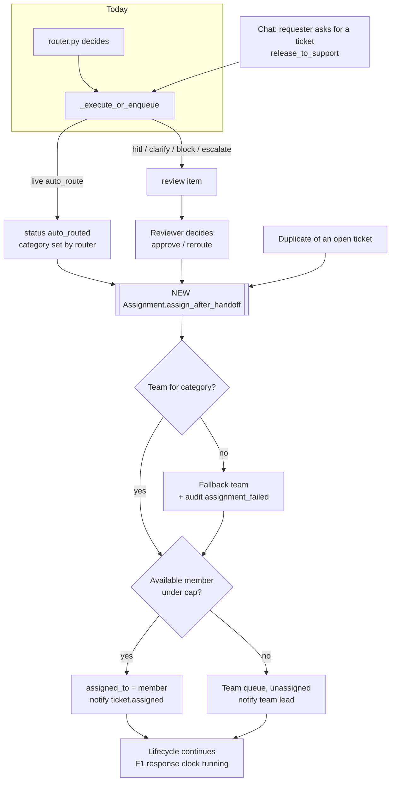

# 6. F2 Teams, assignment & workload — NEW + CHANGED

Must · Wave 2 · ADR-0031 (team scope, accepted 2026-10-17).

## a. Problem & goal

There are no teams. On a live `auto_route`, `pipeline._execute_or_enqueue`
writes `ticket.assigned_team = ticket.category` (a 50-char string, line 398).
After a HITL decision nothing is assigned at all: `ReviewItem.decide` records
the decision and an eval candidate but never touches the ticket. Nobody can
see who is overloaded.

**Goal:** every ticket handed to support gets a team (from its category) and a
person (by the team's strategy), with a reason trail for every reassignment.
The router's decision is never changed by assignment.

**Benchmark:** JSM, SDP and Freshservice offer round-robin and
load-balanced assignment; SDP skips people on leave; ServiceNow caps capacity
per agent. Adopt both strategies and availability. Adapt: assignment runs
after the router's decision is carried out, never instead of it. Skip model-
predicted assignment ([benchmark F2](benchmark.md#f2-teams-assignment--workload)).

## b. Process flow



## c. State changes

No new ticket statuses. New ticket fields change:

| Field | Set by | When |
|---|---|---|
| `team` | Assignment service, a person | Handoff; reassign |
| `assigned_to` | Assignment service, a person, lifecycle `assign_user` | Handoff; take; reassign |
| `category` | Router (today) **or** a reviewer's reroute (CHANGED, see BR-F2-06) | Routing; review decision |

Membership state: `is_available` true/false; leave dates.

## d. Use cases

| Field | UC-F2-01 · Assign at handoff |
|---|---|
| Actor | System |
| Trigger | Live `auto_route` executed; a review item decided `approve` or `reroute`; a chat ticket released to support with an `auto_route` or `hitl` decision; a duplicate linked |
| Preconditions | Ticket has a category (router or reviewer) |
| Main flow | 1. Take an advisory lock for the team. 2. Find the team that owns the category. 3. Pick a member by the team's strategy (BR-F2-03). 4. Set `team`, `assigned_to`, `assigned_team` mirror. 5. Audit `ticket_assigned`. 6. Emit `ticket.assigned` (F4) |
| Alternate | 3a. Duplicate whose original has an active, available assignee → same person (REUSED behaviour, `pipeline.py` line 444). 3b. No eligible member → `assigned_to` stays empty; emit `ticket.unassigned` to the team lead |
| Exception | 2x. No team owns the category → fallback team (`assignment.fallback_team`), audit `assignment_failed` reason `no_team_for_category`. Any error → ticket keeps its status and decision; audit `assignment_failed`; lead notified |
| Postconditions | Team always set; person set when someone is eligible |
| Rules | BR-F2-01…07 |
| Screens | — |
| MoSCoW | Must |

| Field | UC-F2-02 · Take a ticket from the team queue |
|---|---|
| Actor | Technician who is a member of the team |
| Trigger | Clicks **Take** on an unassigned ticket |
| Preconditions | Ticket is in their team, unassigned or assigned to someone unavailable |
| Main flow | 1. System checks membership. 2. Sets `assigned_to` to the caller. 3. Audits, notifies |
| Alternate | — |
| Exception | 2x. Someone took it a moment ago → 409 `already_assigned` (version check) |
| Postconditions | — |
| Rules | BR-F2-04 |
| Screens | [`F2 · Team queue`](https://www.figma.com/design/KXpnlC78p9pHYRuZZuQxIL?node-id=9-237) |
| MoSCoW | Must |

| Field | UC-F2-03 · Reassign with a reason |
|---|---|
| Actor | Assignee, team lead, manager |
| Trigger | Wrong person or wrong team |
| Preconditions | Ticket not in a completed status |
| Main flow | 1. Pick target person or team. 2. Pick a reason code and write a note (≥ 10 chars). 3. System masks the note, applies, audits `ticket_reassigned`, notifies new and previous assignee and the lead |
| Alternate | 1a. Target is another team → that team's strategy picks the person unless the actor named one. 1b. Moving to another team **and** another category → category changes (BR-F2-06) and an `eval_candidate` with source `reroute` is created |
| Exception | 1x. Assignee moving out of team without being lead → 403 `lead_required`. 2x. Missing reason → 422 `reason_required` |
| Postconditions | Reassignment counted in K5 |
| Rules | BR-F2-04, 05, 06 |
| Screens | [`F2 · Reassign dialog`](https://www.figma.com/design/KXpnlC78p9pHYRuZZuQxIL?node-id=9-442) (on `review/[id]` CHANGED and ticket page) |
| MoSCoW | Must |

| Field | UC-F2-04 · See and balance team workload |
|---|---|
| Actor | Team lead, manager |
| Trigger | Opens team workload |
| Preconditions | — |
| Main flow | 1. See each member: available, on leave, open count, cap, oldest SLA due (F1). 2. Select tickets and reassign (UC-F2-03) |
| Alternate | — |
| Exception | Non-lead technician → sees own row only |
| Postconditions | — |
| Rules | BR-F2-04 |
| Screens | [`F2 · Team workload`](https://www.figma.com/design/KXpnlC78p9pHYRuZZuQxIL?node-id=9-450) |
| MoSCoW | Must |

| Field | UC-F2-05 · Set my availability and leave |
|---|---|
| Actor | Technician (self), team lead (for members) |
| Trigger | Going off shift, on leave |
| Preconditions | — |
| Main flow | 1. Toggle available, or add leave dates. 2. Audited |
| Alternate | — |
| Exception | Lead edits someone outside their team → 403 |
| Postconditions | Strategy skips them from now on; already-assigned tickets stay (BR-F2-07) |
| Rules | BR-F2-03, 07 |
| Screens | [`F2 · My availability`](https://www.figma.com/design/KXpnlC78p9pHYRuZZuQxIL?node-id=9-603), [`F2 · Team workload`](https://www.figma.com/design/KXpnlC78p9pHYRuZZuQxIL?node-id=9-450) |
| MoSCoW | Must |

| Field | UC-F2-06 · Configure teams |
|---|---|
| Actor | `workflow_admin`, manager |
| Trigger | Org change |
| Preconditions | — |
| Main flow | 1. Create or edit a team: name, slug, categories, strategy, cap, calendar (F1), Keycloak group. 2. Save with a reason |
| Alternate | — |
| Exception | 1x. A category already owned by another team → 409 `category_taken`. 1y. Not every category owned after save → 422 `category_unowned` |
| Postconditions | Audited `team_changed` |
| Rules | BR-F2-01 |
| Screens | [`F2 · Teams`](https://www.figma.com/design/KXpnlC78p9pHYRuZZuQxIL?node-id=9-646) |
| MoSCoW | Must |

## e. Business rules

| ID | Rule | Rationale | Enforced where |
|---|---|---|---|
| BR-F2-01 | Each of the six categories (`hardware`, `software`, `network`, `access`, `security`, `other`) is owned by exactly one active team; a team may own several | Router chooses a category; assignment must be deterministic from it | DB unique on `team_categories.category`; save check |
| BR-F2-02 | Assignment runs only after the router's decision is carried out (or a person decided). It never changes `branch`, `reason_code`, or the routing decision row | ADR-0001; "nothing quieter than a person overrides the router" | Assignment service is called from `_execute_or_enqueue`, `release_to_support` and the review-decision service only |
| BR-F2-03 | Eligible = active user, membership `is_available`, not on leave today (calendar zone), open count < team cap (if set). `round_robin` picks the eligible member assigned longest ago; `least_loaded` picks the fewest open, ties → assigned longest ago | SDP / JSM patterns; "longest ago" keeps round robin fair when members change | `Assignment.pick()` |
| BR-F2-04 | Who may assign: a member may take from own team; the lead assigns and reassigns within and out of the team; a manager anywhere; `security` only within `security` category | Team scope (ADR-0031) | Endpoint gates |
| BR-F2-05 | Every manual reassignment needs a reason code (`wrong_team`, `workload`, `skill`, `leave`, `escalation`, `requester_request`, `other`) and a note ≥ 10 chars, masked | Reasons make reroutes teachable (spec §12.4) | Request schema; BR-X-06 |
| BR-F2-06 | A person may change a ticket's category only through a review decision (`reroute` with `corrected_category`) or a cross-team reassignment. It is audited and creates an `eval_candidate` (`source: reroute`). No `proposed_*` field is ever read for it | ADR-0001 governs the LLM, not people; reroutes are a free label source (glossary) | Assignment service |
| BR-F2-07 | Going unavailable or on leave does not move tickets already assigned; the lead sees them flagged in the workload view | Silent bulk moves surprise people | Workload query |
| BR-F2-08 | Concurrent assignments to one team are serialized by `pg_advisory_xact_lock(hashtext('assign:' \|\| team_id))` | Same pattern as the incident detector (`IncidentManager.get_or_create_for_mass_incident`) | Assignment service |

## f. Functional requirements

| ID | Requirement |
|---|---|
| FR-F2-001 | The system shall store teams with name, slug, owned categories, strategy, optional per-member cap, optional calendar, optional Keycloak group |
| FR-F2-002 | The system shall store memberships with role `member` or `lead`, availability, and the time of the member's last assignment |
| FR-F2-003 | The system shall store leave periods per user (start date, end date, note) |
| FR-F2-004 | On a live `auto_route`, the system shall assign team and person in the same transaction that moves the ticket to `auto_routed`, replacing `assigned_team = category` |
| FR-F2-005 | On a review decision of `approve` or `reroute`, the system shall assign team and person, using `corrected_category` when given |
| FR-F2-006 | On `release_to_support`, the system shall assign as for the decision it carries out |
| FR-F2-007 | The system shall pick the person by BR-F2-03 under the lock of BR-F2-08 |
| FR-F2-008 | When nobody is eligible, the system shall leave the ticket unassigned in the team queue and emit `ticket.unassigned` to the lead |
| FR-F2-009 | The system shall let a member take an unassigned ticket of their team |
| FR-F2-010 | The system shall reassign with a reason code and a masked note, and emit `ticket.reassigned` |
| FR-F2-011 | The system shall create an `eval_candidate` with source `reroute` when a reassignment or review decision changes the category |
| FR-F2-012 | The system shall show a team queue (unassigned first, then by earliest SLA due) and a workload view per member |
| FR-F2-013 | The system shall keep `tickets.assigned_team` equal to the team's slug for existing readers (lifecycle templates `{{ticket.assignedTeam}}`) |
| FR-F2-014 | The lifecycle `assign_team` action shall accept only an existing team slug (checked when saved) and may pick a member by strategy (`pick_member: true`) |
| FR-F2-015 | For `oidc` users, memberships shall come from Keycloak groups (F13); for local users, `workflow_admin` edits them |
| FR-F2-016 | The system shall audit `ticket_assigned`, `ticket_reassigned`, `assignment_failed`, `team_changed`, `membership_changed`, `availability_changed`, `leave_changed` |

## g. Data changes

| Table | Status | Fields |
|---|---|---|
| `team_teams` | NEW | `slug` unique, `name`, `strategy` (`round_robin` \| `least_loaded`), `max_open_per_member` null, `calendar` FK null (F1), `keycloak_group` null, `is_fallback` bool (exactly one true), `is_active` |
| `team_categories` | NEW | `team` FK, `category` unique (`TicketCategory` values) |
| `team_memberships` | NEW | `team` FK, `user` FK, `role` (`member` \| `lead`), `is_available` default true, `last_assigned_at` null, `source` (`keycloak` \| `local`). Unique (`team`, `user`) |
| `team_leaves` | NEW | `user` FK, `starts_on` date, `ends_on` date, `note` (masked), `created_by` |
| `team_reassignments` | NEW | `ticket` FK, `from_user`, `to_user`, `from_team`, `to_team`, `from_category`, `to_category`, `reason_code`, `note_masked`, `actor`, `created_at` |
| `tickets` | CHANGED | NEW `team` FK null (PROTECT). `assigned_team` kept, written = `team.slug` (mirror, read-only for new code) |

**Migration:** create teams from the six categories (`hardware` … `other`),
one team each, `least_loaded`; `other` is the fallback. Backfill
`tickets.team` from `assigned_team` where it equals a category. Writer:
core-api only. No PII except masked notes.

**`thresholds.yaml` — CHANGED**

```yaml
assignment:
  reassign_note_min_chars: 10
```

**`.env.example` — none.**

**Worked example: `least_loaded` for the Network team, 2026-10-17 11:20 (+07)**

Input — the ticket being assigned:

```json
{ "public_id": "TKT-2026-000415", "category": "network", "status": "auto_routed" }
```

Team and members:

| member | role | available | leave today | open assigned | last_assigned_at | eligible |
|---|---|---|---|---|---|---|
| `duc.tm` | lead | yes | no | 6 | 2026-10-17 10:55 | yes |
| `khoa.lv` | member | yes | no | 4 | 2026-10-17 09:40 | yes |
| `nam.pt` | member | yes | **yes (17–18 Oct)** | 2 | 2026-10-16 16:10 | no |
| `vy.tt` | member | **no** | no | 3 | 2026-10-17 08:15 | no |

The SQL the picker emits (inside the transaction, after the advisory lock):

```sql
SELECT pg_advisory_xact_lock(hashtext('assign:' || '7c2e…'));

SELECT m.user_id,
       COUNT(t.id) AS open_count,
       m.last_assigned_at
FROM team_memberships m
JOIN accounts_user u ON u.id = m.user_id AND u.is_active
LEFT JOIN tickets t
       ON t.assigned_to_id = m.user_id
      AND t.resolved_at IS NULL
      AND t.workflow_status_id NOT IN (
            SELECT ws.id FROM lifecycle_workflow_statuses ws
            JOIN lifecycle_system_statuses ss ON ss.id = ws.base_id
            WHERE ss.name = 'On hold')
WHERE m.team_id = '7c2e…'
  AND m.is_available
  AND NOT EXISTS (SELECT 1 FROM team_leaves l
                  WHERE l.user_id = m.user_id
                    AND DATE '2026-10-17' BETWEEN l.starts_on AND l.ends_on)
GROUP BY m.user_id, m.last_assigned_at
ORDER BY open_count ASC, m.last_assigned_at ASC NULLS FIRST
LIMIT 1;
```

Result → `khoa.lv` (4 open). Rows written:

| table | row |
|---|---|
| `tickets` | `TKT-2026-000415`: team `network`, assigned_team `network`, assigned_to `khoa.lv` |
| `team_memberships` | `khoa.lv`/network: last_assigned_at 2026-10-17 04:20 UTC |
| `audit_log` | `ticket_assigned` `{"team":"network","assignee":"khoa.lv","strategy":"least_loaded","trigger":"auto_route","candidates":2}` |
| `notif_messages` | `ticket.assigned` → `khoa.lv` (F4) |

**Reassignment record** (Khoa finds the VPN works and the account is locked;
he is a member, not lead, so Đức, the Network lead, sends it to Access —
BR-F2-04, AC-F2-05):

| ticket | actor | from → to user | from → to team | from → to category | reason_code | note_masked |
|---|---|---|---|---|---|---|
| `TKT-2026-000415` | `duc.tm` | `khoa.lv` → (strategy: `ha.vt`) | network → access | network → access | `wrong_team` | "VPN kết nối được, tài khoản [EMAIL_1] bị khoá trên Identity Center" |

Plus `eval_candidates`: source `reroute`, `ai_prediction` `{"category":"network"}`, `human_truth` `{"category":"access","reason_code":"wrong_team"}`.

## h. API changes

| Method · Path | Role | Request | Response | Errors |
|---|---|---|---|---|
| `GET /api/teams` | staff | — | `[{slug, name, categories, strategy, cap, members_count}]` | — |
| `POST /api/teams`, `PATCH /api/teams/{slug}` | workflow_admin, manager | `{name, slug, categories, strategy, max_open_per_member, calendar_id, keycloak_group, reason}` | team | 409 `category_taken` · 422 `category_unowned` · 422 `reason_required` |
| `GET /api/teams/{slug}/queue?unassigned=` | team members, manager | — | tickets with assignee, priority, SLA due (F1) | 403 `not_a_member` |
| `GET /api/teams/{slug}/workload` | lead, manager (members: own row) | — | `[{user, available, on_leave, open, cap, oldest_due}]` | 403 |
| `POST /api/tickets/{public_id}/take` | team member | `{expected_version}` | ticket | 409 `already_assigned` · 403 `not_a_member` |
| `POST /api/tickets/{public_id}/reassign` | assignee, lead, manager | `{to_user?, to_team?, reason_code, note, expected_version}` | ticket | 403 `lead_required` · 422 `reason_required` · 409 `version_conflict` |
| `PUT /api/me/availability` | technician | `{is_available}` | membership list | — |
| `POST /api/me/leaves`, `DELETE /api/me/leaves/{id}` | technician (self), lead (members) | `{starts_on, ends_on, note}` | leave | 422 `bad_dates` |
| `POST /api/review/items/{id}/decide` | CHANGED | unchanged body | unchanged response; now also assigns | unchanged |

Example — reassign request and response:

```json
POST /api/tickets/TKT-2026-000415/reassign
{ "to_team": "access", "reason_code": "wrong_team",
  "note": "VPN kết nối được, tài khoản lan.nt@congty.vn bị khoá trên Identity Center",
  "expected_version": 7 }

200
{ "public_id": "TKT-2026-000415", "team": "access", "assigned_to": "ha.vt",
  "category": "access", "version": 8,
  "last_reassignment": { "reason_code": "wrong_team",
    "note_masked": "VPN kết nối được, tài khoản [EMAIL_1] bị khoá trên Identity Center" } }
```

No new Celery task (assignment is synchronous). No webhook event beyond F4's.

## i. Impact

- **Changes:** `pipeline._execute_or_enqueue` (live `auto_route`) calls the assignment service instead of copying the category; the review-decision endpoint assigns; `release_to_support` assigns; lifecycle `assign_team` validates slugs; `tickets.team` added.
- **Must not change:** branch choice, routing-decision rows, shadow mode (in shadow mode nothing is auto-routed, so only review decisions assign); duplicate inheritance when the original assignee is eligible; the reserved pipeline statuses.
- **ADRs:** 0001 (BR-F2-02, 06), 0028 §2 (assignment is not an action on a pipeline status, because pipeline statuses carry no actions), proposed 0031.
- **Regression tests:** `test_assignment_never_changes_routing_decision`; `test_auto_route_assigns_team_from_router_category`; `test_review_reroute_sets_category_and_eval_candidate`; `test_no_eligible_member_leaves_unassigned_and_notifies_lead`; `test_concurrent_assignments_balance` (two workers, one lock); existing `pipeline` tests updated from `assigned_team == category` to `team.slug == category`.

## v0.6.5 — where the code differs (build, 2026-10-26)

Code wins (README §0.4 item 5). Each change and its reason:

1. **"On leave today" is judged in `ASSIGNMENT_TIMEZONE`** (`.env.example`,
   `Asia/Ho_Chi_Minh`) until F1's calendars exist; F1 replaces it with the team's
   calendar (owner's decision, 2026-10-26).
2. **Open count = every unfinished ticket assigned to the person**, including
   ones on hold. §g's SQL left out `On hold` by status name; a ticket on hold is
   still that person's, and a name match breaks when a status is renamed.
3. **Duplicates inherit at handoff, not before routing** (owner's decision).
   The pipeline no longer copies the original's assignee; the assignment
   service gives a duplicate to the original's assignee when they are eligible
   in the team. In shadow mode a duplicate waits for review like any ticket.
4. **The old `POST /api/lifecycle/tickets/{id}/assign` is retired** (owner's
   decision): every manual change goes through Take or Reassign with a reason
   (BR-F2-05). The `assign_user` action stays.
5. **One label per review decision:** a decision that changes the category
   writes one `eval_candidate` with source `reroute`; other overrides keep
   `human_override` (owner's decision).
6. **The category an approval assigns by:** the reviewer's correction, else the
   router's category, else the category the reviewer was shown and marked
   correct (Jev's choice in the run's signals, never a `proposed_*` field). With
   none, the fallback team gets the ticket and `assignment_failed` says
   `no_category`. `ReviewItem.decide` moved to `ReviewDecisions` (CLAUDE.md
   "Where logic goes").
7. **More refusals:** `category_required` (the target team owns several
   categories and none was named, `to_category`), `user_not_in_team`,
   `ticket_completed`, `team_not_found`, `not_allowed` (security staff on a
   non-security ticket), `managed_by_keycloak`, `fallback_required`.
8. **Moving a category between teams:** a save naming a category another team
   owns is refused with `category_taken` unless it says `move_categories: true`;
   otherwise a move would need an intermediate save that leaves it unowned.
9. **API additions:** `GET /api/teams/{slug}` (with members); adding and
   removing local members (`/api/teams/{slug}/members`, audited
   `membership_changed`); a lead setting a member's availability
   (`PUT /api/teams/{slug}/members/{username}/availability`);
   `GET /api/me/availability`. Workload rows carry `last_assigned_at` and
   `next_pick`; teams carry `leads`. Take, reassign and assignment at handoff
   raise `tickets.version`.
10. **A manager outside the team may take a ticket**, as BR-F2-04's "manager
    anywhere" reads.
11. **Screens:** the team queue (`/teams/[slug]`) and workload
    (`/teams/[slug]/workload`) sit under a Teams group in the sidebar; my
    availability is `/me/availability`; teams are under Settings. Priority and
    SLA badges come with F1. The workload has no bulk "reassign selected": each
    ticket is reassigned from the queue or the ticket page. The review page opens
    the ticket page, which carries the Reassign dialog.
12. **`assign_team`'s parameters are `{team, pick_member}`**; saving one that
    names no active team is refused.

## j. Acceptance criteria

```gherkin
Feature: F2 Teams and assignment

  Background:
    Given team "network" owns category "network" with strategy "least_loaded"
    And members "duc.tm" (6 open), "khoa.lv" (4 open), "nam.pt" (2 open, on leave today), "vy.tt" (unavailable)

  @BR-F2-02 @BR-F2-03
  Scenario: AC-F2-01 live auto-route assigns the least-loaded eligible member
    Given SHADOW_MODE is false
    When the router decides auto_route with category "network" for "TKT-2026-000415"
    Then the ticket's team is "network" and assigned_to is "khoa.lv"
    And the routing_decisions row is unchanged by assignment
    And "khoa.lv" has a "ticket.assigned" notice

  @BR-F2-03
  Scenario: AC-F2-02 nobody eligible leaves the ticket in the team queue
    Given every network member is unavailable
    When a network ticket is handed to support
    Then the ticket's team is "network" and assigned_to is empty
    And "duc.tm" (lead) has a "ticket.unassigned" notice

  @BR-F2-06
  Scenario: AC-F2-03 reviewer reroute changes category and creates a label
    Given a pending low_confidence review item for "TKT-2026-000415" with router category "network"
    When "ha.vt" decides "reroute" with corrected_category "access" and a reason
    Then the ticket's category is "access" and team is "access"
    And one eval_candidate with source "reroute" exists

  @BR-F2-05
  Scenario: AC-F2-04 reassign needs a reason
    When "khoa.lv" reassigns "TKT-2026-000415" to team "access" with no note
    Then the response is 422 with code "reason_required"

  @BR-F2-04
  Scenario: AC-F2-05 member cannot move a ticket out of the team
    Given "khoa.lv" is a member, not lead, of "network"
    When "khoa.lv" reassigns to team "hardware" with a valid reason
    Then the response is 403 with code "lead_required"

  @BR-F2-04 @BR-F2-08
  Scenario: AC-F2-06 two takes, one winner
    Given "khoa.lv" and "duc.tm" both click Take on the same unassigned ticket at version 3
    Then one request succeeds and the other returns 409 "already_assigned"

  @BR-F2-01 @BR-F2-02 @BR-X-07
  Scenario: AC-F2-07 assignment failure does not touch routing
    Given no team owns category "software"
    When a live auto_route decision for category "software" is carried out
    Then the ticket is "auto_routed" with team equal to the fallback team
    And one audit row "assignment_failed" with reason "no_team_for_category" exists

  @BR-F2-07
  Scenario: AC-F2-08 going unavailable moves nothing
    Given "vy.tt" has 3 open tickets in team "network"
    When "vy.tt" turns availability off
    Then the 3 tickets stay assigned to "vy.tt"
    And the workload view flags them for "duc.tm"
```
