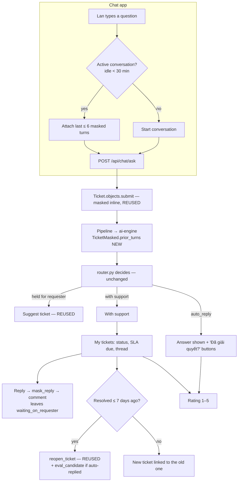

# 6. F3 Requester experience in chat — NEW + CHANGED

Must · Wave 3 · Proposed ADR-0034 (relaxes "each ticket is analysed alone").
Defaults from OQ-07, OQ-08, OQ-09 (accepted 2026-10-17).

## a. Problem & goal

The chat is one page that lists the requester's **chat** tickets as turns
(`GET /api/chat/tickets`). Each message submits a new ticket
(`POST /api/chat/ask`). Once a question is "with support", the requester
sees nothing more: no status, no messages from the technician, no way to
reply, reopen or rate. Form tickets don't appear at all. The `reopen_ticket`
Celery task exists but has no caller, so `reopen_rate_after_autoreply` —
spec §11.1's metric number one — is always 0.

**Goal:** in the chat, the requester can (1) ask follow-ups that the model
understands in the context of the same conversation, (2) see all their
tickets and where each stands, (3) read and answer the technician, (4) reopen
within 7 days, (5) rate the help. Nothing from one conversation reaches the
model in another.

**Benchmark:** Moveworks lists open tickets first, then the last 30 days,
lets users comment and reopen (a closed ticket becomes a new linked one), and
nudges about stale tickets. JSM sends a rating with the resolved notice.
Freshservice doesn't reopen on a rating by default. Adopt the list, reply,
reopen and rating. Adapt: every reply is masked inline; low ratings don't
reopen. Skip requester "close" ([benchmark F3](benchmark.md#f3-requester-experience-in-chat)).

## b. Process flow



## c. State changes

**NEW conversation states** (`chat_conversations`): `active` → `ended`
(30 min idle, the requester clicks "Cuộc trò chuyện mới", or a turn is
`block`ed).

**Ticket moves F3 causes:**

| Trigger | From | To | How |
|---|---|---|---|
| Requester replies | `waiting_on_requester` | the status before it (from the transfer log) | NEW `lifecycle.automatic_move` (trigger `action`, governed by the workflow) |
| Requester reopens, ≤ 7 days | any completed status | `reopened` (pipeline status) | REUSED `tickets.tasks.reopen_ticket` → `system_move` |
| No reply for 5 business days | `waiting_on_requester` | `resolved` | `automatic_move`, comment "Đóng tự động do không có phản hồi" |

**Rating:** one per resolution; editable until the reopen window closes.

## d. Use cases

| Field | UC-F3-01 · Ask a follow-up in the same conversation |
|---|---|
| Actor | Requester (Lan) |
| Trigger | Types a second message within 30 min of the last turn |
| Preconditions | Active conversation; previous turns not blocked |
| Main flow | 1. Chat sends the message with `conversation_id`. 2. core-api submits a ticket (masked inline) linked to the conversation. 3. core-api builds `prior_turns` from the last ≤ 6 turns of **this conversation and this requester**, masked text only. 4. ai-engine uses them as context for drafting and the proposal. 5. Router decides as today |
| Alternate | 1a. Idle ≥ 30 min → new conversation, no prior turns |
| Exception | 3x. A prior turn was `block`ed or `mask_failed` → conversation ended; this message starts a new one with no prior turns |
| Postconditions | New ticket; `tickets.conversation` set |
| Rules | BR-F3-01, 02, 03 |
| Screens | [`F3 · Chat conversation`](https://www.figma.com/design/KXpnlC78p9pHYRuZZuQxIL?node-id=10-426) (CHANGED chat page) |
| MoSCoW | Must |

| Field | UC-F3-02 · See my tickets |
|---|---|
| Actor | Requester |
| Trigger | Opens "Phiếu của tôi" |
| Preconditions | — |
| Main flow | 1. List form **and** chat tickets they reported: open first (by last update), then resolved/closed in the last 30 days. 2. Each row: id, subject (masked), status label, team, resolution due (F1) |
| Alternate | 1a. "Xem thêm" loads older |
| Exception | — |
| Postconditions | — |
| Rules | BR-F3-04, 05 |
| Screens | [`F3 · My tickets`](https://www.figma.com/design/KXpnlC78p9pHYRuZZuQxIL?node-id=10-517) |
| MoSCoW | Must |

| Field | UC-F3-03 · Read the thread and reply |
|---|---|
| Actor | Requester |
| Trigger | Opens a ticket; technician asked something |
| Preconditions | Own ticket, not in `new` or `awaiting_requester` (those use today's chat flows) |
| Main flow | 1. See public comments in order. 2. Type a reply. 3. core-api masks it inline (`mask_reply`), stores a public comment. 4. If the ticket is `waiting_on_requester` → `automatic_move` back. 5. Emit `ticket.requester_replied` to the assignee |
| Alternate | 4a. Ticket in any other open status → comment only |
| Exception | 3x. Reply has `critical` PII → stored masked, ticket `pii_level` raised, `security_alert` (F8), requester told "Vui lòng không gửi mật khẩu" . 3y. `mask_failed` → reply hidden from staff, review item in `mask_failed` queue, requester sees "Đã nhận, đang kiểm tra". 1x. Ticket closed → 409 `ticket_closed`, offer reopen or new ticket |
| Postconditions | Comment stored masked |
| Rules | BR-F3-06, 07, BR-X-06 |
| Screens | [`F3 · Ticket thread`](https://www.figma.com/design/KXpnlC78p9pHYRuZZuQxIL?node-id=10-580) |
| MoSCoW | Must |

| Field | UC-F3-04 · Reopen |
|---|---|
| Actor | Requester |
| Trigger | "Chưa giải quyết được" on a resolved ticket or an auto-reply |
| Preconditions | Own ticket in a completed status |
| Main flow | 1. Requester writes why (masked). 2. Within 7 days of `resolved_at` → `reopen_ticket` (moves to `reopened`, `reopened_count += 1`, retracts few-shot). 3. If it was auto-replied → `eval_candidate` source `reopen`. 4. F1 resumes resolution; F2 gives it back to the last assignee if eligible, else by strategy. 5. Notify assignee and lead |
| Alternate | 2a. After 7 days → new ticket submitted with the requester's text plus "Liên quan đến TKT-…", linked `reopened_from` |
| Exception | 1x. Empty reason → 422 |
| Postconditions | K7 counts it |
| Rules | BR-F3-08, 09 |
| Screens | [`F3 · Ticket thread`](https://www.figma.com/design/KXpnlC78p9pHYRuZZuQxIL?node-id=10-580), [`F3 · Answer card`](https://www.figma.com/design/KXpnlC78p9pHYRuZZuQxIL?node-id=10-500) (CHANGED `TurnView` answered state) |
| MoSCoW | Must |

| Field | UC-F3-05 · Rate the help |
|---|---|
| Actor | Requester |
| Trigger | `ticket.resolved` notice, or the stars on a resolved ticket / answer card |
| Preconditions | Own ticket in a completed status; no rating yet for this resolution |
| Main flow | 1. Pick 1–5. 2. Optional comment (masked). 3. Saved |
| Alternate | 1a. Change it until the reopen window closes |
| Exception | 3x. Rating 1–2 → `ticket.rated_low` to the team lead; if auto-replied, `eval_candidate` source `low_rating` |
| Postconditions | K6 counts it |
| Rules | BR-F3-10 |
| Screens | [`F3 · Rating`](https://www.figma.com/design/KXpnlC78p9pHYRuZZuQxIL?node-id=10-623) |
| MoSCoW | Must |

| Field | UC-F3-06 · Technician writes to the requester |
|---|---|
| Actor | Assignee, team member |
| Trigger | Needs information or reports progress |
| Preconditions | Ticket handed off |
| Main flow | 1. Write a public comment (masked inline) or an internal note. 2. Optionally move to `waiting_on_requester` in the same action. 3. Public comment → `ticket.public_comment` to the requester; meets F1 response if first |
| Alternate | — |
| Exception | Same masking outcomes as UC-F3-03 |
| Postconditions | — |
| Rules | BR-F3-06, BR-F1-06 |
| Screens | [`F3 · Comment box`](https://www.figma.com/design/KXpnlC78p9pHYRuZZuQxIL?node-id=10-665) (CHANGED `review/[id]` and ticket page in admin-console) |
| MoSCoW | Must |

## e. Business rules

| ID | Rule | Rationale | Enforced where |
|---|---|---|---|
| BR-F3-01 | Prior turns come only from the same conversation and the same requester, at most `requester.max_prior_turns` (6), masked text only | OQ-08; R-05 | `Conversations.prior_turns()` |
| BR-F3-02 | A conversation ends after `requester.conversation_idle_minutes` (30), on request, or when a turn is `block`ed or `mask_failed` | A blocked turn must never become context | Conversation service |
| BR-F3-03 | Prior turns are context for drafting and proposing only. The router, the trust scorer and every hard gate run exactly as today on the new ticket | ADR-0001, 0003; hard-gate order fixed | Unchanged `router.py`; wire field read only by ai-engine nodes |
| BR-F3-04 | A requester sees only tickets they reported; anyone else's is 404 | PRE-1 BR-PRE1-02 | Queryset |
| BR-F3-05 | Status labels for requesters come from the system status base, not the workflow status name | Workflows can rename statuses; requesters need a stable vocabulary | Label map (§g) |
| BR-F3-06 | Every comment (requester or staff) is masked inline before storing; staff never see raw text either | Spec §5, BR-X-06 | `Comments.add()` |
| BR-F3-07 | A requester reply moves the ticket out of `waiting_on_requester` through the workflow (rules and actions apply). If the workflow refuses, the comment stays and the assignee is notified | ADR-0028: only the pipeline bypasses the workflow | `lifecycle.automatic_move` |
| BR-F3-08 | Reopen within `requester.reopen_window_days` (7) of `resolved_at`; afterwards a new linked ticket | OQ-09; Moveworks | Reopen service |
| BR-F3-09 | Reopening an auto-replied ticket creates an `eval_candidate` with source `reopen` | Glossary: reopens after auto-reply are a free label source | Reopen service |
| BR-F3-10 | One rating per resolution (`resolution_seq`); a low rating never reopens | Freshservice default; keeps K7 honest | Unique constraint |
| BR-F3-11 | `waiting_on_requester` with no reply for `requester.auto_close_after_business_days` (5) is resolved automatically, with a comment and a notice | Stale tickets distort K2 and workload | `requester.sweep` |

## f. Functional requirements

| ID | Requirement |
|---|---|
| FR-F3-001 | The system shall group chat turns into conversations per requester and end them by BR-F3-02 |
| FR-F3-002 | The system shall pass up to 6 prior masked turns of the same conversation to ai-engine in `TicketMasked.prior_turns` (default empty) |
| FR-F3-003 | ai-engine shall use prior turns in the HyDE draft and the proposal prompts only; prompt versions bump and pass the eval gate |
| FR-F3-004 | The chat page shall show only the active conversation; older turns are reachable through My tickets |
| FR-F3-005 | The system shall list the requester's form and chat tickets: open first, then completed in the last 30 days |
| FR-F3-006 | The system shall show each ticket's requester status label, team, resolution due time and public thread |
| FR-F3-007 | The system shall store public comments and internal notes, masked inline, with author and visibility |
| FR-F3-008 | The system shall move a ticket out of `waiting_on_requester` on a requester reply via `automatic_move` |
| FR-F3-009 | The system shall reopen within the window via `reopen_ticket`, else submit a linked new ticket |
| FR-F3-010 | The system shall create `eval_candidate` rows for reopened and low-rated auto-replies |
| FR-F3-011 | The system shall accept one 1–5 rating per resolution with an optional masked comment, changeable within the window |
| FR-F3-012 | The system shall auto-resolve stale `waiting_on_requester` tickets by BR-F3-11 |
| FR-F3-013 | The system shall emit F4 events `ticket.received`, `ticket.public_comment`, `ticket.requester_replied`, `ticket.status_changed`, `ticket.resolved`, `ticket.reopened`, `ticket.rated_low` |
| FR-F3-014 | The chat app shall poll an open ticket's thread every `NOTIFICATION_POLL_SEC` while it is on screen |
| FR-F3-015 | All requester-facing text shall exist in vi and en and follow `accounts_user.language` |
| FR-F3-016 | The system shall audit `conversation_started`, `conversation_ended`, `ticket_comment_added`, `requester_replied`, `ticket_reopened` (REUSED), `ticket_reopen_linked`, `ticket_rated`, `ticket_auto_closed` |

## g. Data changes

| Table | Status | Fields |
|---|---|---|
| `chat_conversations` | NEW | `requester` FK, `state` (`active` \| `ended`), `started_at`, `last_activity_at`, `ended_at`, `end_reason` (`idle` \| `user` \| `blocked` \| `mask_failed`) |
| `tickets` | CHANGED | NEW `conversation` FK null; NEW `reopened_from` FK self null; NEW `resolution_seq` smallint default 0 (incremented each time it enters a completed status) |
| `ticket_comments` | NEW | `ticket` FK, `author` FK, `author_kind` (`requester` \| `staff` \| `system`), `visibility` (`public` \| `internal`), `body_masked`, `pii_level`, `hidden_for_review` bool, `created_at` |
| `ticket_ratings` | NEW | `ticket` FK, `resolution_seq`, `score` 1–5, `comment_masked` null, `rated_at`, `updated_at`. Unique (`ticket`, `resolution_seq`) |
| `eval_candidates` | CHANGED (values only) | `source` gains `reopen` (now produced) and `low_rating` |
| `pii_quarantine` | REUSED | Comment PII stored like clarification answers (`PiiQuarantine.objects.store`), `pii_map` extended |

**Wire change (both services, same PR — CLAUDE.md rule 4)**

| Where | Change |
|---|---|
| core-api `infrastructure/dtos.py` `TicketMasked` | NEW `prior_turns: list[PriorTurn] = Field(default_factory=list)`; `PriorTurn{question_masked: str, outcome: Literal["answered","with_support","clarify","suggest_ticket"], answer_excerpt: str = ""}` (frozen) |
| ai-engine `schemas.py`, `graph/ticket.py` | Same fields, same defaults |
| ai-engine prompts | `hyde_draft.v3.md`, `propose.v10.md` with an "Earlier in this conversation" block; `.env.example` versions bumped |
| evals | NEW multi-turn golden cases (≥ 20), reviewed by someone other than the author (rule 9) |

**Requester status labels**

| System status base | vi | en |
|---|---|---|
| Intake | Đang tiếp nhận | Received |
| Open | Đang chờ xử lý | Waiting for support |
| In progress | Đang xử lý | In progress |
| On hold + `pauses_sla` | Chờ bạn phản hồi | Waiting for you |
| On hold (other) | Tạm dừng | On hold |
| Resolved | Đã giải quyết | Resolved |
| Closed | Đã đóng | Closed |

**`thresholds.yaml` — CHANGED** (`requester:` section; `auto_close_after_business_days` is in F1's block)

```yaml
requester:
  conversation_idle_minutes: 30
  max_prior_turns: 6
  reopen_window_days: 7
  list_resolved_days: 30
  auto_close_after_business_days: 5
```

### Records, stage by stage — a follow-up that uses context

Turn 1 (09:02, +07), new conversation `cv-71a2`:

| ticket | body_masked | branch | status |
|---|---|---|---|
| `TKT-2026-000431` | "VPN báo lỗi TLS handshake failed khi kết nối từ nhà" | `clarify` → Lan picks "AWS VPN Client trên Windows" | `auto_replied` with `client-vpn-user.windows-troubleshooting` |

Turn 2 (09:10): Lan types "Làm theo rồi vẫn lỗi, em dùng mạng 4G của [PHONE_VN_1] phát ra".

What core-api sends to ai-engine (`TicketMasked`):

```json
{ "ticket_public_id": "TKT-2026-000432",
  "subject_masked": "Làm theo rồi vẫn lỗi, em dùng mạng 4G của [PHONE_VN_1] phát ra",
  "body_masked": "Làm theo rồi vẫn lỗi, em dùng mạng 4G của [PHONE_VN_1] phát ra",
  "pii_level": "routine", "placeholder_keys": ["[PHONE_VN_1]"],
  "prior_turns": [
    { "question_masked": "VPN báo lỗi TLS handshake failed khi kết nối từ nhà",
      "outcome": "answered",
      "answer_excerpt": "Reconnect the AWS VPN Client and check the TAP adapter…" } ] }
```

Router output for turn 2 (unchanged logic): `hitl`, reason `rerank_low_confidence`
→ held for the requester (live chat) → Lan clicks "Tạo phiếu hỗ trợ" →
`release_to_support` → handoff → F2 assigns `khoa.lv`, F1 starts clocks.

Lan typed a follow-up instead of clicking "Chưa giải quyết được", so turn 1
stays `auto_replied`. Had she clicked it, turn 1 would have been **reopened**
(UC-F3-04) and an `eval_candidate` with source `reopen` created. (This
example assumes live mode; in shadow mode turn 1 would have gone to a
reviewer.)

Later — Khoa asks, Lan replies:

| table | row |
|---|---|
| `ticket_comments` | `TKT-2026-000432` · `khoa.lv` · staff · public · "Chị cho em xin ảnh lỗi trong AWS VPN Client > Show logs ạ" |
| `lifecycle_transfers` | `in_progress` → `waiting_on_requester` (manual, `khoa.lv`) |
| `ticket_comments` | `TKT-2026-000432` · `lan.nt` · requester · public · "Em gửi log ạ: user [EMAIL_1] lỗi ở bước TLS" · pii_level `routine` |
| `lifecycle_transfers` | `waiting_on_requester` → `in_progress` (trigger `action`, no actor) |
| `ticket_ratings` | after resolution: `TKT-2026-000432` · seq 1 · score 4 · "Anh hỗ trợ nhanh" |

`GET /api/requester/tickets` for Lan (output):

```json
{ "open": [
    { "public_id": "TKT-2026-000432", "subject_masked": "Làm theo rồi vẫn lỗi, em dùng mạng 4G của [PHONE_VN_1] phát ra",
      "status_label": "Chờ bạn phản hồi", "team": "Network",
      "resolution_due_at": null, "sla_paused": true, "unread_comments": 1 } ],
  "recent": [
    { "public_id": "TKT-2026-000431", "subject_masked": "VPN báo lỗi TLS handshake failed khi kết nối từ nhà",
      "status_label": "Đã giải quyết", "resolved_at": "2026-10-17T02:03:40Z",
      "can_reopen_until": "2026-10-24T02:03:40Z", "rating": null } ] }
```

## h. API changes

| Method · Path | Role | Request | Response | Errors |
|---|---|---|---|---|
| `POST /api/chat/ask` | any (own) | CHANGED: `{message, conversation_id?}` | CHANGED: `ChatTurnOut` + `conversation_id` | 409 `conversation_ended` (client starts a new one) |
| `POST /api/chat/conversations/{id}/end` | own | — | 204 | 404 |
| `GET /api/chat/tickets` | own | CHANGED: `?conversation_id=` (default: active conversation only) | list | — |
| `GET /api/requester/tickets?before=` | own | — | `{open[], recent[]}` | — |
| `GET /api/requester/tickets/{public_id}` | own | — | ticket + public thread + rating + `can_reopen_until` | 404 |
| `POST /api/requester/tickets/{public_id}/replies` | own | `{body}` | comment (masked) | 409 `ticket_closed` · 409 `ticket_in_triage` |
| `POST /api/requester/tickets/{public_id}/reopen` | own | `{reason}` | `{reopened: true}` or `{new_ticket: "TKT-…"}` | 409 `not_resolved` · 422 `reason_required` |
| `PUT /api/requester/tickets/{public_id}/rating` | own | `{score, comment?}` | rating | 409 `not_resolved` / `rating_window_closed` · 422 `bad_score` |
| `GET /api/tickets/{public_id}/comments` | staff | — | all comments (public + internal) | 403 |
| `POST /api/tickets/{public_id}/comments` | staff | `{body, visibility, move_to_waiting?: bool}` | comment | 409 `version_conflict` |

**Celery tasks**

| Task | Trigger | Idempotency |
|---|---|---|
| `requester.sweep` | beat, every 15 min | Ends idle conversations; auto-resolves stale waits once (checks status still `waiting_on_requester` under lock) |
| `tickets.reopen_ticket` | REUSED, called by the reopen endpoint | Locks the ticket; refuses if not completed (CHANGED: today it doesn't check) |

**Lifecycle engine — CHANGED:** NEW `lifecycle.automatic_move(ticket, status_key, reason)`:
a governed move (workflow transitions, rules, actions apply) with trigger
`action` and no actor. Used by F3 (resume, auto-close). Not usable for
pipeline statuses.

Webhook events: through F4 only.

## i. Impact

- **Changes:** chat page shows one conversation; chat ask takes a `conversation_id`; ai-engine wire adds `prior_turns` (both services, defaulted); two prompts bump; `reopen_ticket` gets a caller and a status check; `eval_candidates` gets real `reopen` rows; admin-console gets a comment box.
- **Must not change:** inline masking before any write; injection detection on every ticket (prior turns are already-checked masked text, and a blocked turn ends the conversation); router, trust scorer, hard-gate order; `release_to_support` executes the held decision without re-routing; clarification flow (ADR-0023); shadow mode (nothing held).
- **ADRs:** 0001, 0003, 0023 (unchanged flows), 0028 (`automatic_move` is governed), proposed 0034.
- **Eval:** prompt bumps go through the gate; auto-reply precision must stay ≥ 0.95 on single-turn cases **and** the new multi-turn cases (rule 9: no floor lowered).
- **Regression tests:** `test_prior_turns_only_from_same_conversation_and_requester`; `test_blocked_turn_ends_conversation`; `test_router_ignores_prior_turns` (same signals → same branch with and without prior turns); `test_reply_masked_before_store`; `test_reply_mask_failed_hidden_and_queued`; `test_reopen_after_window_creates_linked_ticket`; `test_reopen_autoreply_creates_eval_candidate`; `test_one_rating_per_resolution`.

## j. Acceptance criteria

```gherkin
Feature: F3 Requester experience

  @BR-F3-01
  Scenario: AC-F3-01 follow-up carries same-conversation context
    Given Lan asked "VPN báo lỗi TLS handshake failed khi kết nối từ nhà" at 09:02 in conversation "cv-71a2"
    When Lan sends "Làm theo rồi vẫn lỗi" at 09:10
    Then the ai-engine request for the new ticket has 1 prior turn with the first question, masked

  @BR-F3-01 @BR-F3-02
  Scenario: AC-F3-02 no context across conversations
    Given Lan's last turn was at 09:10
    When Lan sends a new message at 09:45
    Then a new conversation starts
    And the ai-engine request has 0 prior turns

  @BR-F3-02
  Scenario: AC-F3-03 a blocked turn is never context
    Given turn 1 of a conversation was blocked for "injection_detected"
    When the requester sends turn 2 a minute later
    Then turn 2 starts a new conversation with 0 prior turns

  @BR-F3-03
  Scenario: AC-F3-04 router ignores prior turns
    Given two identical signal sets, one with prior turns and one without
    When the router decides both
    Then both decisions have the same branch and reason_code

  @BR-F3-04
  Scenario: AC-F3-05 my tickets includes form tickets
    Given Lan reported form ticket "TKT-2026-000412" and chat ticket "TKT-2026-000432"
    When Lan opens My tickets
    Then both appear, open tickets first

  @BR-F3-07
  Scenario: AC-F3-06 reply resumes the SLA
    Given "TKT-2026-000432" is "waiting_on_requester" with a paused resolution clock
    When Lan replies "Em gửi log ạ: user lan.nt@congty.vn lỗi ở bước TLS"
    Then the stored comment reads "Em gửi log ạ: user [EMAIL_1] lỗi ở bước TLS"
    And the ticket moves back to "in_progress"
    And the resolution clock is "running"
    And "khoa.lv" has a "ticket.requester_replied" notice

  @BR-F3-06
  Scenario: AC-F3-07 a reply with a password is contained
    When Lan replies "mật khẩu: Abc@12345"
    Then the stored comment contains "[PASSWORD_1]" and not "Abc@12345"
    And one audit row "security_alert" exists for the ticket

  @BR-F3-08 @BR-F3-09
  Scenario: AC-F3-08 reopen within the window
    Given "TKT-2026-000431" was auto-replied 2 days ago
    When Lan reopens it with reason "Vẫn lỗi sau khi cài lại client"
    Then the ticket is "reopened" and reopened_count is 1
    And one eval_candidate with source "reopen" exists
    And reopen_rate_after_autoreply counts it

  @BR-F3-08
  Scenario: AC-F3-09 reopen after the window makes a linked ticket
    Given "TKT-2026-000431" was resolved 9 days ago
    When Lan reopens it with a reason
    Then a new ticket exists with reopened_from "TKT-2026-000431"
    And "TKT-2026-000431" stays resolved

  @BR-F3-10
  Scenario: AC-F3-10 one rating per resolution, low rating alerts the lead
    Given "TKT-2026-000432" is resolved
    When Lan rates it 2 with comment "Phải chờ lâu"
    Then a rating with score 2 exists for resolution_seq 1
    And the Network team lead has a "ticket.rated_low" notice
    And the ticket is still resolved

  @BR-F3-11
  Scenario: AC-F3-11 stale waits close themselves
    Given "TKT-2026-000418" has been "waiting_on_requester" for 5 business days
    When requester.sweep runs
    Then the ticket is "resolved" with a system comment
    And Lan has a "ticket.resolved" notice

  @BR-F3-05
  Scenario: AC-F3-12 a renamed workflow status keeps the requester label
    Given the Access workflow renames status "in_progress" to "Đang cấp quyền"
    When "lan.nt" opens My tickets
    Then "TKT-2026-000412" shows the label "Đang xử lý"
```
