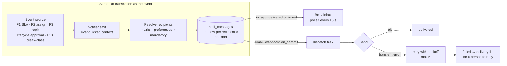

# 6. F4 Notifications — NEW + CHANGED

Must · Wave 1 · Proposed ADR-0033.

## a. Problem & goal

Nobody is told anything. A `require_approval` action waits up to 72 h for an
approver who is never notified (`TODO.md` item 14.3). The only channel is the
lifecycle `send_email` action, which no default workflow uses, and the dev
email backend prints to the console. ADR-0028 explicitly left in-app
notifications out.

**Goal:** one notification service that every feature calls. It tells the
right people (a matrix of event × recipient × channel), through the channels
they chose (preferences), except notices they must not miss (mandatory). A
failed email never changes a ticket.

**Benchmark:** ServiceNow lets users switch notifications and channels on and
off; Freshservice has admin toggles per notification and audience, and
translated templates. Adopt the matrix, preferences and vi/en templates.
Adapt with a mandatory flag and masked-only templates. Skip SMS, push, Slack
and Teams this phase ([benchmark F4](benchmark.md#f4-notifications)).

## b. Process flow



Joins today's flow at: `lifecycle` approval requests (`RequireApproval`
action), and every F1/F2/F3/F5/F13 event below. Never inside `router.py` or
the pipeline's routing step.

## c. State changes

`notif_messages.state`:

| From | Event | To |
|---|---|---|
| — | Emitted, channel `in_app` | `delivered` |
| — | Emitted, channel `email` / `webhook` | `queued` |
| `queued` | Dispatch starts | `sending` |
| `sending` | Provider accepts | `delivered` |
| `sending` | Transient error, attempts < max | `queued` (with `next_attempt_at`) |
| `sending` | Permanent error or attempts = max | `failed` |
| `failed` | A person clicks retry | `queued` |
| `queued` / `sending` | Stuck > `notifications.stuck_after_sec` | `queued` (sweep) |

`read_at` is set on in-app messages when the user opens or marks them.

## d. Use cases

| Field | UC-F4-01 · Notify on an event |
|---|---|
| Actor | System |
| Trigger | A feature calls `Notifier.emit(event, ticket, context)` |
| Preconditions | Event is in the catalog |
| Main flow | 1. Look up matrix rows for the event. 2. Resolve each recipient kind to users (assignee, team lead, …). 3. Drop cells the user turned off, unless mandatory. 4. Render vi or en template from masked fields. 5. Insert one message per recipient × channel in the caller's transaction. 6. After commit, queue dispatch for email/webhook |
| Alternate | 2a. Recipient kind resolves to nobody (no assignee yet) → no row; audited at debug level only |
| Exception | 4x. Template error → message `failed` with `template_error`; event and ticket unaffected |
| Postconditions | Rows exist; the event's own transaction committed regardless of later sending |
| Rules | BR-F4-01…08 |
| Screens | — |
| MoSCoW | Must |

| Field | UC-F4-02 · Read my notifications |
|---|---|
| Actor | Any user |
| Trigger | Bell shows a count; user opens it |
| Preconditions | Signed in |
| Main flow | 1. App polls `GET /api/notifications?unread=true` every 15 s. 2. User opens the panel. 3. Click a row → opens the ticket; row marked read |
| Alternate | 3a. "Mark all read" |
| Exception | — |
| Postconditions | `read_at` set |
| Rules | BR-F4-07 |
| Screens | [`F4 · Notification bell`](https://www.figma.com/design/KXpnlC78p9pHYRuZZuQxIL?node-id=11-480) (admin-console NavBar CHANGED, chat header CHANGED), [`F4 · Notification panel`](https://www.figma.com/design/KXpnlC78p9pHYRuZZuQxIL?node-id=11-531) |
| MoSCoW | Must |

| Field | UC-F4-03 · Set my preferences |
|---|---|
| Actor | Any user |
| Trigger | Opens notification settings |
| Preconditions | — |
| Main flow | 1. See every event that can reach them, per channel, with its default. 2. Toggle cells. 3. Save |
| Alternate | — |
| Exception | 2x. Mandatory cell shown locked with "Required" |
| Postconditions | Preferences apply to the next emit |
| Rules | BR-F4-03 |
| Screens | [`F4 · My notification settings`](https://www.figma.com/design/KXpnlC78p9pHYRuZZuQxIL?node-id=11-564) |
| MoSCoW | Must |

| Field | UC-F4-04 · Edit the notification matrix |
|---|---|
| Actor | `workflow_admin` |
| Trigger | Process change |
| Preconditions | — |
| Main flow | 1. See event × recipient × channel grid. 2. Toggle a cell's default. 3. Save with a reason |
| Alternate | — |
| Exception | 2x. Mandatory cells can't be turned off: 409 `mandatory_cell` |
| Postconditions | Audited `notif_matrix_changed` with before/after |
| Rules | BR-F4-02, 03 |
| Screens | [`F4 · Notification matrix`](https://www.figma.com/design/KXpnlC78p9pHYRuZZuQxIL?node-id=11-710) |
| MoSCoW | Must |

| Field | UC-F4-05 · Handle failed deliveries |
|---|---|
| Actor | `workflow_admin`, `manager` |
| Trigger | Delivery list shows failures |
| Preconditions | — |
| Main flow | 1. Filter failed by channel, event, date. 2. Read error. 3. Retry one or all |
| Alternate | — |
| Exception | — |
| Postconditions | Retried rows `queued`; audited |
| Rules | BR-F4-05 |
| Screens | [`F4 · Delivery log`](https://www.figma.com/design/KXpnlC78p9pHYRuZZuQxIL?node-id=11-890) |
| MoSCoW | Should (inside a Must feature) |

| Field | UC-F4-06 · Subscribe an external system (webhook) |
|---|---|
| Actor | `workflow_admin` |
| Trigger | e.g. post SLA breaches to a Teams channel through n8n |
| Preconditions | Host on `LIFECYCLE_WEBHOOK_ALLOWED_HOSTS` |
| Main flow | 1. Add URL, events, secret. 2. System sends signed JSON on each event |
| Alternate | — |
| Exception | 1x. Host not allowed → 422 `webhook_host_refused` (same check as ADR-0028 §6) |
| Postconditions | Subscription active |
| Rules | BR-F4-06 |
| Screens | [`F4 · Webhook subscriptions`](https://www.figma.com/design/KXpnlC78p9pHYRuZZuQxIL?node-id=11-1047) |
| MoSCoW | Must |

## e. Business rules

| ID | Rule | Rationale | Enforced where |
|---|---|---|---|
| BR-F4-01 | Messages are written in the same transaction as the event; sending happens after commit | No event without its notice, no notice for a rolled-back event (proposed ADR-0033) | `Notifier.emit` |
| BR-F4-02 | The event catalog and its recipient kinds are code (`NotificationEvent` enum). The matrix defaults are data | Like ADR-0028's action catalog: no user-defined logic | Code; matrix API |
| BR-F4-03 | Mandatory cells are fixed in the catalog; neither users nor admins turn them off. Mandatory cells are marked in the catalog below: security alerts and their overdue reminders, break-glass sign-ins, credential exposure (to the requester), incident proposals and broadcasts, approval requests (in-app), rollout flag changes (in-app) and unapproved thresholds | Some notices must not be opt-out | Catalog + API refusal |
| BR-F4-04 | Templates read masked fields only, never the quarantine; the existing variable set of `apps/lifecycle/utils/templates.py` is reused | ADR-0028 §6 | Renderer |
| BR-F4-05 | A failed send never changes a ticket, a decision or a status. Failures are listed for a person | BR-X-07 | Dispatcher |
| BR-F4-06 | Webhook bodies are fixed JSON per event (no free template), signed with HMAC-SHA256 in `X-SmartTicket-Signature`, to allow-listed hosts only, no redirects | ADR-0028 §6, amended 2026-10-15 | Dispatcher |
| BR-F4-07 | Each user gets messages in their `language` (`vi` default, `en`) | Mixed vi/en staff | Renderer |
| BR-F4-08 | One message per (event id, user or subscription, channel) | Retries and re-emits never double-send | Unique constraint |

## f. Functional requirements

| ID | Requirement |
|---|---|
| FR-F4-001 | The system shall provide `Notifier.emit(event, ticket, context)` as the only way to create notifications |
| FR-F4-002 | The system shall support channels `in_app`, `email`, `webhook` |
| FR-F4-003 | The system shall resolve recipient kinds `requester`, `assignee`, `team_lead`, `team_members`, `manager`, `security`, `workflow_admins`, `kb_editors`, `incident_managers`, `approver`, `linked_requesters`, `previous_assignee` |
| FR-F4-004 | The system shall apply user preferences except to mandatory cells |
| FR-F4-005 | The system shall render subject and body from per-language templates using masked fields only |
| FR-F4-006 | The system shall send email through the configured SMTP relay with text and HTML parts and a link to the ticket |
| FR-F4-007 | The system shall retry transient email and webhook failures up to `notifications.max_attempts` with exponential backoff (`LIFECYCLE_RETRY_BACKOFF_*`, reused) |
| FR-F4-008 | The system shall list, filter and retry failed deliveries |
| FR-F4-009 | Both apps shall show an unread count and a panel, polling every `NOTIFICATION_POLL_SEC` (15) |
| FR-F4-010 | The system shall delete in-app messages older than `notifications.in_app_retention_days` (90) |
| FR-F4-011 | The system shall notify the approver when `require_approval` creates an approval request (closes `TODO.md` 14.3) |
| FR-F4-012 | The system shall audit matrix changes, webhook subscription changes and manual retries |
| FR-F4-013 | *(Could)* The system shall offer a daily email digest of non-mandatory events instead of one email each |

**Event catalog** (owners in brackets; events of later features stay inactive until they ship)

| Event | Default recipients → channels | Mandatory |
|---|---|---|
| `ticket.received` [F3] | requester → in_app, email | — |
| `ticket.assigned` [F2] | assignee → in_app, email | — |
| `ticket.reassigned` [F2] | new assignee → in_app, email; previous assignee → in_app; team lead → in_app | — |
| `ticket.unassigned` [F2] | team lead → in_app, email | — |
| `ticket.public_comment` [F3] | requester → in_app, email | — |
| `ticket.requester_replied` [F3] | assignee → in_app, email | — |
| `ticket.status_changed` [F3] | requester → in_app (only into `waiting_on_requester`, `resolved`) | — |
| `ticket.resolved` [F3] | requester → in_app, email (carries the CSAT link) | — |
| `ticket.reopened` [F3] | assignee, team lead → in_app | — |
| `ticket.rated_low` [F3] | team lead → in_app, email | — |
| `sla.warning` [F1] | assignee → in_app, email; team lead → in_app | — |
| `sla.breached` [F1] | assignee, team lead → in_app, email | — |
| `sla.breached_escalated` [F1] | manager → in_app, email | — |
| `sla.holidays_missing` [F1] | workflow_admins → in_app, email | — |
| `assignment.failed` [F2] | team lead of the fallback team → in_app | — |
| `approval.requested` [lifecycle] | approver → in_app, email | in_app |
| `security.alert` [F5, F13, F8] | security → in_app, email | both |
| `identity.break_glass_used` [F13] | security → in_app, email | both |
| `incident.broadcast` [F7] | linked requesters → in_app, email | both |
| `incident.proposed` [F7] | incident managers → in_app, email | both |
| `incident.sla_breached` [F7] | manager → in_app, email | — |
| `security.credential_exposed` [F8] | requester → in_app, email | both |
| `security.ack_overdue` [F8] | security → in_app, email | both |
| `kb.review_requested` [F6] | kb editors, managers → in_app | — |
| `kb.authority_needed` [F6] | managers → in_app, email | — |
| `kb.gaps_ready` [F6] | kb editors → in_app, email | — |
| `rollout.flag_requested` [F9] | managers → in_app, email | — |
| `rollout.flag_changed` [F9] | managers, security → in_app, email | in_app |
| `rollout.gate_unmet` [F9] | managers → in_app, email | — |
| `thresholds.cr_pending` [F9] | managers → in_app | — |
| `thresholds.unapproved` [F9] | managers, security → in_app, email | both |
| `report.weekly` [F10] | managers → email | — |

## g. Data changes

All NEW, app `notifications`, written by core-api only.

| Table | Key fields |
|---|---|
| `notif_matrix_rules` | `event`, `recipient_kind`, `channel`, `default_on` bool, `mandatory` bool (copied from catalog, read-only), `updated_by`, `updated_at`. Unique (`event`, `recipient_kind`, `channel`) |
| `notif_preferences` | `user`, `event`, `channel`, `enabled`. Unique (`user`, `event`, `channel`) |
| `notif_messages` | `event_id` UUID, `event`, `ticket` FK null, `user` FK null, `subscription` FK null, `channel`, `language`, `subject`, `body`, `link`, `state`, `attempts`, `next_attempt_at`, `last_error`, `created_at`, `delivered_at`, `read_at`. Unique (`event_id`, `user`, `subscription`, `channel`). Index (`user`, `read_at`, `created_at`) |
| `notif_webhook_subscriptions` | `name`, `url`, `events` (array), `secret` (encrypted with the PII key's AES-GCM helper), `is_active`, `created_by` |
| `notif_templates` | `event`, `channel`, `language`, `subject_template`, `body_template`, `updated_by` |

**`accounts_user` — CHANGED:** NEW `language` varchar(5) default `vi`.

**`thresholds.yaml` — CHANGED**

```yaml
notifications:
  max_attempts: 5
  stuck_after_sec: 120
  in_app_retention_days: 90
```

**`.env.example` — CHANGED:** `NOTIFICATION_POLL_SEC=15`, `NOTIFICATION_PUBLIC_BASE_URL=http://localhost:3000`; real SMTP values in `EMAIL_*` (already present).

PII: message bodies are rendered from masked text; `user.email` is account data
already stored.

**Records, stage by stage** (Đức is assigned `TKT-2026-000415`)

1 · Event emitted by F2, inside the assignment transaction:

```json
{ "event": "ticket.assigned", "event_id": "5b7e0d1a-…", "ticket": "TKT-2026-000415",
  "context": { "assignee": "duc.tm", "team": "network", "by": "system:least_loaded" } }
```

2 · Matrix and preference rows read:

| table | event | recipient | channel | value |
|---|---|---|---|---|
| `notif_matrix_rules` | `ticket.assigned` | assignee | in_app | default_on true |
| `notif_matrix_rules` | `ticket.assigned` | assignee | email | default_on true |
| `notif_preferences` | `ticket.assigned` | `duc.tm` | email | enabled **false** |

3 · Messages inserted (one row, email dropped by preference):

| event_id | user | channel | language | subject | state |
|---|---|---|---|---|---|
| `5b7e0d1a-…` | `duc.tm` | in_app | vi | "Bạn được giao TKT-2026-000415: VPN client báo lỗi TLS handshake failed khi kết nối từ nhà" | delivered |

4 · Đức's next poll:

```json
GET /api/notifications?unread=true
{ "unread": 1, "items": [ { "id": "c2f1…", "event": "ticket.assigned",
  "subject": "Bạn được giao TKT-2026-000415: VPN client báo lỗi TLS handshake failed khi kết nối từ nhà",
  "link": "/tickets/TKT-2026-000415", "created_at": "2026-10-17T04:20:05Z", "read_at": null } ] }
```

## h. API changes

| Method · Path | Role | Request | Response | Errors |
|---|---|---|---|---|
| `GET /api/notifications?unread=&limit=&before=` | any (own) | — | `{unread, items[]}` | — |
| `POST /api/notifications/{id}/read` | any (own) | — | 204 | 404 |
| `POST /api/notifications/read-all` | any (own) | — | 204 | — |
| `GET /api/notifications/preferences` | any (own) | — | `[{event, channel, enabled, default_on, mandatory}]` | — |
| `PUT /api/notifications/preferences` | any (own) | `[{event, channel, enabled}]` | same as GET | 409 `mandatory_cell` |
| `GET /api/notifications/matrix` | workflow_admin, manager | — | `[{event, recipient_kind, channel, default_on, mandatory}]` | — |
| `PUT /api/notifications/matrix` | workflow_admin | `{changes:[…], reason}` | same as GET | 409 `mandatory_cell` · 422 `reason_required` |
| `GET /api/notifications/deliveries?state=failed&channel=&event=` | workflow_admin, manager | — | list | — |
| `POST /api/notifications/deliveries/retry` | workflow_admin, manager | `{ids:[…]}` or `{all_failed:true}` | `{requeued}` | — |
| `GET/POST/PATCH/DELETE /api/notifications/webhooks` | workflow_admin | `{name, url, events, secret}` | subscription | 422 `webhook_host_refused` |
| `PUT /api/notifications/templates/{event}/{channel}/{language}` | workflow_admin | `{subject_template, body_template}` | template | 422 `unknown_variable` |

**Celery tasks**

| Task | Trigger | Idempotency |
|---|---|---|
| `notifications.dispatch(message_id)` | `on_commit` after emit; retries | Locks the row (`SELECT … FOR UPDATE SKIP LOCKED`); only `queued` rows are sent; a `delivered` row is never re-sent |
| `notifications.sweep` | beat, every 60 s | Requeues `sending` rows older than `stuck_after_sec`; picks due `queued` rows |
| `notifications.purge` | beat, daily 02:00 `Asia/Ho_Chi_Minh` | Deletes in-app rows past retention; safe to re-run |

**Webhook event body** (same shape for every event)

```json
{ "event": "sla.breached", "event_id": "8d1c…", "occurred_at": "2026-10-17T09:31:00Z",
  "ticket": { "id": "TKT-2026-000418", "subject": "Laptop không nhận màn hình thứ hai sau update Windows",
              "status": "in_progress", "category": "hardware", "priority": "P3",
              "assigned_team": "hardware", "assignee": "mai.bn" },
  "data": { "target": "resolution", "due_at": "2026-10-17T09:30:00Z" } }
```

## i. Impact

- **Changes:** NavBar in admin-console and the chat header get a bell; `require_approval` now notifies (TODO 14.3); `accounts_user` gets `language`.
- **Must not change:** lifecycle `send_email` / `call_webhook` actions keep working as configured actions; routing and pipeline timing (emit is a few inserts); no notice ever contains quarantine data.
- **ADRs:** 0028 §6 (masked text, allow-list) applied; proposed 0033.
- **Regression tests:** `test_notice_uses_masked_text_only`; `test_failed_email_leaves_ticket_unchanged`; `test_rolled_back_event_sends_nothing`; `test_mandatory_cell_ignores_preference`; `test_dispatch_twice_sends_once`; lifecycle approval tests assert a notice.

## j. Acceptance criteria

```gherkin
Feature: F4 Notifications

  Scenario: AC-F4-01 assignee gets an in-app notice with masked text
    Given ticket "TKT-2026-000412" has body "Em là [EMPLOYEE_CODE_1], SĐT [PHONE_VN_1]"
    When the ticket is assigned to "ha.vt"
    Then "ha.vt" has one unread in-app notice "ticket.assigned"
    And its body contains "[PHONE_VN_1]" and no phone number

  Scenario: AC-F4-02 preference turns off email
    Given "duc.tm" turned off email for "ticket.assigned"
    When a ticket is assigned to "duc.tm"
    Then an in-app notice exists for "duc.tm"
    And no email message exists for "duc.tm"

  Scenario: AC-F4-03 mandatory notice ignores preference
    Given "anh.lh" tries to turn off email for "security.alert"
    Then the response is 409 with code "mandatory_cell"
    When a break-glass sign-in happens
    Then "anh.lh" gets both an in-app and an email notice

  Scenario: AC-F4-04 failed email does not touch the ticket
    Given the SMTP relay rejects every message
    When a ticket is assigned to "duc.tm"
    Then the assignment is committed
    And after 5 attempts the email message is "failed" with last_error set
    And the ticket's status and version are unchanged by the failure

  Scenario: AC-F4-05 rolled-back event sends nothing
    Given an assignment transaction raises after emit
    Then no notif_messages rows exist for that event_id

  Scenario: AC-F4-06 approver is told
    Given a transition with action require_approval naming "huy.pq"
    When "duc.tm" requests that move
    Then "huy.pq" has an in-app notice "approval.requested" linking to the approval

  Scenario: AC-F4-07 webhook to a disallowed host is refused
    When "tu.dv" subscribes "https://evil.example.com/hook"
    Then the response is 422 with code "webhook_host_refused"

  Scenario: AC-F4-08 language follows the user
    Given "mai.bn" has language "en"
    When a ticket is assigned to "mai.bn"
    Then the notice subject starts with "Assigned to you: TKT-"
```
