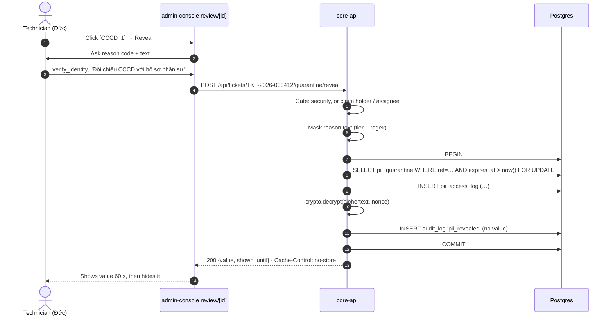

# 6. F5 PII quarantine reveal — NEW

Must · Wave 0 · Closes `status.md` Gap 1 and `TODO.md` item 1.

## a. Problem & goal

Raw PII is masked inline, encrypted (AES-GCM) into `pii_quarantine`, and
deleted after 72 h (`PII_QUARANTINE_TTL_HOURS`). Nobody can read it back:
`crypto.decrypt()` is never called, `PiiAccessLog` has no rows, and no endpoint
exists. A technician working a ticket sees `[PHONE_VN_1]` or `[CCCD_1]` and
can't call the requester back or check the ID. Security can't look at the
credential that got a ticket blocked into the `pii_verify` queue.

**Goal:** an allowed person reveals one value, for one stated reason, and the
log row is written in the same transaction as the decrypt. No code path
returns plaintext without its log row (spec §3.1: every raw-PII read is a log
line, no exceptions).

**Benchmark:** SDP keeps a PII access log with module, action and time; the
others mask or alert but don't offer a logged reveal. Spec §3.1 is stricter
than all of them. Adopt SDP's exportable log; adapt with a mandatory reason
and same-transaction write ([benchmark F5](benchmark.md#f5-pii-quarantine-reveal)).

## b. Process flow



Where it joins today's flow: on any review item a person has claimed
(`review/[id]`), and on any ticket assigned to a person (F2). Today the
`pii_verify` queue holds only `block` / `pii_critical` tickets
(`pipeline._execute_or_enqueue`), so its values are credentials: security only.

## c. State changes

No ticket status changes. A `pii_quarantine` row is read, never changed.

## d. Use cases

| Field | UC-F5-01 · Reveal one masked value |
|---|---|
| Actor | Technician who holds the claim on a pending review item of the ticket, or is the ticket's assignee (F2); or `security` |
| Trigger | Clicks a placeholder chip and **Reveal** |
| Preconditions | Ticket has the placeholder in `pii_map`; quarantine row not expired |
| Main flow | 1. Actor picks a reason code and types a reason. 2. System checks access (BR-F5-01, 02). 3. System masks the reason text (BR-F5-04). 4. System writes the access-log row, decrypts, writes the audit row, commits. 5. Value shown for 60 s, then hidden |
| Alternate | 2a. Placeholder is a critical label → only `security` passes (BR-F5-02) |
| Exception | 2x. Not allowed → 403 `reveal_not_allowed`. 1x. Empty reason → 422 `reason_required`. 4x. Expired → 410 `quarantine_expired`. 4y. Decrypt fails → 500 `decrypt_failed`, transaction rolled back, `pii_reveal_failed` audit row in a separate transaction, `security_alert`. 2y. Over the hourly limit → 429 `reveal_rate_limited` + `security_alert` |
| Postconditions | Exactly one `pii_access_log` row per value returned |
| Rules | BR-F5-01…08 |
| Screens | [`F5 · Reveal dialog`](https://www.figma.com/design/KXpnlC78p9pHYRuZZuQxIL?node-id=12-677) (CHANGED `review/[id]`), [`F5 · Access log`](https://www.figma.com/design/KXpnlC78p9pHYRuZZuQxIL?node-id=12-734) |
| MoSCoW | Must |

| Field | UC-F5-02 · Review the access log |
|---|---|
| Actor | `security` |
| Trigger | Opens the access log, or follows an F8 alert |
| Preconditions | — |
| Main flow | 1. Filter by ticket, actor, date, reason code. 2. Export CSV (no values, only metadata) |
| Alternate | — |
| Exception | Non-security caller → 403 |
| Postconditions | Export is audited (`pii_access_log_exported`) |
| Rules | BR-F5-06 |
| Screens | [`F5 · Access log`](https://www.figma.com/design/KXpnlC78p9pHYRuZZuQxIL?node-id=12-734) |
| MoSCoW | Must |

## e. Business rules

| ID | Rule | Rationale | Enforced where |
|---|---|---|---|
| BR-F5-01 | A technician may reveal only on a ticket where they hold the claim on a review item (state `claimed`, v0.6.2), or are `assigned_to` | Need-to-know: the claim or the assignment is the reason they are looking (`TODO.md` item 1) | Reveal service, before decrypt |
| BR-F5-02 | Critical labels (`PASSWORD`, `TOKEN`, `AWS_KEY`, `GENERIC_SECRET_ASSIGN`) only for `security` | A leaked credential is an incident, not a support detail | Reveal service |
| BR-F5-03 | Reason code from a fixed list **and** reason text of 10–500 characters | Spec §3.1: reason mandatory, non-empty | Request schema + service |
| BR-F5-04 | Reason text is masked by the regex tier (`patterns.py`) only, not NER. A critical hit in the reason refuses the reveal | BR-X-06, without making reveals depend on ai-engine being up. Documented exception | Reveal service |
| BR-F5-05 | Log row, decrypt and audit row are in one transaction. If the log insert fails, no plaintext leaves the function | Spec §3.1, CLAUDE.md "Current state" | `PiiReveal.reveal()`; test with a forced insert failure |
| BR-F5-06 | `pii_access_log` is append-only: a trigger refuses UPDATE and DELETE for every role; `REVOKE UPDATE, DELETE` from the app role as well (v0.6.2) | Same guarantee as `audit_log` | `infra/migrations/sql/0007_pii_access_log_lockdown.sql` |
| BR-F5-07 | At most `pii_reveal.max_per_user_per_hour` reveals (default 20); the next is refused and alerts `security` | Bulk reading looks like exfiltration | `thresholds.yaml`, service |
| BR-F5-08 | The value never appears in logs, audit payloads, notifications, exports, or the URL. Response carries `Cache-Control: no-store` | One person, one screen | Code review; log-capture test |

## f. Functional requirements

| ID | Requirement |
|---|---|
| FR-F5-001 | The system shall reveal one placeholder per request, identified by ticket public id and placeholder text |
| FR-F5-002 | The system shall refuse a reveal unless BR-F5-01 or the `security` role applies |
| FR-F5-003 | The system shall refuse a critical-label reveal for any role but `security` |
| FR-F5-004 | The system shall require a reason code and a 10–500 character reason text |
| FR-F5-005 | The system shall write the `pii_access_log` row, decrypt, and write the `pii_revealed` audit row in one database transaction |
| FR-F5-006 | The system shall refuse a reveal of an expired or missing quarantine row with 410 |
| FR-F5-007 | The system shall apply the hourly per-user limit and raise `security_alert` on the first refusal in an hour |
| FR-F5-008 | The admin console shall hide a revealed value after `pii_reveal.display_seconds` (default 60) and on navigation |
| FR-F5-009 | The system shall list access-log rows to `security`, filterable by ticket, actor, date range and reason code, and export them as CSV without values |
| FR-F5-010 | The system shall route all decrypts through one service; a test shall fail if `crypto.decrypt` is called anywhere else |

## g. Data changes

**`pii_access_log` — CHANGED** (table exists, no rows yet; `apps/tickets/models.py`)

| Field | Before | After | PII? |
|---|---|---|---|
| `ref` | UUID | unchanged | No |
| `actor` | FK user | unchanged | No |
| `reason` | text | unchanged; holds the **masked** reason text | No (masked) |
| `ticket` | — | NEW FK `tickets`, PROTECT | No |
| `placeholder` | — | NEW varchar(40), e.g. `[CCCD_1]` | No |
| `reason_code` | — | NEW varchar(30): `verify_identity`, `contact_requester`, `security_investigation`, `legal_request` | No |
| `review_item` | — | NEW FK `review_items`, null for security and assignees | No |
| `outcome` | — | NEW `revealed` (only value; refusals go to `audit_log`) | No |

Migration: add nullable columns, backfill nothing (table is empty), then set
`ticket`, `placeholder`, `reason_code` NOT NULL. Writer: core-api only.

**`thresholds.yaml` — CHANGED**

```yaml
pii_reveal:
  max_per_user_per_hour: 20   # 🔧 assumption
  display_seconds: 60
```

**Records, stage by stage**

Quarantine row (exists since submit):

| ref | ticket | ciphertext | nonce | expires_at |
|---|---|---|---|---|
| `6f0c…a91e` | `TKT-2026-000412` | `\x8b2f…` (bytea) | `\x1c9a…` | 2026-10-19 09:14 UTC |

Request:

```json
POST /api/tickets/TKT-2026-000412/quarantine/reveal
{ "placeholder": "[CCCD_1]", "reason_code": "verify_identity",
  "reason": "Đối chiếu CCCD với hồ sơ nhân sự trước khi mở khoá tài khoản" }
```

Rows written in one transaction:

| table | row |
|---|---|
| `pii_access_log` | ref `6f0c…a91e` · actor `duc.tm` · ticket `TKT-2026-000412` · placeholder `[CCCD_1]` · reason_code `verify_identity` · reason "Đối chiếu CCCD với hồ sơ nhân sự trước khi mở khoá tài khoản" · review_item `b71d…` · accessed_at 2026-10-17 04:02:11 UTC |
| `audit_log` | event `pii_revealed` · actor `duc.tm` · ticket `TKT-2026-000412` · payload `{"placeholder":"[CCCD_1]","reason_code":"verify_identity","access_log":"9e4a…"}` |

Response:

```json
{ "placeholder": "[CCCD_1]", "value": "001203004567", "shown_until": "2026-10-17T04:03:11Z" }
```

## h. API changes

| Method · Path | Role | Request | Response | Errors |
|---|---|---|---|---|
| `POST /api/tickets/{public_id}/quarantine/reveal` | technician (claim holder) · security | `{placeholder, reason_code, reason}` | 200 `{placeholder, value, shown_until}` | 403 `reveal_not_allowed` · 403 `critical_needs_security` · 404 `placeholder_not_found` · 410 `quarantine_expired` · 422 `reason_required` / `reason_has_secret` · 429 `reveal_rate_limited` · 500 `decrypt_failed` |
| `GET /api/pii/access-log?ticket=&actor=&from=&to=&reason_code=` | security | — | 200 list of rows (no values) | 403 |
| `GET /api/pii/access-log.csv` (same filters) | security | — | 200 `text/csv` | 403 |

No Celery task. No webhook event.

## i. Impact

- **Changes:** `crypto.decrypt()` gets its first caller; the `pii_verify` queue becomes workable.
- **Must not change:** masking (inline, synchronous, 100 % branch coverage); `mask_failed` → person; 72 h TTL and the hourly expiry task.
- **ADRs / rules:** spec §3.1; BR-X-02, 03, 06, 08.
- **Regression tests:** `test_reveal_writes_exactly_one_access_log_row`; `test_no_plaintext_when_access_log_insert_fails`; `test_decrypt_has_one_caller`; `test_expired_entry_is_gone`; `test_masking_coverage_still_100`; `test_revealed_value_absent_from_logs`.

## v0.6.2 — where the code differs (built 2026-10-17)

Code wins (README §0.4 item 5). Each change and its reason:

1. **"Claim on a `pending` item" → state `claimed`.** `ReviewItem.claim()` moves
   an item from `pending` to `claimed`, so a claimed item is never pending
   (`apps/review/models.py`). BR-F5-01 and the §j Background now say `claimed`.
2. **Append-only by trigger.** core-api's role owns `pii_access_log`; a REVOKE
   against a table's owner is a no-op in Postgres (as `infra/migrations/sql/0004`
   says for `audit_log`). `0007_pii_access_log_lockdown.sql` adds the REVOKE and
   a trigger; Postgres's message is "pii_access_log is append-only" (AC-F5-09).
3. **New 500 code `access_log_failed`** for a failed access-log insert (AC-F5-06),
   beside `decrypt_failed`. Both audit `pii_reveal_failed` and raise
   `security_alert` in a separate transaction.
4. **Assignee needs no F2.** `Ticket.assigned_to` exists today and the lifecycle's
   assign action sets it, so BR-F5-01's assignee branch works in wave 0.
5. **The reveal lives on `tickets/[id]`**, not `review/[id]`: the admin console
   folded the review page into the ticket page (it redirects). The ticket detail
   (`GET /api/tickets/{id}/detail`) gained `pii_placeholders: [{placeholder,
   level}]` so the page can colour each chip and mark credentials security-only.
   Access-log rows carry `level` for the same reason.
6. **The button says "Reveal"**, not "Reveal for 60 s": the display time is
   `pii_reveal.display_seconds` in `thresholds.yaml`, and the dialog counts down
   from the response's `shown_until`.
7. **Reason length** outside 10–500 answers `reason_required` (one code for empty,
   short and long), and a time filter without a zone is UTC (BR-X-09).

## j. Acceptance criteria

```gherkin
Feature: F5 PII reveal

  Background:
    Given ticket "TKT-2026-000412" has placeholder "[CCCD_1]" in quarantine, expiring in 30 hours
    And a low_confidence review item for it is claimed by "duc.tm"

  @BR-F5-01 @BR-F5-03 @BR-F5-05
  Scenario: AC-F5-01 claim holder reveals with a reason
    When "duc.tm" reveals "[CCCD_1]" with reason_code "verify_identity" and a 40-character reason
    Then the response is 200 with the decrypted value
    And exactly one pii_access_log row exists for actor "duc.tm" and placeholder "[CCCD_1]"
    And one audit_log row "pii_revealed" exists whose payload has no value

  @BR-F5-03
  Scenario: AC-F5-02 empty reason is refused
    When "duc.tm" reveals "[CCCD_1]" with reason ""
    Then the response is 422 with code "reason_required"
    And no pii_access_log row is written

  @BR-F5-01
  Scenario: AC-F5-03 technician without the claim is refused
    When "mai.bn" (technician) reveals "[CCCD_1]"
    Then the response is 403 with code "reveal_not_allowed"

  @BR-F5-02
  Scenario: AC-F5-04 critical label needs security
    Given the ticket also has "[PASSWORD_1]"
    When "duc.tm" reveals "[PASSWORD_1]"
    Then the response is 403 with code "critical_needs_security"
    When "anh.lh" (security) reveals "[PASSWORD_1]" with a reason
    Then the response is 200

  @FR-F5-006
  Scenario: AC-F5-05 expired value is gone
    Given the quarantine row expired 1 minute ago
    When "anh.lh" reveals "[CCCD_1]"
    Then the response is 410 with code "quarantine_expired"

  @BR-F5-05
  Scenario: AC-F5-06 no plaintext without a log row
    Given inserting into pii_access_log raises an error
    When "anh.lh" reveals "[CCCD_1]"
    Then the response is 500 and contains no value
    And no pii_access_log row exists

  @BR-F5-07
  Scenario: AC-F5-07 rate limit alerts security
    Given "anh.lh" made 20 reveals in the last hour
    When "anh.lh" reveals one more value
    Then the response is 429 with code "reveal_rate_limited"
    And one audit_log row "security_alert" exists with reason "reveal_rate_limited"

  @BR-F5-04
  Scenario: AC-F5-08 a reason with a secret is refused
    When "duc.tm" reveals with reason "mật khẩu: Abc@12345 để thử đăng nhập"
    Then the response is 422 with code "reason_has_secret"

  @BR-F5-06
  Scenario: AC-F5-09 the access log can't be edited
    Given one pii_access_log row exists for "[CCCD_1]" on "TKT-2026-000412"
    When core-api's database role runs UPDATE or DELETE on pii_access_log
    Then Postgres refuses with "pii_access_log is append-only"

  @BR-F5-08
  Scenario: AC-F5-10 the value leaves no trace
    Given "duc.tm" revealed "[CCCD_1]" with value "001203004567"
    Then no log line, audit payload, notification, export or URL contains "001203004567"
    And the response has the header "Cache-Control: no-store"
```
