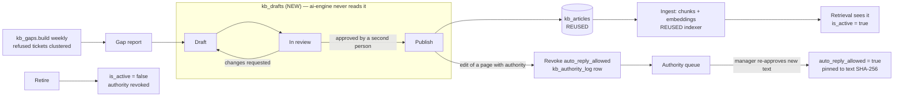

# 6. F6 KB authoring & governance UI — NEW + CHANGED

Should · Wave 4 · Proposed ADR-0036 (KB drafts live outside `kb_articles`).

## a. Problem & goal

Today:

- `POST /api/kb` creates a page and ingests it at once
  (`KbArticleManager.create_and_ingest`). There is no draft, no review, and
  (until PRE-1) no role check. Retrieval sees the page the moment it exists.
- Editing a page's text keeps its auto-reply authority.
  `upsert_from_source` bumps `version` but never touches `auto_reply_allowed`.
  Only the demo loader re-checks, by pinning approvals to a SHA-256
  (`demo_kb/curation.json`). For any other edit, a manager's approval of
  *yesterday's* text silently covers *today's* text.
- Authority changes are logged (`kb_authority_log`) but nobody can see the log
  without SQL.
- `refusal_rate` is on the dashboard (`apps/metrics/utils.py`), but nothing
  says *which* topics are being refused.

**Goal:** pages go live only after a second person reviews them. Publishing
never grants auto-reply authority (ADR-0002). A content change revokes
authority until a manager re-approves the new text. The authority log is
viewable. Refused tickets are grouped into topics, so KB editors know what to
write next.

**Benchmark:** ServiceNow has Draft → In review → Published → Retired, with
approval or instant paths. Freshservice assigns approvers per folder, and
authors can't edit while awaiting review. Moveworks clusters last month's
tickets into knowledge gaps and drafts an article per cluster. Adopt the
states and the author ≠ reviewer rule. Adapt: two separate approvals (content,
then authority), and the gap report built from our own refusal signal. Skip
LLM-drafted articles ([benchmark F6](benchmark.md#f6-kb-authoring--governance)).

## b. Process flow



Joins today's flow at `kb_articles`, which ai-engine already reads with
`is_active = true` (`retrieve/vector.py`, `retrieve/bm25.py`,
`candidate_pool/links.py`). Nothing in ai-engine changes.

## c. State changes

`kb_drafts.state`:

| From | Event | To | Who |
|---|---|---|---|
| — | Create (new page or edit of an existing one) | `draft` | `kb_editor`, manager |
| `draft` | Submit | `in_review` | author |
| `in_review` | Request changes (comment required) | `changes_requested` | reviewer ≠ author |
| `changes_requested` | Resubmit | `in_review` | author |
| `in_review` | Approve | `published` | reviewer ≠ author (`kb_editor` or manager) |
| `draft`, `changes_requested` | Withdraw | `withdrawn` | author, manager |
| `in_review` | The live page changed since the draft started | `conflict` | system |

`kb_articles` (REUSED fields, new transitions):

| Field | Change | Trigger |
|---|---|---|
| `version` | +1 | Publish an edit |
| `auto_reply_allowed` | true → **false** | Publish an edit of its text or title; retire |
| `is_active` | true → false | Retire |
| `approved_text_sha256` | NEW; set on grant | Manager grants authority |

## d. Use cases

| Field | UC-F6-01 · Write and submit a draft |
|---|---|
| Actor | `kb_editor` (Mai) |
| Trigger | New fix found, or a gap from the report |
| Preconditions | — |
| Main flow | 1. New page or "Edit" on a live page → draft with `base_version`. 2. Edit title, body (Markdown), category, proposed risk tier, change note. 3. Preview chunking (same chunker as ingest). 4. Submit |
| Alternate | 1a. Started from a gap → `gap_cluster` linked, sample tickets shown beside the editor |
| Exception | 4x. Title or body empty → 422 |
| Postconditions | `in_review`; reviewers notified (`kb.review_requested`) |
| Rules | BR-F6-01, 02 |
| Screens | `F6 · KB editor`, `F6 · KB drafts` |
| MoSCoW | Should |

| Field | UC-F6-02 · Review and publish |
|---|---|
| Actor | Another `kb_editor`, or a manager |
| Trigger | A draft in review |
| Preconditions | Reviewer ≠ author |
| Main flow | 1. See a diff against the live page. 2. Approve. 3. System writes `kb_articles` (create, or update + `version`+1), ingests, and marks the draft `published`. 4. If the page had authority → revoke (UC-F6-03). 5. If the proposed risk tier differs → an authority-queue item for the manager |
| Alternate | 2a. Request changes with a comment → `changes_requested` |
| Exception | 2x. Author approves own draft → 403 `self_review`. 3x. Live page changed since `base_version` → `conflict`; the author rebases. 3y. Ingest fails → the article keeps its old chunks if it existed; else the page is saved with no chunks (today's behaviour) and listed for `/reingest` |
| Postconditions | Retrieval sees the new text after ingest |
| Rules | BR-F6-02, 03, 04 |
| Screens | `F6 · Draft review` |
| MoSCoW | Should |

| Field | UC-F6-03 · Revoke authority on a content change |
|---|---|
| Actor | System, during publish |
| Trigger | Publishing an edit of title or body for a page with `auto_reply_allowed = true` |
| Preconditions | — |
| Main flow | 1. Set `auto_reply_allowed = false` in the publish transaction. 2. Write a `kb_authority_log` row: field `auto_reply_allowed`, old `true`, new `false`, actor = publisher, reason "Nội dung thay đổi ở bản nháp {id}; cần phê duyệt lại". 3. Add the page to the authority queue |
| Alternate | — |
| Exception | — |
| Postconditions | Router sends any auto-reply citing this page to a person (`kb_not_authorized`) until re-approved |
| Rules | BR-F6-04, ADR-0002 |
| Screens | `F6 · Authority queue` |
| MoSCoW | Should |

| Field | UC-F6-04 · Grant or re-grant auto-reply authority |
|---|---|
| Actor | Manager (Huy) |
| Trigger | Authority-queue item |
| Preconditions | Page active; risk tier set |
| Main flow | 1. See the text, risk tier, and the diff since the last approved text. 2. Confirm "Tôi đã đọc nội dung này". 3. Write a reason. 4. Existing `set_auto_reply_allowed` grants, plus `approved_text_sha256` |
| Alternate | 1a. Bulk approve several low- or medium-risk pages with one reason → one log row per page (ADR-0027) |
| Exception | 1x. Any high-risk page in a bulk request → 422 `high_risk_needs_single_review`, nothing approved. 4x. Not a manager → 403 |
| Postconditions | Authority pinned to the text the manager saw |
| Rules | BR-F6-05, 06 |
| Screens | `F6 · Authority queue` |
| MoSCoW | Should |

| Field | UC-F6-05 · View the authority log |
|---|---|
| Actor | Manager, security, `kb_editor` (read) |
| Trigger | Audit, incident review |
| Preconditions | — |
| Main flow | 1. Filter by page, actor, field, date. 2. Export CSV |
| Alternate | — |
| Exception | — |
| Postconditions | Export audited |
| Rules | — |
| Screens | `F6 · Authority log` |
| MoSCoW | Should |

| Field | UC-F6-06 · Use the KB-gap report |
|---|---|
| Actor | `kb_editor`, manager |
| Trigger | Weekly report ready (`kb.gaps_ready` notice) |
| Preconditions | ≥ `kb_gaps.min_cluster_size` refused tickets on one topic |
| Main flow | 1. See clusters by size: sample subjects (masked), nearest live page and its similarity, label `gap` or `update`. 2. "Start draft" (new page) or "Edit page" (update) |
| Alternate | 2a. Dismiss with a reason (e.g. "ngoài phạm vi IT") → hidden from future reports for 90 days |
| Exception | — |
| Postconditions | Draft linked to the cluster; the next report shows whether refusals dropped |
| Rules | BR-F6-07, 08 |
| Screens | `F6 · KB gaps` |
| MoSCoW | Should |

| Field | UC-F6-07 · Retire a page |
|---|---|
| Actor | `kb_editor` (with review) or manager |
| Trigger | Page obsolete |
| Preconditions | — |
| Main flow | 1. Retire draft with a reason. 2. On approval: `is_active = false`, authority revoked, logged |
| Alternate | — |
| Exception | — |
| Postconditions | ai-engine stops retrieving it (existing `is_active` filters) |
| Rules | BR-F6-04 |
| Screens | `F6 · Draft review` |
| MoSCoW | Should |

## e. Business rules

| ID | Rule | Rationale | Enforced where |
|---|---|---|---|
| BR-F6-01 | Drafts live in `kb_drafts`, never in `kb_articles` | ai-engine reads `kb_articles` and stays unchanged; no draft can leak into retrieval (proposed ADR-0036) | Schema |
| BR-F6-02 | The reviewer is never the author | Two-person check on what the model may quote | Approve endpoint |
| BR-F6-03 | Publishing never grants auto-reply authority | ADR-0002 | Publish service |
| BR-F6-04 | Publishing a changed title or body, or retiring, revokes `auto_reply_allowed` in the same transaction, with a `kb_authority_log` row. Revoking is allowed for any publisher; granting only for a manager | Authority was granted to specific text (`curation.json` already pins it); revoking moves toward people | Publish service |
| BR-F6-05 | A grant records the SHA-256 of the title + body the manager saw. A page whose current text hash differs is treated as not authorized | Same pin as the demo loader, for every page | `KbArticle` check; router input `kb.auto_reply_allowed` computed as `allowed and sha matches` |
| BR-F6-06 | High-risk pages are granted one at a time, never in a bulk request | ADR-0027 | Bulk endpoint |
| BR-F6-07 | The gap report uses only refused tickets (`retrieval_below_floor`) and HITL tickets whose reviewer marked `kb_verdict = wrong`. Ticket text shown is masked | Spec §11.1: a refusal spike means a KB hole | Report task |
| BR-F6-08 | A cluster is `update` if its nearest live chunk has cosine similarity ≥ `kb_gaps.update_similarity`, else `gap` | Moveworks' gap vs update split, on our vectors | Report task |
| BR-F6-09 | `load_demo_kb` keeps importing directly (snapshot + SHA pins) and is audited as `kb_snapshot_loaded` | It's an ops import of a reviewed snapshot, not authoring | Management command |

## f. Functional requirements

| ID | Requirement |
|---|---|
| FR-F6-001 | The system shall store KB drafts for new pages, edits and retirements, with author, base version, state and change note |
| FR-F6-002 | The system shall show a diff of a draft against the live page and a chunk preview from the ingest chunker |
| FR-F6-003 | The system shall move drafts through the states in §c and refuse self-review |
| FR-F6-004 | On approval, the system shall write `kb_articles` and ingest in the existing way, and mark the draft `published` |
| FR-F6-005 | The system shall detect a live page changed since `base_version` and set the draft to `conflict` |
| FR-F6-006 | The system shall revoke auto-reply authority on a published text change or retirement, with a log row |
| FR-F6-007 | The system shall keep an authority queue of pages needing a grant, re-grant or tier decision |
| FR-F6-008 | The system shall grant authority only through `set_auto_reply_allowed` by a manager, storing the text SHA-256 |
| FR-F6-009 | The system shall offer bulk grant for low and medium risk only, writing one log row per page |
| FR-F6-010 | The system shall treat a page as not authorized when its text SHA-256 differs from `approved_text_sha256` |
| FR-F6-011 | The system shall list and export `kb_authority_log` rows with filters |
| FR-F6-012 | A weekly task shall cluster refused tickets of the last `kb_gaps.window_days` by embedding and label each cluster `gap` or `update` |
| FR-F6-013 | The system shall let an editor start a draft from a cluster, or dismiss it with a reason |
| FR-F6-014 | `POST /api/kb` shall create a **draft** instead of a live page |
| FR-F6-015 | The system shall audit `kb_draft_created`, `kb_draft_submitted`, `kb_draft_reviewed`, `kb_published`, `kb_retired`, `kb_authority_revoked`, `kb_gap_dismissed` |

## g. Data changes

| Table | Status | Fields |
|---|---|---|
| `kb_drafts` | NEW | `kind` (`create` \| `edit` \| `retire`), `article` FK null, `slug`, `title`, `body`, `category`, `proposed_risk_tier`, `change_note`, `state`, `base_version`, `author`, `reviewer` null, `review_comment`, `gap_cluster` FK null, `created_at`, `updated_at`, `published_at` |
| `kb_articles` | CHANGED | NEW `approved_text_sha256` char(64) null. Existing `auto_reply_allowed`, `approved_by`, `version`, `is_active` reused |
| `kb_gap_reports` | NEW | `window_start`, `window_end`, `tickets_considered`, `created_at` |
| `kb_gap_clusters` | NEW | `report` FK, `label` (`gap` \| `update`), `size`, `sample_tickets` (array of ticket ids), `nearest_article` FK null, `nearest_similarity`, `state` (`open` \| `drafted` \| `dismissed`), `dismiss_reason`, `dismissed_until` |
| `kb_gap_cluster_tickets` | NEW | `cluster` FK, `ticket` FK |

**Migration:** backfill `approved_text_sha256` for every page with
`auto_reply_allowed = true` from its current title + body (the text live
today is the text that was approved; for the demo KB it matches
`curation.json`). Writer: core-api only. ai-engine: no grant change. PII: none
beyond masked ticket subjects already stored.

**`thresholds.yaml` — CHANGED**

```yaml
kb_gaps:
  window_days: 28
  cluster_similarity: 0.80     # 🔧 assumption
  min_cluster_size: 3
  update_similarity: 0.65      # 🔧 assumption, on bge-m3 cosine
  dismiss_days: 90
```

### Records, stage by stage — an edit that revokes authority

Before:

| slug | title | version | auto_reply_allowed | risk_tier | approved_text_sha256 |
|---|---|---|---|---|---|
| `identity-center.resetpassword-accessportal` | Resetting your AWS access portal user password | 3 | true | low | `0aca86e4…` |

Draft by Mai (edit), reviewed by Hà:

```json
{ "kind": "edit", "slug": "identity-center.resetpassword-accessportal", "base_version": 3,
  "title": "Resetting your AWS access portal user password",
  "body": "…(adds) Nhân viên công ty: dùng cổng SSO nội bộ thay vì liên kết 'Forgot password'…",
  "change_note": "Thêm hướng dẫn cho tài khoản qua SSO công ty", "state": "in_review",
  "author": "mai.bn" }
```

After Hà approves (one transaction, then ingest):

| table | row |
|---|---|
| `kb_articles` | version **4**, auto_reply_allowed **false**, approved_text_sha256 `0aca86e4…` (old, now stale) |
| `kb_authority_log` | field `auto_reply_allowed` · old `true` · new `false` · actor `ha.vt` · reason "Nội dung thay đổi ở bản nháp 5e21…; cần phê duyệt lại" |
| `kb_drafts` | state `published`, reviewer `ha.vt` |
| `kb_chunks` | re-chunked, re-embedded (REUSED `indexer.ingest`) |

Huy re-grants from the authority queue → `auto_reply_allowed true`,
`approved_text_sha256 = 7d41c0…` (new text), one more log row.

### Records — one weekly gap report

Input (refused in the last 28 days, masked):

| ticket | subject_masked |
|---|---|
| `TKT-2026-000377` | "Không in được ra máy in tầng 5 sau khi đổi mật khẩu" |
| `TKT-2026-000389` | "Printer HP tầng 5 báo offline" |
| `TKT-2026-000402` | "Máy in tầng 5 không nhận lệnh in từ laptop [EMPLOYEE_CODE_1]" |
| `TKT-2026-000409` | "Mất thiết bị MFA, không đăng nhập được AWS console" |
| `TKT-2026-000421` | "Lost my MFA phone, cannot sign in to the IAM user" |
| `TKT-2026-000426` | "Điện thoại có app MFA bị hỏng màn hình" |

Output clusters:

| label | size | samples | nearest live page | similarity |
|---|---|---|---|---|
| `gap` | 3 | 377, 389, 402 | `workspaces-user.client_troubleshooting` | 0.41 |
| `update` | 3 | 409, 421, 426 | `iam.id_credentials_mfa_lost-or-broken` ("Recover an MFA protected identity in IAM") | 0.72 |

Reading: the printer topic has no page (the AWS demo KB has none: a real
gap). The MFA topic has a page but tickets still fall below the floor:
likely Vietnamese wording the page doesn't use. The update action is an edit
draft on that page.

## h. API changes

| Method · Path | Role | Request | Response | Errors |
|---|---|---|---|---|
| `GET /api/kb/drafts?state=&author=` | kb_editor, manager | — | list | — |
| `POST /api/kb/drafts` | kb_editor, manager | `{kind, slug?, title, body, category, proposed_risk_tier, change_note, gap_cluster_id?}` | draft | 404 `article_not_found` · 409 `slug_taken` |
| `PATCH /api/kb/drafts/{id}` | author | fields | draft | 409 `not_editable` |
| `POST /api/kb/drafts/{id}/submit` | author | — | draft | 409 |
| `POST /api/kb/drafts/{id}/review` | kb_editor, manager (≠ author) | `{decision: "approve" \| "request_changes", comment}` | draft (+ article if published) | 403 `self_review` · 409 `conflict` · 422 `comment_required` |
| `GET /api/kb/drafts/{id}/diff` | kb_editor, manager | — | `{title_diff, body_diff, chunks_preview}` | — |
| `GET /api/kb/authority-queue` | manager | — | pages needing grant/re-grant/tier | — |
| `POST /api/kb/{slug}/auto-reply-allowed` | manager | REUSED; CHANGED: also stores `approved_text_sha256` | article | REUSED |
| `POST /api/kb/auto-reply-allowed/bulk` | manager | `{slugs, allowed, reason}` | `{updated}` | 422 `high_risk_needs_single_review` |
| `GET /api/kb/authority-log?slug=&actor=&from=&to=` (+ `.csv`) | manager, security, kb_editor | — | rows | — |
| `GET /api/kb/gaps?report=latest` | kb_editor, manager | — | clusters | — |
| `POST /api/kb/gaps/{cluster_id}/dismiss` | kb_editor, manager | `{reason}` | cluster | 422 |
| `POST /api/kb` | CHANGED | same body | **201 draft** (was: live article) | — |

**Celery tasks**

| Task | Trigger | Idempotency |
|---|---|---|
| `kb.publish_draft(draft_id)` | On approve, `on_commit` (ingest is slow) | Locks the draft; only `approved`-but-unpublished drafts run; re-run re-ingests the same text |
| `kb.gaps_build` | beat, Monday 06:00 `Asia/Ho_Chi_Minh` | One report per `(window_start, window_end)`; re-run replaces that report |

F4 events added: `kb.review_requested` (reviewers), `kb.authority_needed` (managers), `kb.gaps_ready` (kb_editors).

## i. Impact

- **Changes:** `POST /api/kb` makes drafts; edits revoke authority; the router's `kb.auto_reply_allowed` input becomes "allowed **and** the hash matches" (computed in `pipeline._kb_meta` before the call — `router.py` stays pure); `kb_articles` gets one column.
- **Must not change:** ai-engine code and grants; ADR-0002 (only a manager grants, with a reason, with a named approver; the DB `CHECK` stays); ADR-0027 (high-risk never bulk); `load_demo_kb` and its SHA pins; `set_risk_tier` path.
- **ADRs:** 0002, 0027, 0025 (ingest still refreshes associations), proposed 0036.
- **Regression tests:** `test_publish_never_grants_authority`; `test_edit_revokes_authority_with_log_row`; `test_hash_mismatch_means_not_authorized`; `test_bulk_refuses_high_risk`; `test_draft_invisible_to_ai_engine_queries`; `test_self_review_refused`; existing KB governance tests unchanged.

## j. Acceptance criteria

```gherkin
Feature: F6 KB governance

  Scenario: AC-F6-01 a draft is invisible to retrieval
    Given "mai.bn" creates a draft for slug "printer-floor5-hp"
    When ai-engine runs vector retrieval for "Máy in tầng 5 báo offline"
    Then no chunk from "printer-floor5-hp" is returned

  Scenario: AC-F6-02 the author cannot approve
    Given "mai.bn" submitted a draft
    When "mai.bn" approves it
    Then the response is 403 with code "self_review"

  Scenario: AC-F6-03 publishing an edit revokes authority
    Given "identity-center.resetpassword-accessportal" has auto_reply_allowed true
    When "ha.vt" approves "mai.bn"'s edit of its body
    Then the page is version 4 with auto_reply_allowed false
    And one kb_authority_log row records true → false with actor "ha.vt"
    And the page is in the authority queue

  Scenario: AC-F6-04 a hash mismatch blocks auto-reply
    Given a page with auto_reply_allowed true and a stale approved_text_sha256
    When the router evaluates an auto-reply proposal citing it
    Then the decision is hitl with reason "kb_not_authorized"

  Scenario: AC-F6-05 bulk grant refuses high-risk pages
    When "huy.pq" bulk-approves 3 pages, one with risk_tier "high"
    Then the response is 422 with code "high_risk_needs_single_review"
    And none of the 3 pages changed

  Scenario: AC-F6-06 the gap report separates gaps from updates
    Given the 6 refused tickets in §g
    When kb.gaps_build runs
    Then one "gap" cluster of 3 printer tickets exists
    And one "update" cluster of 3 MFA tickets points to "iam.id_credentials_mfa_lost-or-broken"

  Scenario: AC-F6-07 a stale draft is caught
    Given a draft started at base_version 3
    And the live page is now version 4
    When a reviewer approves the draft
    Then the draft state is "conflict" and the live page is unchanged
```
