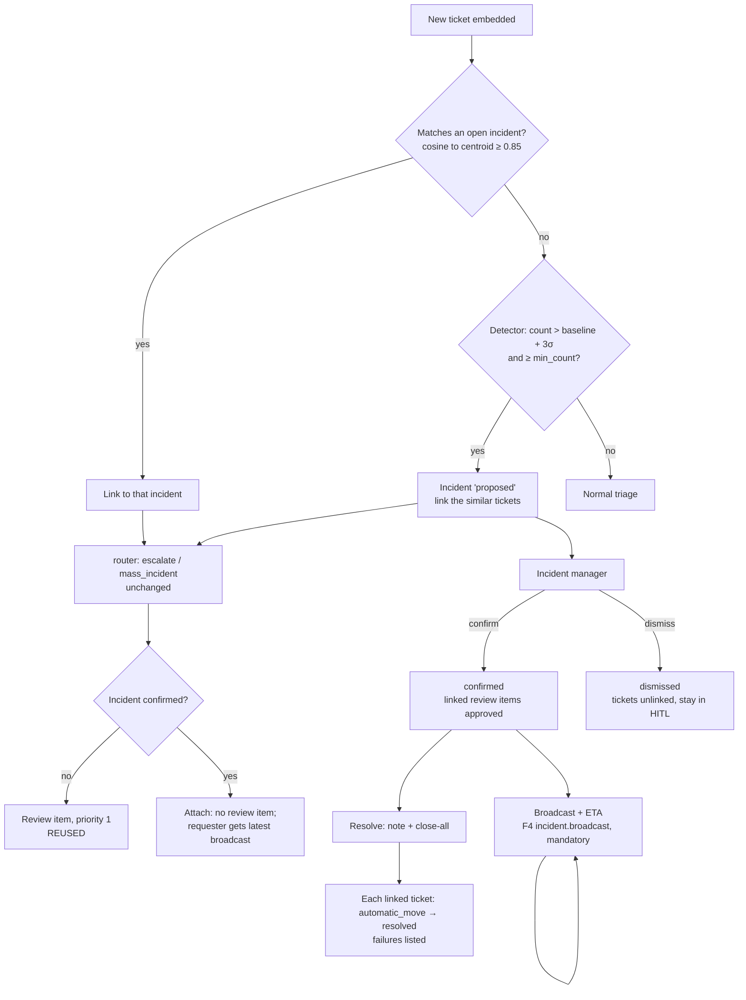

# 6. F7 Mass-incident management — NEW + CHANGED

Should · Wave 4.

## a. Problem & goal

The detector works (spec §9; adaptive baseline + 3σ, advisory lock). It
creates an `Incident`, links similar tickets, and the router sends each to
`escalate` with a review item. After that nothing happens:

- No incident page. `Incident.status` is the string `"open"` forever.
- No broadcast. Spec §9's promise is "40 people get one notice with an ETA";
  today they get nothing.
- No way to close the 40 tickets when the outage ends.
- **Two defects found in code reading** (to pin with tests in the F7 build):
  1. At detection time `ticket.category` is still empty: the router sets it
     later. So `get_or_create_for_mass_incident` keys every incident to
     `other`. Two unrelated outages within 6 h merge into one incident.
     (`apps/tickets/tests/test_incident.py` passes a category, so it doesn't
     catch this.)
  2. The triggering ticket already has its embedding stored when
     `similar_to` runs, so it is in `similar`, and `ticket_count = len(similar)
     + 1` counts it twice.

**Goal:** an incident manager confirms or dismisses what the detector
proposes, broadcasts with an ETA to every linked requester, keeps updating,
and closes all linked tickets in one action when it's fixed. Tickets join the
right incident by similarity, not by category.

**Benchmark:** ServiceNow: anyone or a rule proposes a candidate; the major
incident manager promotes it; communication plans drive updates. Freshservice:
link child tickets, email stakeholders, publish to a status page. SDP:
announcements with a display window. Moveworks: targeted broadcasts with
delivery analytics. Adopt propose → confirm, broadcast with ETA and delivery
count. Adapt close-all as per-ticket governed moves. Skip the public status
page ([benchmark F7](benchmark.md#f7-mass-incident-management)).

## b. Process flow



## c. State changes

`incidents.status` (CHANGED: free string → enum):

| From | Event | To | Who |
|---|---|---|---|
| — | Detector | `proposed` | system |
| — | Declare | `confirmed` | incident manager |
| `proposed` | Confirm | `confirmed` | incident manager |
| `proposed` | Dismiss (reason) | `dismissed` | incident manager |
| `confirmed` | Resolve (note) | `resolved` | incident manager |
| `resolved` | 7 days pass, or manual | `closed` | system / incident manager |
| `resolved` | Reopen (same outage back) | `confirmed` | incident manager |

Public stage shown in broadcasts: `investigating`, `identified`,
`monitoring`, `resolved`.

Linked tickets: resolution clocks **paused** while their incident is
`confirmed` (NEW BR-F1-15, see §i); the first broadcast meets their response
clock (a staff public message, BR-F1-06).

## d. Use cases

| Field | UC-F7-01 · Confirm or dismiss a proposed incident |
|---|---|
| Actor | Incident manager (Đức, on-call) |
| Trigger | `incident.proposed` notice |
| Preconditions | Status `proposed` |
| Main flow | 1. See linked tickets (masked subjects, times, requesters' departments), detection numbers (count, baseline, σ). 2. Name it, pick category and affected service. 3. Confirm |
| Alternate | 3a. Dismiss with a reason → tickets unlinked, their review items stay pending as normal HITL |
| Exception | 3x. Not an incident manager → 403 |
| Postconditions | Confirmed: each linked ticket's pending `escalate` review item is resolved as `approve` by the incident manager (agrees with the router) — no eval candidates |
| Rules | BR-F7-01, 02, 03 |
| Screens | [`F7 · Incident list`](https://www.figma.com/design/KXpnlC78p9pHYRuZZuQxIL?node-id=14-952), [`F7 · Incident page`](https://www.figma.com/design/KXpnlC78p9pHYRuZZuQxIL?node-id=14-1090) |
| MoSCoW | Should |

| Field | UC-F7-02 · Declare an incident by hand |
|---|---|
| Actor | Incident manager |
| Trigger | Monitoring or a phone call shows an outage before tickets pile up |
| Preconditions | — |
| Main flow | 1. Create: title, category, service, first broadcast text, ETA. 2. Optionally link existing tickets from a similarity search |
| Alternate | — |
| Exception | — |
| Postconditions | `confirmed`, `detected_by = human`; new matching tickets attach |
| Rules | BR-F7-02 |
| Screens | [`F7 · Declare incident`](https://www.figma.com/design/KXpnlC78p9pHYRuZZuQxIL?node-id=14-1298) |
| MoSCoW | Should |

| Field | UC-F7-03 · Broadcast an update |
|---|---|
| Actor | Incident manager |
| Trigger | Confirmed, or new information |
| Preconditions | `confirmed` |
| Main flow | 1. Write the message (vi; en optional), stage, ETA (time or "chưa xác định"). 2. Send. 3. One notice per **requester** (not per ticket), in-app + email, mandatory. 4. A system public comment on each linked ticket. 5. Delivery count shown |
| Alternate | 3a. Requesters who join later get the latest broadcast at once |
| Exception | 3x. Email failures → listed in F4 delivery log; in-app still delivered |
| Postconditions | First broadcast meets linked tickets' response clocks |
| Rules | BR-F7-04, 05 |
| Screens | [`F7 · Incident page`](https://www.figma.com/design/KXpnlC78p9pHYRuZZuQxIL?node-id=14-1090) (broadcast composer, history, delivery count); chat [`F7 · Incident banner`](https://www.figma.com/design/KXpnlC78p9pHYRuZZuQxIL?node-id=14-1332) |
| MoSCoW | Should |

| Field | UC-F7-04 · Resolve and close all |
|---|---|
| Actor | Incident manager |
| Trigger | Fix confirmed |
| Preconditions | `confirmed` |
| Main flow | 1. Write a resolution note (public). 2. Choose "Đóng tất cả phiếu liên quan". 3. Final broadcast (stage `resolved`). 4. Each linked open ticket gets the note as a public comment and an `automatic_move` to `resolved`. 5. Results listed: closed N, failed M with reason |
| Alternate | 2a. Don't close all → tickets stay open, clocks resume |
| Exception | 4x. A workflow refuses the move (strict transition, rule) → that ticket listed; its assignee notified |
| Postconditions | `resolved`; resolution clocks `met`; no per-ticket rating request |
| Rules | BR-F7-06, 07 |
| Screens | [`F7 · Resolve dialog`](https://www.figma.com/design/KXpnlC78p9pHYRuZZuQxIL?node-id=14-1324) |
| MoSCoW | Should |

| Field | UC-F7-05 · Unlink a wrongly matched ticket |
|---|---|
| Actor | Incident manager, assignee |
| Trigger | A ticket isn't about this outage |
| Preconditions | Linked |
| Main flow | 1. Unlink with a reason. 2. Ticket gets a normal HITL review item (`low_confidence`), clocks resume |
| Alternate | — |
| Exception | — |
| Postconditions | Counted in detector precision (F10) |
| Rules | BR-F7-08 |
| Screens | [`F7 · Incident page`](https://www.figma.com/design/KXpnlC78p9pHYRuZZuQxIL?node-id=14-1090) |
| MoSCoW | Should |

## e. Business rules

| ID | Rule | Rationale | Enforced where |
|---|---|---|---|
| BR-F7-01 | The detector only **proposes**; an incident manager confirms | ServiceNow pattern; a human owns a broadcast to many people | Status machine |
| BR-F7-02 | A new ticket joins the open (`proposed` or `confirmed`) incident whose centroid it matches at cosine ≥ `incident.similarity`; else the detector may propose a new one. Category is not part of the key | Fixes defect 1; category is unknown at detection | `Incidents.match()` under `pg_advisory_xact_lock(hashtext('mass_incident'))` |
| BR-F7-03 | Confirming approves each linked ticket's pending `escalate` review item in the incident manager's name; it never changes the routing decision | The router chose `escalate`; confirming agrees with it | Confirm service |
| BR-F7-04 | Once an incident is confirmed, an `escalate` / `mass_incident` decision for a newly linked ticket is carried out by attaching it to the incident (no new review item) | `escalate` means "hand to incident management"; the incident is that hand | `_execute_or_enqueue` ESCALATE branch |
| BR-F7-05 | Broadcasts go once per requester per broadcast, are mandatory, and show the ETA. Text is written by a person and masked like any comment | Spec §9; BR-X-06 | Broadcast service, F4 |
| BR-F7-06 | Close-all is one governed `automatic_move` per ticket, each audited; a refused move doesn't stop the rest | Per-ticket audit; ADR-0028 | Resolve service |
| BR-F7-07 | Linked tickets' resolution clocks pause while their incident is `confirmed`; they resume on unlink, dismiss, or resolve without close-all | 40 tickets can't each be fixed separately; the incident carries the clock | F1 hook (BR-F1-15) |
| BR-F7-08 | No auto-reply ever for a linked ticket | Spec §9; today's `mass_incident` gate | Unchanged router gate |
| BR-F7-09 | `ticket_count` = number of linked tickets, counted from the links | Fixes defect 2 | Query, not a stored sum |
| BR-F7-10 | An incident has its own P1 target: confirm + 240 min, 24×7. Breach → `incident.sla_breached` to manager | One clock for the outage | Incident sweep |

## f. Functional requirements

| ID | Requirement |
|---|---|
| FR-F7-001 | The system shall store incidents with status enum, public stage, title, category, affected service, ETA, centroid embedding, detector numbers, confirmed/resolved times and actor |
| FR-F7-002 | The system shall match a new ticket to an open incident by centroid similarity before running the detector, and update the centroid when a ticket joins |
| FR-F7-003 | The system shall create `proposed` incidents from the detector and notify incident managers (`incident.proposed`) |
| FR-F7-004 | The system shall let an incident manager confirm, dismiss, declare, resolve, reopen and close incidents |
| FR-F7-005 | On confirm, the system shall resolve linked pending `escalate` review items as `approve` by the incident manager |
| FR-F7-006 | The system shall attach newly linked tickets of a confirmed incident without a review item, and show the requester the latest broadcast |
| FR-F7-007 | The system shall send broadcasts once per requester (in-app + email, mandatory) and add a system public comment to each linked ticket |
| FR-F7-008 | The system shall show delivery counts per broadcast: requesters, in-app delivered, email delivered, email failed |
| FR-F7-009 | On resolve with close-all, the system shall move each linked open ticket to `resolved` via `automatic_move` with the resolution note, and list failures |
| FR-F7-010 | The system shall pause and resume linked tickets' resolution clocks per BR-F7-07 |
| FR-F7-011 | The system shall unlink a ticket with a reason and give it a `low_confidence` review item |
| FR-F7-012 | The chat shall show an incident banner (title, stage, ETA, last update) on every linked ticket |
| FR-F7-013 | The system shall audit `incident_proposed`, `incident_confirmed`, `incident_dismissed`, `incident_declared`, `incident_broadcast`, `incident_resolved`, `incident_closed`, `incident_ticket_linked`, `incident_ticket_unlinked` |

## g. Data changes

| Table | Status | Fields |
|---|---|---|
| `incidents` | CHANGED | `category` becomes nullable (set at confirm); `status` → enum (`proposed`, `confirmed`, `dismissed`, `resolved`, `closed`); NEW `stage`, `service`, `eta` null, `eta_unknown` bool, `centroid` vector(1024), `confirmed_by`, `confirmed_at`, `resolved_by`, `resolved_at`, `resolution_note_masked`, `dismiss_reason`, `target_resolve_at`. `ticket_count` kept as a cached display value, recomputed from links (BR-F7-09) |
| `incident_broadcasts` | NEW | `incident` FK, `stage`, `body_vi_masked`, `body_en_masked`, `eta`, `sent_by`, `sent_at`, `requesters_count` |
| `incident_links` | NEW | `incident` FK, `ticket` FK unique, `linked_by` (`detector` \| `matcher` \| user), `linked_at`, `similarity`, `unlinked_at`, `unlink_reason` |
| `tickets` | CHANGED | `incident` FK kept as the current link (mirror of the active `incident_links` row) |
| `ticket_comments` (F3) | REUSED | `author_kind = system`, NEW `broadcast` FK null |

**Migration:** existing `incidents.status = "open"` → `confirmed`
[ASSUMPTION: they were real]; compute `centroid` from linked tickets'
embeddings; create `incident_links` from `tickets.incident`. Writer:
core-api. PII: broadcast text masked.

**`thresholds.yaml` — CHANGED** (`incident:` gains)

```yaml
incident:
  similarity: 0.85        # existing; now also the centroid match bar
  window_minutes: 15      # existing
  min_count: 5            # existing
  sigma_multiplier: 3.0   # existing
  resolve_target_minutes: 240
  auto_close_after_days: 7
```

### Records, stage by stage — a VPN outage on Monday morning

Input — 6 tickets in 12 minutes (masked):

| ticket | at (+07) | subject_masked |
|---|---|---|
| `TKT-2026-000440` | 08:31 | "VPN không kết nối được, báo TLS handshake failed" |
| `TKT-2026-000441` | 08:33 | "Cannot connect to company VPN this morning" |
| `TKT-2026-000442` | 08:35 | "Lỗi VPN từ sáng, nhân viên [EMPLOYEE_CODE_1]" |
| `TKT-2026-000443` | 08:38 | "AWS VPN Client stuck at Connecting" |
| `TKT-2026-000444` | 08:40 | "VPN báo lỗi chứng chỉ" |
| `TKT-2026-000445` | 08:43 | "Không vào được VPN, làm việc từ nhà" |

Detector at 08:43: 6 similar in 15 min, baseline 0.4 + 3 × 0.63 = 2.3, `min_count` 5 → propose.

| table | row |
|---|---|
| `incidents` | `INC-2026-0012` · status `proposed` · category empty (unknown before routing; set at confirm) · detector `{count:6, baseline:0.4, sigma:0.63}` |
| `incident_links` | 6 rows, `linked_by detector` |
| `routing_decisions` | 6 × `escalate` / `mass_incident` (unchanged) |
| `review_items` | 6 × `low_confidence`, priority 1 (unchanged) |

08:49 — Đức confirms "VPN công ty gián đoạn", category `network` → 6 review items resolved `approve` by `duc.tm`; incident `confirmed`, `target_resolve_at` 12:49.

08:52 — Broadcast 1:

```json
POST /api/incidents/INC-2026-0012/broadcasts
{ "stage": "identified",
  "body_vi": "VPN công ty đang gián đoạn do chứng chỉ máy chủ hết hạn. Đội Network đang thay chứng chỉ.",
  "body_en": "Company VPN is down because a server certificate expired. Network is replacing it.",
  "eta": "2026-10-19T03:30:00Z" }
```

Output: `{ "requesters": 6, "in_app_delivered": 6, "email_queued": 6 }`. Six
response clocks met at 08:52 (21 min after the first ticket). 09:05 — a 7th
ticket matches the centroid (0.91) → linked, no review item; its requester
sees the banner and broadcast 1 at once.

10:12 — Resolve with close-all, note "Đã thay chứng chỉ, VPN hoạt động lại.
Vui lòng kết nối lại." → 7 tickets `resolved`, 0 failed.

## h. API changes

| Method · Path | Role | Request | Response | Errors |
|---|---|---|---|---|
| `GET /api/incidents?status=` | staff | — | list | — |
| `GET /api/incidents/{public_id}` | staff | — | incident + links + broadcasts + delivery counts | 404 |
| `POST /api/incidents` | incident_manager | `{title, category, service, broadcast?, eta?, ticket_ids?}` | incident (`confirmed`) | 422 |
| `POST /api/incidents/{id}/confirm` | incident_manager | `{title, category, service}` | incident | 409 `not_proposed` |
| `POST /api/incidents/{id}/dismiss` | incident_manager | `{reason}` | incident | 409 · 422 `reason_required` |
| `POST /api/incidents/{id}/broadcasts` | incident_manager | `{stage, body_vi, body_en?, eta?, eta_unknown?}` | broadcast + counts | 409 `not_confirmed` |
| `POST /api/incidents/{id}/resolve` | incident_manager | `{resolution_note, close_all}` | `{closed, failed:[{ticket, code}]}` | 409 |
| `POST /api/incidents/{id}/reopen` | incident_manager | `{reason}` | incident | 409 |
| `POST /api/incidents/{id}/links` | incident_manager | `{ticket_ids}` | links | 409 `already_linked` |
| `DELETE /api/incidents/{id}/links/{ticket}` | incident_manager, assignee | `{reason}` | 204 | 422 |
| `GET /api/requester/tickets/{id}` | CHANGED (F3) | — | adds `incident: {title, stage, eta, last_update}` | — |

**Celery tasks**

| Task | Trigger | Idempotency |
|---|---|---|
| `incidents.close_all(incident_id, actor_id)` | On resolve with close-all | Per ticket: skip if already completed; results stored, re-run continues where it stopped |
| `incidents.sweep` | beat, every 60 s | Target breach notice once (`target_breached_at`); auto-close `resolved` after 7 days once |

F4 events added: `incident.proposed` (incident managers, in-app + email,
mandatory), `incident.sla_breached` (managers). `incident.broadcast` already
in the catalog.

## i. Impact

- **Changes:** detector matches by centroid first and keys incidents by similarity (fixes defects 1 and 2); `_execute_or_enqueue` ESCALATE attaches to a confirmed incident instead of creating a review item; `Incident.status` becomes an enum; **F1 gains BR-F1-15** (pause linked tickets' resolution clocks while the incident is confirmed); chat shows a banner.
- **Must not change:** the router's `mass_incident` gate and its place in the hard-gate order; no auto-reply for linked tickets; the advisory lock pattern; shadow mode (in shadow mode, tickets still reach a reviewer; broadcasting is a person's act, allowed in both modes).
- **ADRs:** 0001, 0028 (`automatic_move` governed), spec §9.
- **Regression tests:** `test_unrelated_outages_get_separate_incidents` (defect 1); `test_ticket_count_counts_each_ticket_once` (defect 2); `test_confirm_approves_without_eval_candidates`; `test_linked_ticket_never_auto_replied`; `test_broadcast_once_per_requester`; `test_close_all_continues_after_refusal`; `test_linked_clock_paused_while_confirmed`.

## j. Acceptance criteria

```gherkin
Feature: F7 Mass-incident management

  Scenario: AC-F7-01 two outages, two incidents
    Given an open incident about VPN with a centroid built from VPN tickets
    When 6 printer tickets arrive within 15 minutes
    Then a second incident is proposed for the printer tickets
    And no printer ticket is linked to the VPN incident

  Scenario: AC-F7-02 confirming agrees with the router
    Given "INC-2026-0012" is proposed with 6 linked tickets, each with a pending escalate review item
    When "duc.tm" confirms it
    Then the 6 review items are resolved with action "approve" by "duc.tm"
    And no eval_candidate is created

  Scenario: AC-F7-03 one notice per requester
    Given "lan.nt" has two tickets linked to "INC-2026-0012"
    When "duc.tm" sends a broadcast with ETA 10:30 (+07)
    Then "lan.nt" receives exactly one in-app and one email notice
    And both tickets have a system public comment with the broadcast

  Scenario: AC-F7-04 late joiner sees the latest update at once
    Given "INC-2026-0012" is confirmed with one broadcast
    When a new matching ticket arrives
    Then it is linked without a review item
    And its requester's chat shows the incident banner with ETA 10:30 (+07)

  Scenario: AC-F7-05 close-all continues past a refusal
    Given 7 linked open tickets, one in a strict workflow with no transition to "resolved"
    When "duc.tm" resolves with close_all true
    Then 6 tickets are "resolved" and 1 is listed as failed with code "transition_not_allowed"
    And that ticket's assignee is notified

  Scenario: AC-F7-06 dismiss returns tickets to normal review
    Given a proposed incident with 5 linked tickets
    When "duc.tm" dismisses it with reason "Trùng hợp, không cùng nguyên nhân"
    Then the 5 tickets are unlinked
    And their review items are still pending

  Scenario: AC-F7-07 linked tickets never get an auto-reply
    Given SHADOW_MODE is false and a linked ticket's proposal cites an approved page
    Then the decision is escalate with reason "mass_incident"
```
