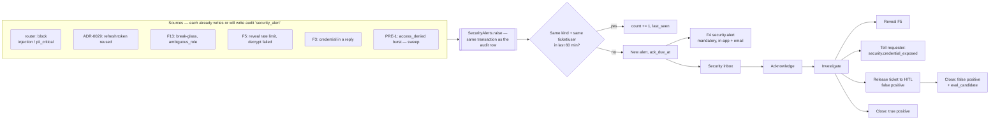

# 6. F8 Security inbox — NEW + CHANGED

Should · Wave 4.

## a. Problem & goal

Security events are written, then nobody looks:

- `block` decisions (injection, critical PII) write a `security_alert` audit
  row (`pipeline._finalize`) and a review item in queue `injection` or
  `pii_verify`. Those queues sit in the same review list technicians use
  (`GET /api/review/queue`); the `security` role has no screen.
- Refresh-token reuse writes `security_alert` with reason
  `refresh_token_reused` (`apps/accounts/utils.py`, ADR-0029).
- Phase 2 adds more: break-glass sign-ins and ambiguous roles (F13), reveal
  rate limits and decrypt failures (F5), credentials in requester replies
  (F3), bursts of refused calls (PRE-1).
- A requester who pasted a password is never told to change it.

**Goal:** every security event becomes an alert in one inbox that only
`security` sees, with triage states, an acknowledgement target, and actions
on the ticket behind it. Blocked tickets that turn out harmless go back to
normal human review, and the false positive becomes a label.

**Benchmark:** ServiceNow SIR keeps security incidents behind security roles,
even from admins. Atlassian Guard alerts admins with the content and who
wrote it. The other products have nothing comparable in the sources checked.
Adopt security-only access and alerts that name ticket, reason and actor.
Adapt the sources to our own signals. Skip SOC tooling
([benchmark F8](benchmark.md#f8-security-inbox)).

## b. Process flow



## c. State changes

`security_alerts.state`:

| From | Event | To |
|---|---|---|
| — | Raised | `new` |
| `new` | Acknowledge | `acknowledged` |
| `acknowledged` | Start investigating (assign to self) | `investigating` |
| `new` / `acknowledged` / `investigating` | Close with resolution `true_positive`, `false_positive` or `duplicate` (note required) | `closed` |
| `closed` | Reopen (note) | `investigating` |

Ticket moves F8 causes:

| Action | Ticket from | Ticket to | Review item |
|---|---|---|---|
| Release (false positive) | `blocked` | `pending_review` (via `system_move`, as a review outcome) | `injection`/`pii_verify` item decided `reject` with the reason; NEW `low_confidence` item |
| Close as true positive | `blocked` | stays `blocked` | item decided `approve` |

## d. Use cases

| Field | UC-F8-01 · Triage a new alert |
|---|---|
| Actor | Security (Anh) |
| Trigger | `security.alert` notice, or the inbox |
| Preconditions | — |
| Main flow | 1. Inbox sorted by severity, then oldest. 2. Open: kind, severity, ticket (masked), user, source events, count. 3. Acknowledge (stops the ack timer). 4. Investigate, add notes (masked). 5. Close with a resolution |
| Alternate | 5a. Duplicate of another alert → link and close `duplicate` |
| Exception | Non-security caller → 403 |
| Postconditions | K12 measured from `created_at` to `acknowledged_at` |
| Rules | BR-F8-01…04 |
| Screens | [`F8 · Security inbox`](https://www.figma.com/design/KXpnlC78p9pHYRuZZuQxIL?node-id=15-1087), [`F8 · Alert detail`](https://www.figma.com/design/KXpnlC78p9pHYRuZZuQxIL?node-id=15-1265) |
| MoSCoW | Should |

| Field | UC-F8-02 · Handle a credential pasted into a ticket |
|---|---|
| Actor | Security |
| Trigger | Alert kind `pii_critical` or `credential_in_reply` |
| Preconditions | Ticket blocked or reply stored masked |
| Main flow | 1. Reveal the value if needed to identify the system (F5, security only for critical labels). 2. Send the requester `security.credential_exposed` ("Bạn đã gửi mật khẩu trong phiếu. Hãy đổi mật khẩu ngay."), mandatory. 3. If the request itself is valid, release the ticket to HITL — the credential stays masked. 4. Close `true_positive` |
| Alternate | 3a. Request isn't valid support → leave blocked |
| Exception | 1x. Quarantine expired → close with note "value expired"; still notify |
| Postconditions | Requester told; ticket handled without the secret |
| Rules | BR-F8-05, 06 |
| Screens | [`F8 · Alert detail`](https://www.figma.com/design/KXpnlC78p9pHYRuZZuQxIL?node-id=15-1265) |
| MoSCoW | Should |

| Field | UC-F8-03 · Release a false-positive injection block |
|---|---|
| Actor | Security |
| Trigger | Alert kind `injection_detected`, text is a genuine question (e.g. "Làm sao bỏ qua bước xác thực cũ khi đổi điện thoại?") |
| Preconditions | Ticket `blocked`, review item `injection` pending |
| Main flow | 1. Release with a reason. 2. Review item decided `reject` (an override of the router's block) with the reason → `eval_candidate` (REUSED behaviour of `ReviewItem.decide`). 3. Ticket `system_move` → `pending_review`; NEW `low_confidence` review item. 4. Close alert `false_positive` |
| Alternate | — |
| Exception | 1x. No reason → 422 |
| Postconditions | Ticket reaches a technician; the AI is not re-run (it would block again) |
| Rules | BR-F8-06, 07 |
| Screens | [`F8 · Alert detail`](https://www.figma.com/design/KXpnlC78p9pHYRuZZuQxIL?node-id=15-1265) |
| MoSCoW | Should |

| Field | UC-F8-04 · Investigate a session or access alert |
|---|---|
| Actor | Security |
| Trigger | `refresh_token_reused`, `break_glass_sign_in`, `ambiguous_role`, `access_denied_burst`, `reveal_rate_limited` |
| Preconditions | — |
| Main flow | 1. See the user, IP, client, sessions (`GET /api/auth/sessions` data for that user), recent audit events. 2. End all their sessions if needed. 3. Close |
| Alternate | 2a. Disable the user in Keycloak (outside the app); F13 sync applies it |
| Exception | — |
| Postconditions | Action audited |
| Rules | BR-F8-08 |
| Screens | [`F8 · Alert detail`](https://www.figma.com/design/KXpnlC78p9pHYRuZZuQxIL?node-id=15-1265) |
| MoSCoW | Should |

## e. Business rules

| ID | Rule | Rationale | Enforced where |
|---|---|---|---|
| BR-F8-01 | Alerts are visible to `security` only; managers see counts by kind and state, not details | SIR pattern; alerts contain who did what | Endpoints |
| BR-F8-02 | Every place that writes a `security_alert` audit row also raises an alert, in the same transaction | One source of truth; nothing written but unseen | `SecurityAlerts.raise_`; test lists callers |
| BR-F8-03 | Same kind + same ticket (or same user when no ticket) within `security.group_window_minutes` (60) increments one alert | 40 refused calls are one story | Raise service |
| BR-F8-04 | Ack target by severity: `critical` 1 business hour, `high` 4 business hours, `medium` 1 business day, on the default calendar (F1 business-time code) | K12 | `ack_due_at`; sweep notifies overdue |
| BR-F8-05 | A requester who sent a credential always gets `security.credential_exposed` | They are the only one who can change it | F4 mandatory cell |
| BR-F8-06 | Release puts the ticket in front of a person, never back through the AI | Re-running would block again; a person decides | Release service |
| BR-F8-07 | Queues `injection` and `pii_verify` are listed only to `security` (CHANGED from all staff) | Their content is the attack or the secret | Review queue queryset |
| BR-F8-08 | `access_denied_burst`: ≥ `security.access_denied_burst` (20) refusals for one user in 10 min | Probing after PRE-1 | Sweep |

| Kind | Severity | Source |
|---|---|---|
| `pii_critical` | critical | router block (ticket) |
| `credential_in_reply` | critical | F3 reply masking |
| `refresh_token_reused` | critical | ADR-0029 reuse detection |
| `break_glass_sign_in` | critical | F13 |
| `injection_detected` | high | router block |
| `ambiguous_role` | high | F13 |
| `reveal_rate_limited` | high | F5 |
| `decrypt_failed` | high | F5 |
| `access_denied_burst` | medium | PRE-1 audit, sweep |
| `thresholds_unapproved` | high | F9 boot check |

## f. Functional requirements

| ID | Requirement |
|---|---|
| FR-F8-001 | The system shall store security alerts with kind, severity, state, ticket, subject user, first/last seen, count, ack due time, assignee, resolution and notes |
| FR-F8-002 | The system shall raise an alert wherever it writes a `security_alert` audit row, and group repeats per BR-F8-03 |
| FR-F8-003 | The system shall notify `security` on each new alert (F4 mandatory) and again when its ack is overdue |
| FR-F8-004 | The system shall list alerts to `security`, filterable by kind, severity, state, assignee, date |
| FR-F8-005 | The system shall let security acknowledge, assign, add masked notes, close with a resolution, and reopen |
| FR-F8-006 | The system shall release a blocked ticket to `pending_review` with a new `low_confidence` review item, deciding the original item `reject` with the reason |
| FR-F8-007 | The system shall send `security.credential_exposed` to the requester for credential alerts |
| FR-F8-008 | The system shall restrict `injection` and `pii_verify` review queues to `security` |
| FR-F8-009 | The system shall show managers alert counts by kind and state for the last 30 days |
| FR-F8-010 | The system shall audit `security_alert_acknowledged`, `security_alert_closed`, `security_alert_reopened`, `security_ticket_released` |

## g. Data changes

| Table | Status | Fields |
|---|---|---|
| `security_alerts` | NEW | `kind`, `severity`, `state`, `ticket` FK null, `subject_user` FK null, `first_seen_at`, `last_seen_at`, `count`, `ack_due_at`, `acknowledged_by/at`, `assignee`, `resolution` (`true_positive` \| `false_positive` \| `duplicate`) null, `duplicate_of` FK null, `closed_by/at` |
| `security_alert_events` | NEW | `alert` FK, `kind` (`raised` \| `regrouped` \| `ack` \| `note` \| `state` \| `release`), `audit_log_id`, `actor`, `note_masked`, `at` |
| `eval_candidates` | REUSED | `source = human_override` from the `reject` decision (existing behaviour) |

**`thresholds.yaml` — CHANGED**

```yaml
security:
  group_window_minutes: 60
  access_denied_burst: 20
  access_denied_window_minutes: 10
  ack_business_minutes: { critical: 60, high: 240, medium: 570 }
```

**Migration:** create `new` alerts for `security_alert` audit rows of the last
30 days [ASSUMPTION], grouped; older ones stay in `audit_log` only. Writer:
core-api. PII: notes masked; no values.

### Records, stage by stage — a pasted password

Input, submitted by Lan at 14:05 (+07):

> "Không đăng nhập được AWS console. mật khẩu: Hn@2026xyz, user lan.nt"

After inline masking (REUSED): `pii_level critical`, body
"Không đăng nhập được AWS console. [PASSWORD_1] user lan.nt" (the regex takes the label, the value and the trailing comma). Router:
`block` / `pii_critical`, `alert_security = true`.

Rows in the `_finalize` transaction:

| table | row |
|---|---|
| `routing_decisions` | `block` · `pii_critical` (unchanged) |
| `audit_log` | `security_alert` `{"reason_code":"pii_critical"}` (unchanged) |
| `security_alerts` | NEW · kind `pii_critical` · severity critical · ticket `TKT-2026-000450` · subject_user `lan.nt` · state `new` · ack_due_at 15:05 (+07) |
| `review_items` | queue `pii_verify`, priority 1 (unchanged; now security-only) |
| `notif_messages` | `security.alert` → `anh.lh` in-app + email |

14:20 — Anh acknowledges; sends `security.credential_exposed` to Lan; the
request is real (forgot how to sign in), so she releases:

| table | row |
|---|---|
| `review_decisions` | item `pii_verify` · `reject` · reason "Yêu cầu hợp lệ; mật khẩu đã che, đã nhắc người dùng đổi" |
| `eval_candidates` | source `human_override` |
| `lifecycle_transfers` | `blocked` → `pending_review` (system) |
| `review_items` | NEW `low_confidence`, priority 2 |
| `security_alerts` | state `closed` · resolution `true_positive` (a real credential was exposed; the ticket was valid) |

## h. API changes

| Method · Path | Role | Request | Response | Errors |
|---|---|---|---|---|
| `GET /api/security/alerts?kind=&severity=&state=&assignee=&from=&to=` | security | — | list | 403 |
| `GET /api/security/alerts/{id}` | security | — | alert + events + ticket (masked) + user sessions | 403 |
| `POST /api/security/alerts/{id}/ack` | security | — | alert | 409 `not_new` |
| `POST /api/security/alerts/{id}/assign` | security | `{user}` | alert | 422 `not_security` |
| `POST /api/security/alerts/{id}/notes` | security | `{note}` | event | — |
| `POST /api/security/alerts/{id}/close` | security | `{resolution, note, duplicate_of?}` | alert | 422 `note_required` |
| `POST /api/security/alerts/{id}/reopen` | security | `{note}` | alert | 409 |
| `POST /api/security/alerts/{id}/release-ticket` | security | `{reason}` | ticket | 409 `not_blocked` · 422 `reason_required` |
| `POST /api/security/alerts/{id}/notify-requester` | security | — | 204 | 409 `no_ticket` |
| `GET /api/security/summary` | security, manager | — | counts by kind × state, 30 days | — |
| `GET /api/review/queue` | CHANGED | — | excludes `injection`, `pii_verify` for non-security callers | — |

**Celery:** `security.sweep` (beat, every 60 s): overdue-ack notices once per
alert; `access_denied_burst` detection. Idempotent by `ack_overdue_notified_at`
and the grouping window.

F4 events added: `security.credential_exposed` (requester, in-app + email,
mandatory), `security.ack_overdue` (security, mandatory).

## i. Impact

- **Changes:** every `security_alert` writer also raises an alert; review queue listing hides two queues from non-security staff; security gets a release action on blocked tickets.
- **Must not change:** the router's hard gates and their order (`injection` before everything); `block` still writes its decision, audit row and review item; masking; no AI re-run on release.
- **ADRs:** 0001, 0028 (release uses `system_move` as a review outcome, like a clarification answer moving to `new`), 0029.
- **Regression tests:** `test_every_security_alert_audit_raises_an_alert`; `test_repeat_alerts_group`; `test_release_goes_to_a_person_not_the_ai`; `test_injection_queue_hidden_from_technicians`; `test_credential_alert_notifies_requester`.

## j. Acceptance criteria

```gherkin
Feature: F8 Security inbox

  @BR-F8-02 @BR-F8-04 @BR-F8-05
  Scenario: AC-F8-01 a pasted password raises a critical alert
    When "lan.nt" submits a ticket containing "mật khẩu: Hn@2026xyz"
    Then the ticket is "blocked" with reason "pii_critical"
    And one security alert of kind "pii_critical" and severity "critical" exists with ack_due_at 1 business hour later
    And "anh.lh" has a mandatory "security.alert" notice

  @BR-F8-07
  Scenario: AC-F8-02 technicians don't see the secret queues
    Given pending review items in queues "pii_verify" and "low_confidence"
    When "duc.tm" lists the review queue
    Then only the "low_confidence" item is returned

  @BR-F8-03
  Scenario: AC-F8-03 repeats group into one alert
    Given a "refresh_token_reused" alert for "duc.tm" raised 10 minutes ago
    When the same reuse happens again for "duc.tm"
    Then the alert's count is 2 and no new alert exists

  @BR-F8-06
  Scenario: AC-F8-04 release sends the ticket to a person
    Given a blocked injection ticket with alert "injection_detected"
    When "anh.lh" releases it with reason "Câu hỏi hợp lệ về đổi thiết bị MFA"
    Then the ticket is "pending_review" with a new "low_confidence" review item
    And the injection review item is decided "reject" with that reason
    And one eval_candidate exists
    And no new ai_run exists for the ticket

  @BR-F8-04
  Scenario: AC-F8-05 overdue acknowledgement is escalated once
    Given a critical alert created at 14:05 (+07) on a working day
    When the sweep runs at 15:06 and 15:30 (+07) without an acknowledgement
    Then exactly one "security.ack_overdue" notice exists

  @BR-F8-01
  Scenario: AC-F8-06 managers see counts only
    When "huy.pq" calls GET /api/security/alerts
    Then the response is 403
    When "huy.pq" calls GET /api/security/summary
    Then the response lists counts by kind and state with no ticket or user ids

  @BR-F8-08
  Scenario: AC-F8-07 a burst of refusals raises one alert
    Given user "tmp.contractor3" gets 20 access_denied refusals between 10:00 and 10:09 (+07)
    When the sweep runs at 10:10
    Then one alert of kind "access_denied_burst" exists for "tmp.contractor3"
```
