# 6. F9 Rollout & threshold control — NEW + CHANGED

Should · Wave 4 · Proposed ADR-0035. Must exist before P3.

## a. Problem & goal

Today:

- `SHADOW_MODE` is an env var read once (`config/settings/base.py`). Going
  live means editing `.env` and restarting. It is all-or-nothing:
  auto-route, auto-reply and requester questions switch together. README's
  rollout plan wants them one at a time (P3 auto-route, then P4 auto-reply).
- `thresholds.yaml` is the only home of tunables (CLAUDE.md hard rule 2) and
  is snapshotted into every `routing_decisions.thresholds_used`. Nothing
  checks that a change was reviewed before it went live. Rule 9 asks for an
  outside reviewer on eval baselines, but not on the thresholds that act on
  real tickets.
- Phase gates ("reroute rate < 15 % for 2 weeks") are written in README and
  computed by nobody.

**Goal:** turn each automated branch live separately, only after its gate is
met and two people approve; turn it off with one click by one person. Make
every threshold change a reviewed, recorded change request, and refuse to act
live on thresholds nobody approved.

**Benchmark:** Moveworks Triage writes a field only above a confidence
threshold, runs each field in dry-run until enabled, and reports coverage and
precision. Adopt the per-branch switch with dry-run = shadow, and the
coverage/precision display. Adapt threshold changes to stay in
`thresholds.yaml` with an approval record ([benchmark F9](benchmark.md#f9-rollout--threshold-control)).

## b. Process flow

```mermaid
flowchart TB
  subgraph PD["Per decision, in _finalize"]
    D[Router decision<br/>unchanged, pure] --> S{Live for this branch?}
    S -- "env SHADOW_MODE=true" --> SH[Shadow: to a person]
    S -- flag off --> SH
    S -- thresholds unapproved --> SH
    S -- flag on --> LIVE[Carry out live]
  end
  subgraph TO["Turning a branch on"]
    G[Gate met?<br/>computed from F10 metrics] --> RQ[Request: reason]
    RQ --> A1[Approval 1: manager]
    A1 --> A2[Approval 2: a different manager]
    A2 --> ON[Flag on, audited]
  end
  OFF[Any manager or security:<br/>turn off now, reason] --> FLAG[Flag off, audited]
  subgraph TC["Threshold change"]
    CR[Change request: new YAML + evidence] --> R1[Approved by 2 people,<br/>not the author]
    R1 --> PR[PR sets thresholds.yaml<br/>version = CR id]
    PR --> BOOT[core-api boot: sha256 of file<br/>matches an approved CR?]
    BOOT -- no --> UNAPP[All branches shadow<br/>alert thresholds_unapproved]
  end
```



## c. State changes

Rollout flags (NEW): `auto_route`, `auto_reply`, `requester_questions`
(clarify asked in chat, and chat holding a handoff for the requester).

| From | Event | To | Who |
|---|---|---|---|
| `off` | Request with reason | `pending_on` | manager |
| `pending_on` | First approval | `pending_on` (1/2) | a manager ≠ requester |
| `pending_on` | Second approval | `on` | a different manager |
| `pending_on` | Reject, or 72 h pass | `off` | any approver / system |
| `on` | Turn off (reason) | `off` | any manager or security, alone |

**Effective live for a decision** = `SHADOW_MODE` env is false **and** the
branch's flag is `on` **and** the loaded thresholds are approved. Otherwise
shadow. `SHADOW_MODE=true` stays the master kill switch.

Threshold change requests: `draft` → `pending` → `approved` / `rejected` →
`loaded` (core-api booted with that file).

## d. Use cases

| Field | UC-F9-01 · Turn a branch live |
|---|---|
| Actor | Manager (Huy) requests; a second manager approves |
| Trigger | Gate met (e.g. P3: reroute rate < 15 % for 14 days) |
| Preconditions | Branch `off`; `SHADOW_MODE=false` in the deployment |
| Main flow | 1. Open Rollout; see the branch's gate value, window, and shadow agreement. 2. Request "on" with a reason. 3. First approval. 4. Second approval by another manager. 5. Flag `on`; snapshot of gate values stored |
| Alternate | 1a. Gate not met → request needs an explicit `gate_override_reason`, shown to both approvers |
| Exception | 3x. Requester approves own request → 403 `self_approval`. 3y. Thresholds unapproved → 409 `thresholds_unapproved` |
| Postconditions | From the next decision, that branch is carried out live |
| Rules | BR-F9-01…04 |
| Screens | `F9 · Rollout`, `F9 · Flag request` |
| MoSCoW | Should |

| Field | UC-F9-02 · Turn a branch off now |
|---|---|
| Actor | Any manager or security |
| Trigger | A wrong auto-reply, a reopen spike, an incident |
| Preconditions | Flag `on` |
| Main flow | 1. "Tắt ngay" with a reason. 2. Flag `off` at once. 3. Managers notified |
| Alternate | — |
| Exception | — |
| Postconditions | Decisions from now on are shadow for that branch |
| Rules | BR-F9-02 |
| Screens | `F9 · Rollout` |
| MoSCoW | Should |

| Field | UC-F9-03 · Propose a threshold change |
|---|---|
| Actor | Manager, `workflow_admin`, tech lead (author) |
| Trigger | Calibration result (`evals/calibration/choose_thresholds.py`), eval run |
| Preconditions | — |
| Main flow | 1. Paste or upload the full new `thresholds.yaml`. 2. System validates it with the same Pydantic model core-api boots with, and shows a diff against the loaded file. 3. Attach evidence (calibration run id, `evals/HISTORY.md` entry). 4. Submit |
| Alternate | — |
| Exception | 2x. Invalid YAML or model error → 422 with the field path |
| Postconditions | `pending`; approvers notified |
| Rules | BR-F9-05, 06 |
| Screens | `F9 · Threshold change request` |
| MoSCoW | Should |

| Field | UC-F9-04 · Approve a threshold change and ship it |
|---|---|
| Actor | Two approvers, neither the author, at least one a manager (the other is usually the core-api tech lead) |
| Trigger | Pending request |
| Preconditions | — |
| Main flow | 1. Review diff and evidence. 2. Approve (both). 3. System stores the approved file's SHA-256 and the version string `CR-YYYY-NNN`. 4. Engineer opens a PR replacing `thresholds.yaml` with the approved text. 5. Deploy; on boot core-api finds the SHA approved → `loaded`, audits `thresholds_loaded` |
| Alternate | — |
| Exception | 5x. Booted file matches no approved request → every branch shadow, `thresholds_unapproved` security alert (F8), managers notified |
| Postconditions | `routing_decisions.thresholds_used` keeps snapshotting the file as today |
| Rules | BR-F9-05…08 |
| Screens | `F9 · Threshold change request`, `F9 · Threshold history` |
| MoSCoW | Should |

## e. Business rules

| ID | Rule | Rationale | Enforced where |
|---|---|---|---|
| BR-F9-01 | Live needs all three: env not shadow, branch flag on, thresholds approved. Any one missing → shadow | Degrade toward people; three independent keys | `Rollout.is_live(branch)` called in `_finalize` before `_execute_or_enqueue`; router untouched |
| BR-F9-02 | On needs two different managers (neither the requester); off needs one manager or security | Asymmetric on purpose: turning automation on is the risky direction | Flag service |
| BR-F9-03 | A request to turn on records the gate values at request and at approval; approving with an unmet gate requires an override reason from each approver | Gates are the README's rollout contract | Flag service |
| BR-F9-04 | Gates per branch (data, editable by managers with approval): `auto_route` — P3 reroute rate < 15 % over 14 days on shadow `auto_route` decisions; `auto_reply` — P4 auto-reply precision ≥ 0.95 on the calibration holdout **and** ≥ 3 approved `low` pages; `requester_questions` — clarify agreement ≥ 0.80 over 14 days [ASSUMPTION] | README rollout table, spec §14 | `rollout_gates` + F10 queries |
| BR-F9-05 | `thresholds.yaml` stays the only source of tunables. A change request holds the full proposed file, never a partial patch | Hard rule 2; full-file snapshots match `thresholds_used` | CR model |
| BR-F9-06 | A change request needs two approvals, neither by its author | Rule 9's outside-reviewer principle, applied to live numbers | CR service |
| BR-F9-07 | At boot core-api hashes the loaded file. No approved CR with that hash → all branches shadow and a `thresholds_unapproved` alert | Unreviewed numbers never act on tickets | Startup check; `Rollout.is_live` |
| BR-F9-08 | Local dev and CI may skip the check with `THRESHOLDS_REQUIRE_APPROVAL=false` in `.env`; production settings force it true | Developers change thresholds freely; production doesn't | `production.py` |
| BR-F9-09 | Each routing decision stores which flags were on (`rollout_snapshot`) next to `shadow_mode` | Replays explain "why was this live?" | `_finalize` |
| BR-F9-10 | No flag exists for runbooks | ADR-0006: runbooks always go through a person | — (by absence) |

## f. Functional requirements

| ID | Requirement |
|---|---|
| FR-F9-001 | The system shall store one flag per branch family (`auto_route`, `auto_reply`, `requester_questions`) with state and history |
| FR-F9-002 | The system shall decide live vs shadow per decision by BR-F9-01, outside `router.py` |
| FR-F9-003 | The system shall record `rollout_snapshot` on every routing decision (BR-F9-09) |
| FR-F9-004 | The system shall run the request → two approvals flow for turning a flag on, and one-step off |
| FR-F9-005 | The system shall show, per branch: gate metric, threshold, window, current value, met/unmet, and shadow agreement (from F10) |
| FR-F9-006 | The system shall store threshold change requests with full YAML, diff, evidence, author, approvals, state, SHA-256 and version |
| FR-F9-007 | The system shall validate a proposed file with the boot-time `Thresholds` model |
| FR-F9-008 | At boot, the system shall match the loaded file's SHA-256 to an approved request, mark it `loaded`, and audit `thresholds_loaded` |
| FR-F9-009 | When no approved request matches, the system shall treat every branch as shadow and raise `thresholds_unapproved` |
| FR-F9-010 | A CI check shall fail a PR that changes `thresholds.yaml` without changing its `version` |
| FR-F9-011 | The system shall audit `rollout_flag_requested`, `rollout_flag_approved`, `rollout_flag_on`, `rollout_flag_off`, `threshold_cr_submitted`, `threshold_cr_approved`, `threshold_cr_rejected`, `thresholds_loaded`, `thresholds_unapproved` |

## g. Data changes

| Table | Status | Fields |
|---|---|---|
| `rollout_flags` | NEW | `branch` unique, `state` (`off` \| `pending_on` \| `on`), `changed_by`, `changed_at`, `reason` |
| `rollout_flag_requests` | NEW | `branch`, `requested_by`, `reason`, `gate_snapshot_at_request` JSON, `approvals` (array of `{user, at, gate_snapshot, override_reason}`), `state`, `expires_at` |
| `rollout_gates` | NEW | `branch`, `phase` (`P3`, `P4`, …), `metric`, `comparator`, `threshold`, `window_days`, `is_active` |
| `threshold_change_requests` | NEW | `version` (`CR-2026-004`), `yaml_text`, `sha256`, `base_sha256`, `diff`, `evidence`, `author`, `approvals` JSON, `state`, `loaded_at` null |
| `routing_decisions` | CHANGED | NEW `rollout_snapshot` JSON default `{}` (old rows deserialize) |

**Migration:** seed three flags `off`; seed gates from README; create
`CR-2026-000` for the file on `main` at migration time with state `approved`
and both approvals set to the migration (documented as the baseline), so the
first boot after migration is not shadow-forced. Writer: core-api.

**`.env.example` — CHANGED:** `THRESHOLDS_REQUIRE_APPROVAL=false`
(`production.py` forces `true`). `SHADOW_MODE` unchanged.

**`thresholds.yaml` — CHANGED** (`rollout:`)

```yaml
rollout:
  flag_request_expiry_hours: 72
```

### Records, stage by stage — turning on auto-route (P3)

Gate input (F10 query over 14 days, shadow `auto_route` decisions that a
reviewer decided):

| shadow decisions `auto_route` | decided by reviewers | of which `reroute` | rate |
|---|---|---|---|
| 263 | 248 | 31 | 31 / 248 = **12.5 %** → met (< 15 %) |

Request and approvals:

| table | row |
|---|---|
| `rollout_flag_requests` | branch `auto_route` · by `huy.pq` · reason "P3: reroute 12.5 % trên 14 ngày" · gate `{value:0.125, threshold:0.15, met:true}` |
| approvals | `quang.nv` (manager) at 10:02, `dung.ht` (manager) at 10:40. An approval by `tu.dv` would be refused: `workflow_admin` is not a manager |
| `rollout_flags` | `auto_route` → `on` at 10:40 |

Next live decision (`SHADOW_MODE=false`, thresholds approved):

```json
{ "branch": "auto_route", "reason_code": "all_checks_passed", "shadow_mode": false,
  "rollout_snapshot": { "auto_route": "on", "auto_reply": "off", "requester_questions": "off",
                        "thresholds": "CR-2026-003", "env_shadow": false } }
```

The same minute, an auto-reply decision for another ticket is still shadow:
`{"branch": "auto_reply", "shadow_mode": true, …}`.

### Records — a threshold change

| field | value |
|---|---|
| version | `CR-2026-004` |
| diff | `routing.t_route: 0.72 → 0.70`; `calibration_source: "shadow_run_2026-07 (n=612)" → "shadow_run_2026-11 (n=1,284)"` |
| evidence | `evals/calibration` run 2026-11-20, route precision 0.87 at 0.70 on holdout (n=312) |
| author | `tu.dv` · approvals `huy.pq`, `dung.ht` |
| sha256 | `b41e…09` |
| state after deploy | `loaded` 2026-11-21 09:12 |

## h. API changes

| Method · Path | Role | Request | Response | Errors |
|---|---|---|---|---|
| `GET /api/rollout` | manager, security, technician (read) | — | flags + gates + current values + env shadow + thresholds status | — |
| `POST /api/rollout/{branch}/requests` | manager | `{reason, gate_override_reason?}` | request | 409 `already_on` / `thresholds_unapproved` |
| `POST /api/rollout/requests/{id}/approve` | manager ≠ requester | `{gate_override_reason?}` | request (+ flag) | 403 `self_approval` · 409 `already_approved_by_you` · 422 `override_reason_required` |
| `POST /api/rollout/requests/{id}/reject` | manager | `{reason}` | request | — |
| `POST /api/rollout/{branch}/off` | manager, security | `{reason}` | flag | 409 `already_off` |
| `GET/PATCH /api/rollout/gates` | manager (read/write with reason) | `{metric, threshold, window_days}` | gates | — |
| `POST /api/thresholds/change-requests` | manager, workflow_admin, technician | `{yaml_text, evidence}` | request with diff | 422 `invalid_thresholds` (with path) |
| `POST /api/thresholds/change-requests/{id}/submit` · `/approve` · `/reject` | author · approvers | `{comment}` | request | 403 `self_approval` |
| `GET /api/thresholds/history` | staff | — | requests, loaded versions | — |
| `GET /api/thresholds/current` | staff | — | `{version, sha256, approved, loaded_at, yaml}` | — |

**Celery:** `rollout.sweep` (beat, hourly): expire `pending_on` requests past
72 h; once per day, notify managers if a gate that was met when a flag went
on is now unmet (e.g. reroute rate rose to 18 %). No automatic turn-off
[ASSUMPTION: a person decides].

F4 events added: `rollout.flag_requested`, `rollout.flag_changed`,
`rollout.gate_unmet`, `thresholds.cr_pending`, `thresholds.unapproved`
(managers; the last is mandatory).

## i. Impact

- **Changes:** `_finalize` asks `Rollout.is_live(branch)` instead of reading `settings.SHADOW_MODE` directly; `routing_decisions` gains `rollout_snapshot`; boot computes the thresholds hash; CI gains a version check.
- **Must not change:** `router.py` (pure; still built from `settings.THRESHOLDS`); `thresholds.yaml` as the only home of tunables; the `thresholds_used` snapshot; "the same `route()` runs in both modes" (spec §8.2); runbooks always HITL (ADR-0006); P3 before P4.
- **ADRs:** 0001, 0006, CLAUDE.md hard rules 1, 2, 9; proposed 0035.
- **Regression tests:** `test_route_is_identical_whatever_the_flags`; `test_env_shadow_overrides_flags`; `test_unapproved_thresholds_force_shadow`; `test_one_person_cannot_turn_on`; `test_one_person_can_turn_off`; `test_no_runbook_flag_exists`; `test_threshold_cr_rejects_invalid_yaml`.

## j. Acceptance criteria

```gherkin
Feature: F9 Rollout and threshold control

  Scenario: AC-F9-01 one branch live, the other shadow
    Given SHADOW_MODE is false, thresholds approved, auto_route "on" and auto_reply "off"
    When the router decides auto_route for ticket A and auto_reply for ticket B
    Then ticket A is "auto_routed" and ticket B has a review item
    And both routing_decisions rows store the same rollout_snapshot

  Scenario: AC-F9-02 two managers to turn on
    Given "huy.pq" requested auto_route on
    When "huy.pq" approves his own request
    Then the response is 403 with code "self_approval"
    When "quang.nv" and then "dung.ht" approve
    Then auto_route is "on"

  Scenario: AC-F9-03 one person to turn off
    Given auto_reply is "on"
    When "anh.lh" (security) turns it off with reason "Phản hồi sai trên trang VPN"
    Then auto_reply is "off" immediately
    And the next auto_reply decision is shadow

  Scenario: AC-F9-04 env kill switch wins
    Given auto_route is "on" and SHADOW_MODE is true
    When the router decides auto_route
    Then the decision has shadow_mode true

  Scenario: AC-F9-05 unapproved thresholds force shadow
    Given core-api booted with a thresholds.yaml whose sha256 matches no approved change request
    Then every decision has shadow_mode true
    And one security alert "thresholds_unapproved" exists

  Scenario: AC-F9-06 unmet gate needs an override reason
    Given the auto_route gate value is 0.18 against 0.15
    When a manager approves without gate_override_reason
    Then the response is 422 with code "override_reason_required"

  Scenario: AC-F9-07 no switch for runbooks
    When a manager requests a flag for "runbook"
    Then the response is 404
```
