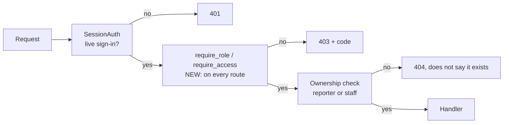

# 6. PRE-1 and PRE-2 — prerequisites

Must · Wave 0 · Both come before any feature in this pack.

---

# PRE-1 Server-side role enforcement — CHANGED

## a. Problem & goal

Today 13 of 27 non-lifecycle routes check only that the caller is signed in
(§3.4). An employee with a valid session can:

| Call | What happens today |
|---|---|
| `GET /api/tickets/TKT-2026-000415` | Gets another person's masked ticket |
| `POST /api/review/items/{id}/decide` `{"action_taken":"approve",…}` | Approves a review item, including a `runbook_approval` item |
| `POST /api/itsm/review-items/{id}/execute` | Runs the runbook that item approved |
| `POST /api/kb` | Creates and ingests a KB page that retrieval sees at once |
| `GET /api/metrics/dashboard` | Reads reviewer names and approval rates |

The admin console refuses employees in the browser. The API does not.

**Goal:** every route checks the caller's role (and, after F13, capability) in
core-api. A test fails if a new route forgets.

Benchmark: every product in the benchmark enforces roles server-side; SIR even
blocks admins by default ([benchmark F8](benchmark.md#f8-security-inbox)).

## b. Flow



## c. State changes

None.

## d. Use cases

| Field | UC-PRE1-01 · Refuse a call outside the caller's role |
|---|---|
| Actor | Any signed-in user |
| Trigger | A request to a role-gated route |
| Preconditions | Live session (ADR-0029) |
| Main flow | 1. `SessionAuth` accepts the token. 2. The route's gate compares `user.role` (and capabilities, after F13) with the route's allowed set. 3. Allowed → handler runs |
| Alternate | 2a. Route is ownership-scoped (`GET /api/tickets/{id}`): staff pass; the reporter passes for their own ticket; anyone else gets 404 |
| Exception | 2x. Not allowed → 403 `{"code":"role_not_allowed"}`; one `access_denied` audit row |
| Postconditions | Refused calls change nothing |
| Rules | BR-PRE1-01…03 |
| Screens | None (API) |
| MoSCoW | Must |

## e. Business rules

| ID | Rule | Rationale | Enforced where |
|---|---|---|---|
| BR-PRE1-01 | Every route except sign-in, refresh, sign-out and the lifecycle callback declares its allowed roles | BR-X-02 | `require_role` on each handler; route test |
| BR-PRE1-02 | A ticket that isn't yours is a 404 for an employee, not a 403 | Don't confirm another person's ticket exists; chat already does this (`apps/chat/views.py`) | Ticket view |
| BR-PRE1-03 | Refusals are audited (`access_denied`), at most one row per user per route per minute [ASSUMPTION] | Lets F8 spot probing without flooding `audit_log` | Gate decorator |

## f. Functional requirements

| ID | Requirement |
|---|---|
| FR-PRE1-001 | The system shall apply the role table in §h to every listed route |
| FR-PRE1-002 | The system shall return 404 to an employee who requests a ticket they did not report |
| FR-PRE1-003 | The system shall audit each refusal as `access_denied` with user, route, method and role |
| FR-PRE1-004 | The system shall include a test that lists every Ninja route and fails if a non-exempt route has no gate |
| FR-PRE1-005 | The system shall check that the decider of a `runbook_approval` item and the executor are `technician` or `manager` (ADR-0006: "a person" means staff) |

## g. Data changes

None. `audit_log` gets a new event name.

## h. API changes (CHANGED gates)

| Route | Before | After |
|---|---|---|
| `GET /api/tickets/{public_id}` | any signed-in | staff: technician, manager, security · employee: own tickets only |
| `GET /api/review/queue`, `GET /api/review/items/{id}` | any signed-in | technician, manager, security |
| `POST /api/review/items/{id}/claim`, `/decide` | any signed-in | technician, manager, security (F8 narrows `injection`/`pii_verify` later) |
| `POST /api/kb`, `/kb/{slug}/reingest` | any signed-in | manager (F6 adds `kb_editor` for drafts) |
| `POST /api/kb/{slug}/auto-reply-allowed`, `/risk-tier` | any signed-in; model checks manager | manager at the route **and** the model (both kept) |
| `GET /api/metrics/dashboard` | any signed-in | technician, manager |
| `GET /api/itsm/runbooks`, `POST /api/itsm/review-items/{id}/execute` | any signed-in | technician, manager |
| `GET /api/fewshot/category/{category}` | any signed-in | technician, manager |
| `GET /api/kb` | any signed-in | unchanged (employees may read live pages) |
| `/api/chat/*`, `/api/accounts/me`, `/api/auth/sessions*` | own data only | unchanged |
| `/api/lifecycle/*` | gated | unchanged |

Refusal body:

```json
{ "code": "role_not_allowed", "message": "requires role in [manager, technician]", "details": { "role": "employee" } }
```

## i. Impact

- Changes: 13 routes refuse callers they used to serve.
- Must not change: any staff flow; chat flows; sign-in.
- ADRs: 0006 (made enforceable), 0029 (unchanged).
- Regression tests: `test_every_route_is_gated`; `test_employee_cannot_read_another_ticket`; `test_employee_cannot_decide_review_item`; `test_runbook_needs_staff_approver_and_executor`; existing review, KB and metrics tests run as staff users.
- Docs: README route table becomes true; README and CLAUDE.md fix `services/web` → `admin-console` and `chat` (R-07).

## j. Acceptance criteria

```gherkin
Feature: PRE-1 role enforcement

  Scenario: AC-PRE1-01 employee cannot read another person's ticket
    Given "lan.nt" is an employee with a live session
    And "TKT-2026-000415" was reported by "duc.tm"
    When "lan.nt" calls GET /api/tickets/TKT-2026-000415
    Then the response is 404
    And no ticket data is returned

  Scenario: AC-PRE1-02 employee reads her own ticket
    Given "TKT-2026-000412" was reported by "lan.nt"
    When "lan.nt" calls GET /api/tickets/TKT-2026-000412
    Then the response is 200 with subject_masked "Không vào được AWS access portal, báo sai mật khẩu"

  Scenario: AC-PRE1-03 employee cannot approve a runbook
    Given a pending review item in queue "runbook_approval"
    When "lan.nt" posts decide with action_taken "approve"
    Then the response is 403 with code "role_not_allowed"
    And the item stays "pending"
    And one audit row "access_denied" exists for "lan.nt"

  Scenario: AC-PRE1-04 a new route without a gate fails CI
    Given a developer adds a route with only SessionAuth
    When the test suite runs
    Then test_every_route_is_gated fails and names the route
```

---

# PRE-2 Accept ADR-0028 and ADR-0029 — CHANGED (status only)

| Item | Content |
|---|---|
| Problem | F1, F2 and F4 add hooks to the lifecycle engine (ADR-0028); F13 changes sign-in (ADR-0029). Both ADRs are **Proposed**. If either is rejected after phase 2 builds on it, four features need rework |
| Work | 1. Run TODO 14.4 once: one n8n round trip and one real SMTP send against the Dockerized stack. 2. Tech lead reviews both ADRs and records the decision in each file's status line. 3. Update `status.md` rows for both |
| Done when | Both ADRs say `Accepted (date)` or are superseded by an ADR that phase 2 then builds on |
| Owner | Tech lead, core-api |
| FR | FR-PRE2-001 The team shall record a decision on ADR-0028 and ADR-0029 before the first F1, F2, F4 or F13 migration merges |
| AC | AC-PRE2-01: Given the first F1 migration PR, when CI runs, then a check reads both ADR status lines and fails unless both start with "Accepted" |
