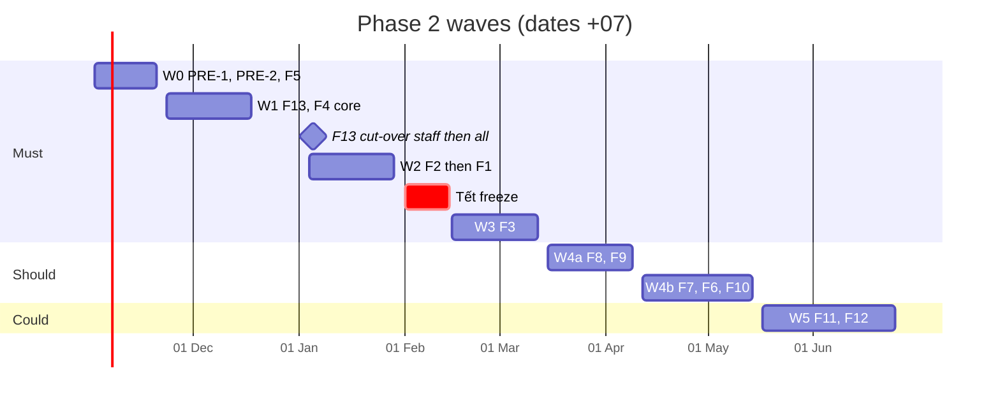

# 10. Release plan

How the build waves of [§2.3](02-scope.md#23-build-order) ship, and how they line
up with the rollout phases of `requirement.md` §14 (P1 shadow → P5 runbooks).

The short version: **waves 0–3 ship while `SHADOW_MODE=true`** and change
nothing the router decides. **No branch goes live before F9 exists**, and each
branch goes live only through F9's two-manager flag with its gate met.

## 10.1 Rules for every release

| # | Rule | Source |
|---|---|---|
| RL-01 | `SHADOW_MODE=true` stays the production value until P3. Phase 2 features never change a routing decision (BR-X-07) | CLAUDE.md "Current state", BR-X-07 |
| RL-02 | Migrations are additive in the release that needs them (new tables, nullable columns with defaults). Destructive steps (`NOT NULL`, enum narrowing, removing `RUNBOOK_REGISTRY`, dropping old fields) ship in a later release, after one stable week | Rollback by redeploy must keep working |
| RL-03 | Before each release: `make check` in core-api, `uv run pytest`, `uv run mypy`, masking + router coverage at 100 % (`make coverage`), TS types regenerated (`make types`) | CLAUDE.md "Before opening a PR" |
| RL-04 | A release that bumps a prompt or touches `graph/nodes/retrieve/`, `candidate_pool/`, `rerank/` runs the full eval suite; no floor is lowered (rule 9). The run goes in `evals/HISTORY.md` | CLAUDE.md rules 8, 9 |
| RL-05 | New settings land in the settings code, `.env.example` and `docker-compose.yml` in the same PR; ops diff their `.env` against `.env.example` before deploy | CLAUDE.md "Commands" |
| RL-06 | From the F9 release on, every `thresholds.yaml` change ships only with an approved change request; the F9 migration registers the file on `main` as baseline `CR-2026-000` (06-F9 §g) | F9 BR-F9-05…07, R-13 |
| RL-07 | No production deploys from 1 Feb to 14 Feb 2027 (Tết Nguyên đán 4–10 Feb) or on 29 Apr – 3 May 2027 | A-01; holidays in F1 §g |
| RL-08 | Each user-facing release gets two weeks of hypercare: the feature owner watches its KPIs (§1.3) daily and the on-call runbook gains its failure paths | [runbooks/on-call.md](../../runbooks/on-call.md) |
| RL-09 | Sign-off per wave by the approvers in §0.2 for the features in it; the Information Security Officer signs every wave that touches F5, F8, F13 or the RBAC matrix | §0.2 |

## 10.2 Waves on a calendar

Dates assume pack sign-off (version 1.0) by **Fri 30 Oct 2026** and a team of
two core-api developers, one frontend developer and half an ai-engine
developer [ASSUMPTION A-23]. Should and Could waves move to phase 3 before any
Must slips (R-03).

| Wave | Ships | Production date (+07) | Rollout phase while it ships | Entry criteria | Exit criteria (measured in hypercare) | Signs off |
|---|---|---|---|---|---|---|
| 0 | PRE-1, PRE-2, F5 | Thu 19 Nov 2026 | P1 shadow (unchanged) | ADR-0028, ADR-0029 Accepted (PRE-2); pack v1.0 | `test_every_route_is_gated` green; `access_denied` rows appear for refused calls; K9 = 0 with the first real reveals | Tech lead, ISO, DPO |
| 1 | F13, F4 core (in-app + email, matrix, preferences) | Thu 17 Dec 2026 (code); SSO cut-over Tue 5 Jan 2027 staff, Tue 12 Jan 2027 everyone | P1 | Keycloak realm, clients (`smart-ticket`, `smart-ticket-sync`) and groups ready (OQ-03); SMTP relay (OQ-10) | K10 = 100 % except 2 break-glass accounts by 26 Jan 2027; K11 ≤ 5 min in a test leaver; K8 ≤ 5 s / ≤ 2 min | ISO, DPO, Head of IT Ops |
| 2 | F2, then F1 | Wed 27 Jan 2027 | P1 | 2027 holidays entered (F1 · Holidays); teams mapped to Keycloak groups | K4 median ≤ 15 business min; K1/K2 measured for 2 full weeks; K3 = 100 % | Service Desk Manager |
| — | Freeze | 1–14 Feb 2027 | P1 | — | SLA clocks skip 4–10 Feb (AC-F1-02 pattern verified in production data) | — |
| 3 | F3 (conversation context, My tickets, thread, reopen, rating) | Wed 10 Mar 2027 | P1 | Full eval run on `hyde_draft.v3` + `propose.v10` passes every gate (R-08); multi-turn golden cases reviewed | K6 response rate ≥ 20 %; K7 measurable (reopen button live); no regression in recall@5 ≥ 0.90 | Service Desk Manager, product owner |
| 4a | F8, F9 | Wed 7 Apr 2027 | P2: fitted thresholds can now ship as an approved change request | Baseline `CR-2026-000` registered by the migration and checked against production's file; two managers hold `manager` (OQ-20) | K12 = 100 % for critical alerts over 4 weeks; K14 = 0; every routing decision carries `rollout_snapshot` | ISO, Head of IT Ops |
| 4b | F7, F6, F10 | Wed 12 May 2027 | P2 → **P3 decision** | Incident managers named; `kb_editor` holders named | K13 ≤ 15 min in one drill; reports match their exports (AC-F10-06) | Service Desk Manager, Head of IT Ops |
| 5 | F11, F12 | Wed 23 Jun 2027 | P3 running; P4 decision in July; P5 after it | `smart-ticket-runbooks` client (OQ-25); n8n allow-list | Retrieval suite unchanged with overrides; no runbook runs without an approving decision | ISO, tech lead |

## 10.3 Rollout phases: what each needs from phase 2

Phase 2 doesn't switch any phase on. It builds what each switch needs, and F9
makes the switch itself a governed act.

| Phase (`requirement.md` §14) | Today | Phase 2 features it needs | Gate (F9 `rollout_gates`, F10 query) | Earliest |
|---|---|---|---|---|
| P1 Shadow | Running | — | ≥ 500 shadow pairs | Now |
| P2 Calibration (fit trust score, choose `t_auto` / `t_route`) | Not started; coefficients hand-set | F10 (readiness, shadow agreement), F9 (ship the fitted thresholds as an approved CR) | Auto-reply precision ≥ 0.95 on the holdout | Calibration scripts can run any time there are ≥ 500 pairs; the result ships after wave 4a (Apr 2027) |
| P3 Auto-route live | — | PRE-1, F2 (real assignment instead of `assigned_team = category`), F1, F4, F9, F10 | Reroute rate < 15 % over 14 days (BR-F9-04) | Wave 4b + 14 days of data, late May 2027 |
| P4 Auto-reply live | — | F3 (reopen makes K7 real), F6 (authority pinned to reviewed text), F9, F10 | Precision ≥ 0.95 and ≥ 3 approved low pages; then reopen < 5 % for 1 month | After P3 has run 4 weeks, Jul 2027 |
| P5 Runbooks, few-shot, wider KB | — | F12 (real executors, still HITL), F6 authority queue for each batch | Reopen gate per batch | After wave 5, Q3 2027 |

**P4 and ADR-0027.** Spec §14 starts P4 with 3–5 low-risk pages; ADR-0027
(accepted) approved every low- and medium-risk page (2,892). The `auto_reply`
flag is per branch, not per page, so P4 goes live on that whole set. Default
applied [OQ-28]: keep ADR-0027's set, review K7 weekly in the first month, and
turn `auto_reply` off (one manager or security, instant, BR-F9-02) on the first
week above 5 %. Narrowing to 3–5 pages would need a new ADR superseding 0027.

## 10.4 Cut-overs

**F13 sign-in (wave 1).** First OIDC sign-in links the existing local user by
username, then by `sub` forever (BR-F13-04).

1. Tue 5 Jan 2027: staff (technicians, managers, security) sign in through Keycloak. Employees still use the old page.
2. Tue 12 Jan 2027: everyone. Local password sign-in refused except the 2 break-glass accounts (BR-F13-06).
3. Mon 18 Jan 2027: `identity_link_report` run; unlinked local users linked or deactivated.
4. Rollback before Fri 29 Jan 2027: redeploy the wave 0 release; local password hashes are kept until then [ASSUMPTION A-22], so old sign-in works again. After that date the hashes are cleared and the break-glass accounts are the only fallback.

**F2 assignment (wave 2).** Migration creates one team per category and backfills `tickets.team` from `assigned_team` (06-F2 §g). Leads check memberships against Keycloak groups the week before.

**F3 chat (wave 3).** Existing chat history stays readable through My tickets; conversations start fresh on release day (no old turn becomes context, BR-F3-01).

**F9 thresholds (wave 4a).** The migration registers the `thresholds.yaml` on `main` as `CR-2026-000`. Ops check before deploy that production's file has the same SHA-256; if not, the deploy boots shadow-forced, which is safe but noisy (R-13).

## 10.5 Rollback

| Wave | How to roll back | What survives |
|---|---|---|
| 0 | Redeploy previous image | `access_denied` rows; `pii_access_log` rows (append-only) |
| 1 | Redeploy wave 0 (see 10.4 for sign-in); notification outbox rows stop being sent | Users' `sub` links; notices already sent |
| 2 | Redeploy wave 1. `tickets.team` and clocks stay but are not read; `assigned_team` mirror kept current until then | Team tables, clocks |
| 3 | Redeploy wave 2. `PROMPT_VERSION` and `DRAFT_PROMPT_VERSION` go back to their pre-wave values (today `propose.v9`, `hyde_draft.v1` in `.env.example`) | Comments, ratings, conversations |
| 4a | Turn every flag off (instant), then redeploy | Alerts, CR history |
| 4b, 5 | Redeploy previous; runbook catalog keeps executor `mock` for anything not yet verified | Drafts, incidents, overrides |

## 10.6 People and communication

| When | Who | What |
|---|---|---|
| Each wave −1 week | Feature owner | 30-minute demo to the approvers on the Figma flow ([02 Flows](https://www.figma.com/design/KXpnlC78p9pHYRuZZuQxIL?node-id=1-3)) and the staging build |
| Wave 1 −1 week | IT Service Desk | Email to all staff (vi/en): new sign-in, the bell, what notices they will get |
| Wave 2 | Team leads | Training: team queue, reassign reasons, workload, SLA badge |
| Wave 3 | Employees | Chat banner for one week: “IT Help now remembers your conversation and shows your tickets” |
| Wave 4b | Incident managers | One mass-incident drill (declare → broadcast → close-all) measuring K13 |
| Each phase switch (P3, P4) | Managers | The written answer to spec §14 question 6 (“who is accountable for a wrong auto-reply”) before P4 |
